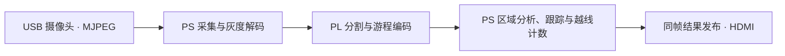

# 高速小型物料智能视觉计数系统

AT-OV9281 USB 摄像头采集输送带上的螺母、垫圈等小型物料。PYNQ-Z2 对前景进行分割、跟踪和越线计数，并通过 HDMI 显示画面和累计数量。

[作品介绍](docs/competition/OVERVIEW.md) · [系统架构](docs/competition/ARCHITECTURE.md) · [硬件实拍](docs/competition/HARDWARE.md) · [演示指南](docs/competition/DEMO.md) · [测试结果](docs/competition/RESULTS.md)


从输送带入口投料，物料经过相机视野并跨越画面内的计数线后，查看显示器右侧的累计数量。首页使用团队提供的《正面全景照片》，更多[原始实拍与接口细节](docs/competition/HARDWARE.md#实物照片)可单独查看。照片中的数字为当时的界面读数。

## 阅读入口

| 想了解什么 | 从这里开始 |
| --- | --- |
| 作品解决什么问题、有哪些技术特色 | [作品介绍](docs/competition/OVERVIEW.md) |
| FPGA 与 ARM 的职责、源码在哪里 | [架构与代码对应](docs/competition/ARCHITECTURE.md) |
| 输送机构、相机、板卡、接口及显示屏 | [硬件说明与六张原始实拍](docs/competition/HARDWARE.md) |
| 本地体验、现场演示与正式视频状态 | [演示指南](docs/competition/DEMO.md) |
| 实测条件、原始证据和待验收项目 | [结果与提交清单](docs/competition/RESULTS.md) |
| 搭建环境、运行离线样例或部署 | [开发与复现](docs/DEVELOPMENT.md) · [部署说明](docs/DEPLOYMENT.md) |

[完整文档目录](docs/README.md) · [开发者导航](PROJECT_INDEX.md) · [版本记录](CHANGELOG.md) · [贡献指南](CONTRIBUTING.md)

提交准备：[队友 V13 主线](docs/competition/V13.md) · [版本与候选绑定](docs/competition/SUBMISSION.md) · [上传文件清单](docs/competition/UPLOAD.md) · [可复用技能包](skill/README.md) · [原始协作交互](docs/competition/AI_INTERACTIONS.md) · [AMD 指南对照](docs/competition/CONTEST_REQUIREMENTS.md)。

## 当前状态

**比赛提交以队友 LJ-01 V13 为主线**，应用源码固定为 [`5438e0e1`](https://github.com/POPO-so/material-counter/tree/5438e0e1f737fc426224f285a4c8b2454d225efc)，硬件构建源码单列 `037d38d1`。完整 BIT/HWH、index 身份及历史测试见 [V13 绑定说明](docs/competition/V13.md)。默认分支 LJ-01 可以继续开发，当前分支 HEAD 不自动等于 V13 运行包。

V13 交付记录记载 67 文件完整性 PASS、50 模块逐字节对应，以及专项 71 passed、2 failed。本轮能读取固定源码，但尚未取得队友实际运行包重新核验，不把历史记录写成本轮实测。RLE 独立基线、V12 及 JPEG v8 候选继续分别保留，真实物料准确率仍需独立真值证据。

## 软硬件分工



- **PL 图像前端**对 640×400 灰度图像执行 ROI、灰度偏移、阈值分割和可选形态学处理，将每行连续前景编码成游程，随投影和帧状态回传。
- **PS 计数**校验数据包，以 8 连通规则合并游程。对疑似粘连区域局部重建掩膜并拆分，随后关联轨迹，用越线滞回和已计数状态抑制重复计数。
- **板端显示**用帧号关联画面和计数结果，由 VDMA 扫描输出。JPEG 硬解候选把解码移入 PL，并单独记录其制品及验证结果。

## 实测记录

| 配置 | 输入与范围 | 结果 | 证据 |
| --- | --- | --- | --- |
| 队友 V13 主线 | 历史交付记录，非本轮重测 | 67 文件完整性 PASS、50 模块对应；专项 71 passed、2 failed | [V13 来源、工件身份及缺口](docs/competition/V13.md) |
| 640×400 RLE 独立入口 | 相机 300 帧，关闭完整像素调试比对 | 300/300 帧，20.57 FPS，回传 4,088–4,176 B/帧，无溢出 | [原始相机记录](data/results/rle-20261028-board/camera-300-native-v2.json) |
| RLE 50 MHz 位流 | XC7Z020 布局布线 | LUT 5,809/53,200（10.92%），WNS +3.366 ns，WHS +0.036 ns | [构建及验收记录](data/results/rle-20261028-board/README.md) |
| JPEG 硬解候选 | 相机空场景 120 帧 | 120/120 帧，11.31 FPS，输出监视器逐帧核对身份 | [板测记录](data/results/jpeg-pl-board-20261102/board-run.json) |
| JPEG 硬解候选 | 五张合成 JPEG 连续输入 | 模拟目标越线后累计数从 0 变为 1 | [合成样本验证](data/results/jpeg-pl-board-20261102/README.md) |

上述测试分别绑定各自的源码与制品。真实物料准确率需结合独立人工真值，按批次核对漏计和重复计数。

## 上板运行

准备 PYNQ-Z2（XC7Z020）、AT-OV9281 USB 相机、HDMI 显示器和配套的 Linux/PYNQ 环境。

- **V13 主线演示**按 [V13 绑定说明](docs/competition/V13.md)取得队友原始交付包并核对，使用其 standalone 整合入口及匹配 BIT/HWH；不直接用当前开发 HEAD 替换包内代码。现有 [V12 部署记录](scripts/standalone/DEPLOYMENT.md)保留为历史依据。
- **JPEG 硬解候选**下载 [v8 ZIP](data/results/jpeg-pl-board-20261102/jpeg-pl-runtime-v8.zip)，按[启动命令](data/results/jpeg-pl-board-20261102/README.md#v8-默认入口运行包)核对 SHA-256、解压并运行包内入口。板端需已有匹配的原生库，或具备 `g++` 用于构建该库。
- **离线复现**在具备 NumPy、OpenCV、pytest 和 `g++` 的环境中，按 [RLE 运行说明](scripts/rle/README.md)执行离线样例和软件回归。

## 从源码构建

| 构建路径 | 源码与入口 | 产物与验证边界 |
| --- | --- | --- |
| RLE 基线 | [RTL](fpga/rtl/) · [约束](fpga/constraints/) · [Vivado 构建 Tcl](scripts/rle/build.tcl) | 脚本要求先通过 XSim 与综合后仿真门禁，按 Tcl 配置板卡仓库和辅助脚本路径。已有 [BIT/HWH 和 manifest](data/results/gray8-rle-20261028-verified-build/export/) 可用于核对。 |
| 板端 HDMI 集成 | [集成构建 Tcl](scripts/standalone/build_g2_integration.tcl) · [部署记录](scripts/standalone/DEPLOYMENT.md) | 按实际部署版本核对集成 BIT/HWH 和显示 manifest。 |
| JPEG 硬解联合设计 | [联合构建 Tcl](fpga/experimental/jpeg_integration/joint_build.tcl) · [候选构建和板测记录](data/results/jpeg-pl-board-20261102/README.md) | 冻结源码 `5438e0e1` 中的合并设计仍需重新综合、布局布线并生成配套 BIT/HWH，随后上板复验。v8 ZIP 的制品对应独立候选快照。 |

## 项目与文档结构

```text
README.md                    作品首页
CONTRIBUTING.md              公开贡献与问题反馈指南
PROJECT_INDEX.md             工程导航、阶段状态和证据入口
CHANGELOG.md                 重要版本与文档变更
docs/
  README.md                  文档总目录
  competition/               作品介绍、架构、硬件、演示、结果
  DEVELOPMENT.md             环境与离线复现
  DEPLOYMENT.md              版本选择与板端部署入口
  assets/photos/             原始实拍、来源和文件哈希
  adr/                       技术决策
  verification/              验证记录
scripts/rle/                 游程协议、原生区域分析与运行器
scripts/standalone/          板端显示、运行控制和部署
fpga/                        RTL、约束、仿真与候选联合设计
data/results/                按版本保存的构建、板测和交付证据
skill/                       团队提炼的可复用方法与校验工具
```

与 AMD 自主选题指南推荐目录的对应关系如下。当前沿用已有工程目录，不因文档整理移动已绑定的源码或构建证据。

| 指南目录 | 本仓库对应入口 |
| --- | --- |
| `src/` | [fpga](fpga/) · [scripts/rle](scripts/rle/) · [scripts/standalone](scripts/standalone/) |
| `sim/` | [FPGA 仿真](fpga/sim/)及对应脚本目录的测试、仿真入口 |
| `build/` | [RLE 构建](scripts/rle/build.tcl) · [HDMI 集成构建](scripts/standalone/build_g2_integration.tcl) · [构建记录](data/results/) |
| `board/` | [板端运行与部署](docs/DEPLOYMENT.md) · [原始输出](data/results/) |
| `data/` | [data](data/) |
| `skill/` | [skill](skill/README.md) |
| `report/` | [作品文档](docs/README.md) · [协作记录](docs/competition/AI_COLLABORATION.md) · [历史验证](docs/verification/) |

技能包、目录英文命名和协作记录的具体要求见[指南对照](docs/competition/CONTEST_REQUIREMENTS.md)。现存中文历史路径仍需按依赖迁移，尚未据此认定目录命名要求已全部满足。

正式演示视频、器件接线清单、最终提交工件绑定和完整真值验收仍待补齐，见[提交前待补资料](docs/competition/RESULTS.md#提交前待补资料)。
