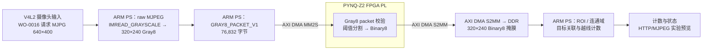
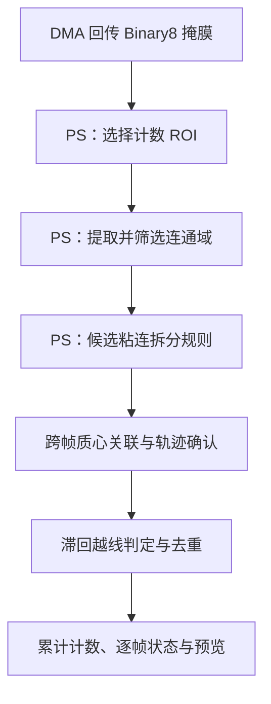

# 高速小型物料智能视觉计数系统

面向螺母、垫圈等小型物料连续输送场景的 PYNQ-Z2 视觉计数原型，探索由 FPGA PL 承担流式像素变换、ARM PS 承担区域分析与跨帧计数的实现路径。

> **当前状态：工程原型，尚未完成工业工况验收。** 历史 M6 螺母板测为 4/5（80%），计数准确率验收未通过；该数据绑定旧 RGB 实现。Gray8 合成和真实相机 DMA 输入均已通过全像素验证，并完成 900 帧持续运行测量；本次相机二值掩膜全黑、未检出前景，因此物料识别准确率及有目标时吞吐仍未验证。本文按代码和可追溯报告区分实现、离线验证、仿真与板端结果。

> **2026-10-30 独立显示进度：** G1 与 G1.5 已通过各自独立显示门禁。G1.5 验证了三槽普通 RAM 共享帧 IPC 和绘图子进程，平均有效显示 13.5807 FPS；不含 RLE 计数接入。G2 具备启动条件但尚未开始，剩余整机门禁均未通过，不能据此称整机通过。详见 [G1.5 板端证据](data/results/standalone-20261030-g15/README.md)。

> **2026-10-29 桌面入口更新：** `Python脚本/启动GUI.pyw` 默认使用 `RLE桌面部署.json`，接入 640×400 原分辨率 PL 游程链。PL 执行 ROI、强度偏移、阈值和可选形态学、游程与投影；PS 执行原生游程区域分析、跟踪和越线。GUI 显示 `pl_rle` 及该位流对应的 LUT 10.92% 静态报告。下方 2026-10-27 的 320×240 整帧 Binary8 通路保留为历史实验说明，不能代表新桌面会话。新入口仍为候选链，性能与准确率限制见 [桌面 RLE 验证记录](data/results/rle-desktop-20261029/README.md)。

> **2026-10-27 Gray8 改造与实测：** 用户已授权 Gray8 作为当前唯一运行协议。旧 RGB 编码、RTL、构建和回放代码已删除，不保留 RGB 运行回退；历史 `data/results/` 原样保留。三项 XSim、Vivado BIT/HWH 构建及离线 delivery verify 已通过。板端完成 3 帧合成自检、30 帧相机短测、30 帧预热和 300×3 帧持续测试，963 帧全部通过 Binary8 全像素比对且 DMA 无故障。三轮测得 19.106、19.368、20.192 FPS，900 帧加权 19.545 FPS，包含启动/预热、像素验证和 PS 计数；本次相机二值掩膜全黑、未检出前景，不能据此证明物料准确率或有目标时的吞吐。详见 [相机板测记录](data/results/gray8-camera-20261027-122633/README.md)、[清理与板测记录](data/results/gray8-cleanup-20261027/README.md)、[构建时序/资源记录](data/results/gray8-dma-20261027/README.md) 和 [PLAN.md](PLAN.md)。

## 项目概述

脱机灰度 HDMI 分屏已按 [计划.md](计划.md) 开始实施，G0 环境与依赖证据见 [记录](data/results/standalone-20261029-g0/README.md)。G1 已通过独立显示门禁；G1.5 也已通过独立 HDMI 显示、三槽普通 RAM 共享帧 IPC 与绘图子进程门禁，结果见 [G1.5 板端证据](data/results/standalone-20261030-g15/README.md)。G2 具备启动条件但尚未开始；RLE 集成及剩余整机门禁尚未通过，因此整机未通过验收。

生产线上螺母、垫圈等小零件连续移动时，目标可能相互接近、短时粘连或漏检。项目以 PYNQ-Z2（Zynq-7000 / XC7Z020）为平台，研究怎样把像素级、规则明确的处理放到 PL 数据流中，再由 PS 完成较灵活的区域提取、目标关联和越线计数。

目标应用基线是供料器、单条可调速输送带、摄像头、照明和 PYNQ-Z2。机械与相机的最终集成路线仍在验证；编码器测速目前属于计划功能。现阶段的板测是有限帧数的工程实验，不代表持续生产运行或通用物料准确率。

## 核心技术特色

- **PL 流式图像前端：** 当前 Gray8 RTL 接收 32-bit AXI-Stream Gray8 packet，直接阈值化为 Binary8，处理 packet 验证、反压和帧结束；活动流水线不再包含 RGB-to-gray。
- **DMA 图像往返：** 当前实现由 MM2S 发送 76,832 字节 Gray8 packet，PL 输出 76,800 字节 Binary8 掩膜，经 S2MM 写回 PS 可访问的 DDR。合成和真实相机共 963 帧 DMA 与 Binary8 全像素比对通过；当前相机样本的前景像素为零，不能代表有物料时的识别效果。
- **PS 端目标计数：** Python、NumPy 和 OpenCV 处理回传掩膜，执行 ROI 区域分析、连通域筛选、候选粘连拆分、跨帧质心关联、轨迹确认和越线计数。
- **模块级探索与验证：** ROI 裁剪、3×3 形态学等 RTL 模块有独立仿真或综合证据；它们尚未全部集成到本次板测数据通路。
- **计数与预览解耦：** WO-0016 提供 HTTP/MJPEG 预览实现；计数处理和 JPEG 编码分开调度。浏览器实际显示帧率尚未测定。

PL 流水线的工程价值在于可按像素顺序进行确定性处理，并有机会减少 PS 对每个像素执行重复运算的负担。当前没有同输入、同精度条件下的 CPU/PL 对比基准，因此不宣称已测得加速比或端到端性能优势。

## 系统架构：2026-10-27 Gray8 历史验证通路

下图描述当前已授权的 Gray8 实现路径，不代表视频源、机械路线、算法 Route 或正式接口已经冻结。相机 MJPEG 在 PS 直接解码为 Gray8；PS 发送 Gray8 packet，PL threshold 输出 Binary8。合成帧和真实相机数据均已在板端完成 DMA 与逐像素验证；本次相机二值掩膜全黑、未检出前景。



ROI 裁剪和 3×3 形态学仍是独立模块，不在当前 Gray8 板端验证路径内。计数路径中的 ROI、连通域及跟踪由 PS 执行。旧 RGB→Gray XSim/板测记录只证明各自历史配置，不能作为 Gray8 DMA 板测证据。

### PS 端计数流程



当前粘连拆分规则是持续优化中的 PS 候选算法。最近的螺母录像分析使用相机 Gray8 在 PS 离线阈值化回放，不能等同于 PL Binary8 或已部署板端算法验收。

## PL 与 PS 的职责

| 层级 | 当前实现 | 边界 |
|---|---|---|
| **FPGA PL** | 当前唯一链路为 [Gray8 AXI-Stream adapter/pipeline](fpga/experimental/gray8/axis_dma_gray_image_pipeline.v) 和 S2MM wrapper；[ROI 裁剪](fpga/rtl/axis_roi_crop.v)、[3×3 形态学](fpga/rtl/axis_morphology3x3.v)仍为独立模块。 | Adapter、320×240 wrapper、S2MM guards 的 XSim 已通过；963 帧合成/相机数据已完成 DMA 和全像素板端验证。本次相机二值掩膜全黑、未检出前景。旧 RGB 实验结果是历史证据。 |
| **ARM PS** | [Gray8 运行入口](scripts/gray8/run_gray8_counter.py)与 [WO-0016 计数/流处理](scripts/wo0016/stream_counter.py)提供 raw MJPEG 灰度解码、Gray8 编码、DMA 控制及回传 Binary8 的 ROI、连通域、跟踪、越线计数和预览。 | 图像采集、计数算法及显示处理由 PS 执行；不能称为 PL 硬件模块。 |
| **PS/PL 交互** | 当前协议为 `GRAY8_PACKET_V1`：MM2S TX 76,832 字节，S2MM RX 76,800 字节 Binary8；复用 MaskCounter。 | 3 帧合成及 960 帧相机输入全像素通过。三个 300 帧相机轮次加权为 19.545 FPS，含启动/预热、逐像素验证和 PS 计数；本次二值掩膜全黑、CCL 未运行。无物料准确率或 YOLO 收益结论。 |

## 硬件组成与连接

**当前板端路径：** PYNQ-Z2（XC7Z020）上由 PS 读取 raw MJPEG 并解码成 Gray8，发送 `GRAY8_PACKET_V1`；PL threshold 后由 S2MM 返回 Binary8，PS 再运行 MaskCounter 并提供实验预览。3 帧合成及 960 帧相机 DMA 与像素比对均已通过；本次相机二值掩膜全黑、未检出前景，物料计数准确率仍待有真值的实物测试。

**目标应用设备：** 供料器、单条可调速输送带、摄像头、固定照明和 PYNQ-Z2。输送机构的生产工况、最终摄像头接入方案和照明标定尚未完成验收。编码器采集及带速参与计数目前未实现，不能将目标硬件清单视为已连接或已验证系统。

## 软件、固件与开发环境

| 项目 | 当前仓库内容 |
|---|---|
| PL RTL | Verilog AXI4-Stream 模块、实验链路及仿真测试台，主要位于 fpga/rtl/、fpga/experimental/、fpga/sim/。 |
| PS 软件 | Python/PYNQ 运行脚本、计数器和参考模型，主要位于 scripts/wo0015/、scripts/wo0016/、python/refmodel/。 |
| 离线依赖 | scripts/delivery/requirements.txt；生成数据与基础回归依赖见 python/synth/requirements.txt。 |
| FPGA 工具 | Gray8 唯一构建流程位于 scripts/gray8/；XSim 三项和 Vivado BIT/HWH 构建已通过，离线 delivery verify 已通过。 |
| 板端环境 | PYNQ-Z2 Linux、Gray8 BIT/HWH、V4L2 摄像头及足够的 CMA 内存；合成和相机 DMA/像素验证已通过。重启或换包后仍须按当前 boot ID、manifest 与软件哈希重新执行门控。 |

## 部署、运行与复现

### 离线软件检查

从仓库根目录创建 Python 环境并安装脚本依赖：

```powershell
python -m venv .venv
.\.venv\Scripts\Activate.ps1
python -m pip install -r scripts/delivery/requirements.txt
```

运行 WO-0016 软件回归和纯模拟入口：

```powershell
python -m pytest -q scripts/wo0016
python scripts/wo0016/run_stream_counter.py --mode mock --mock-frames 8
```

Mock 模式使用合成目标，不连接 PYNQ、DMA 或摄像头，结果不能作为硬件性能或计数准确率证据。

### RTL 离线回放

按照 [scripts/delivery/REPLAY.md](scripts/delivery/REPLAY.md) 在新的空输出目录打包自检 testbench 输入，再使用本机 Vivado/XSim 执行回放及独立黄金比对。该入口不要求准备 H3 输入、不访问开发板，也不会生成板端验收结论。

### 板端实验

Gray8 板端模式是有限帧、单次授权的实验入口，需要先完成同一开机周期的 Overlay 准备、manifest 哈希核验、一次性许可和证据路径检查。按 [Gray8 运行说明](scripts/gray8/README.md) 操作。WO-0015/0016 的旧 RGB 参数和命令段是历史基线，不可用于当前 Gray8 运行；不要把 Mock 命令改成板端命令后直接运行。

## 性能与验证状态

状态标签表示证据类型；“板端链路完成”不代表物料计数准确率验收通过。

| 状态 | 项目与结果 | 测量口径及限制 |
|---|---|---|
| **历史板测（旧 RGB 实现）** | WO-0016 Stage A Attempt 8：30/30 帧完成；当时端到端吞吐 15.157 FPS（65.975 ms/帧）。 | 结果绑定当时的旧 RGB overlay 与软件，不代表当前 Gray8 链路性能。空载 0/0 目标不能证明准确率；ROI 均值 17.657 ms，CCL 在 30/30 帧运行。 |
| **历史板测（旧 RGB 实现）** | WO-0016 Stage B-2 Attempt-5 Recovery-2：165/165 帧完成；5 颗 M6 螺母计数为 4（80%）；当时端到端吞吐 22.132 FPS。 | 只代表旧 overlay/软件配置；物料准确率验收失败，不能作为 Gray8 或 YOLO 性能证据。 |
| **SIMULATION_ONLY** | Gray8 adapter、320×240 wrapper、S2MM guards 三项 XSim 通过；50 MHz BIT/HWH 构建完成。 | 仿真本身不代表物料识别或准确率已验收。 |
| **板端协议与相机验证** | 同一启动周期完成 3 帧合成、30 帧相机短测、30 帧预热和三轮 300 帧相机流；963 帧全部全像素验证通过，DMA idle、fault=0、buffers释放。 | 三个性能轮次为 19.1063、19.3684、20.1920 FPS；900帧加权19.5448 FPS。本次相机二值掩膜全黑、未检出前景，CCL执行0帧；该结果不能验证检测准确率或有目标时吞吐。详见[相机板测记录](data/results/gray8-camera-20261027-122633/README.md)。 |
| **VERIFIED_OFFLINE** | `scripts/delivery/verify_delivery.py` 离线验证通过；当前相关软件验证 108 passed（sandbox 外运行，4.14 s）。 | 旧的较宽全套运行记录为706 passed、8 skipped、2 known failures（ablation 临时路径和预览抗锯齿像素断言）；不得将其表述为当前全套全绿。 |
| **VERIFIED_OFFLINE** | 2026-10-24 粘连候选诊断记录 pytest scripts/wo0016 为 288 passed、3 skipped。 | 这是报告中的离线测试记录，不是本次 README 修改后重跑的结果；见[诊断报告](data/results/wo0017-touching-diagnosis-20261024/README.md)。 |
| **历史仿真/综合（旧 RGB 实验）** | WO-0014 RGB→Gray→Binary8：旧链路的 XSim 与 OOC 综合证据。 | 旧 RTL/回放已从活动实现移除；历史记录保留，不代表当前 Gray8 协议。 |
| **SIMULATION_ONLY** | ROI 裁剪与 3×3 形态学 RTL 各有独立测试和综合记录。 | 模块证据不表示已接入或通过整机板测；具体用例见[ROI 验证](docs/verification/wo-0008-handoff.md)和[形态学验证](docs/morphology-verification-20261013.md)。 |
| **NOT_VERIFIED** | 有目标物料下的计数准确率和吞吐、YOLO收益、最终视频/机械 Route、编码器带速、PL ROI/形态学整合、连续生产工况及浏览器显示帧率。 | 当前约19.545 FPS来自二值掩膜全黑、未检出前景的相机样本，且含校验/PS计数；旧 RGB 历史FPS不作新旧收益比较，包长减少也不等于FPS或YOLO收益。 |

## 已知限制与后续优化

- **计数准确率仍需解决。** 板测样本为 4/5；目标间接近、粘连或分割变化可能导致少计，现有单轮证据不能建立通用准确率。
- **近期算法改进仍属候选。** 2026-10-24 的两颗/三颗螺母录像用 Gray8 离线阈值回放比较拆分规则；部分样本从旧规则的 1 次事件变为 2 或 3 次。录像没有 PL Binary8，不能作为部署后结果。
- **ROI 热路径需优化。** Stage A 的计数 ROI 平均耗时 17.657 ms，超过 2.5 ms 目标。
- **模块尚未整合。** PL ROI 和形态学逻辑有独立实现，但未串入当前 Gray8 阈值链路；视频源最终 Route 和正式接口仍未冻结。
- **系统级指标未齐。** 尚无已验收的输送带速度、生产照明、完整物料矩阵、持续运行可靠性或端到端 CPU/PL 对比数据；编码器测速也未实现。
- **许可证未声明。** 仓库根目录当前没有 LICENSE 文件。若希望社区明确复用权限，需要维护者补充许可证。

下一步建议围绕同步 Gray8/PL Binary8 采集和逐颗人工标注复现粘连问题，优化 PS ROI 计数耗时，再评估是否把 ROI/形态学接入 PL 链路，并以新一轮可追溯板测验证最终摄像头、DMA 和计数闭环。

## 项目目录

```text
fpga/rtl/                 可复用 AXI4-Stream RTL 模块
fpga/experimental/        Work Order 隔离的 PL 实验链路
fpga/sim/                 仿真测试台与用例
fpga/experimental/gray8/  当前 Gray8 AXI-Stream adapter/pipeline/wrapper
fpga/sim/gray8/           当前 Gray8 adapter、wrapper 与 S2MM guards 测试台
scripts/wo0015/           Overlay、DMA、相机适配与板端门禁
scripts/wo0016/           双缓冲流计数、PS 算法与预览
scripts/gray8/             当前唯一协议、构建、manifest 与板端运行入口
scripts/delivery/         离线回放、依赖和交付检查
python/refmodel/          PS 参考模型、实验及离线测试
docs/                     需求范围、接口、路线和验证报告
data/results/             追溯性测试与验收证据
```

## 文档索引

- [项目导航](PROJECT_INDEX.md)
- [系统范围与目标](docs/00_scope.md) · [接口定义](docs/02_interfaces.md) · [路线状态](docs/07_routes.md)
- [视频源路线 ADR](docs/adr/adr-0001-video-source.md)
- [WO-0016 板端验收](docs/verification/wo-0016-board-acceptance.md)
- [WO-0014 离线图像链路](docs/verification/wo-0014-offline-integration-20261014.md) · [OOC 时序优化](docs/verification/wo-0014-timing-acceptance-20261014.md)
- [WO-0017 紧邻螺母离线诊断](data/results/wo0017-touching-diagnosis-20261024/README.md)
- [WO-0016 运行说明](scripts/wo0016/README.md) · [离线 RTL 回放说明](scripts/delivery/REPLAY.md)

---

本 README 面向竞赛评审、FPGA/SoC 开发者及复现人员；具体能力和限制以链接的源代码、工作包与验证报告为准。
