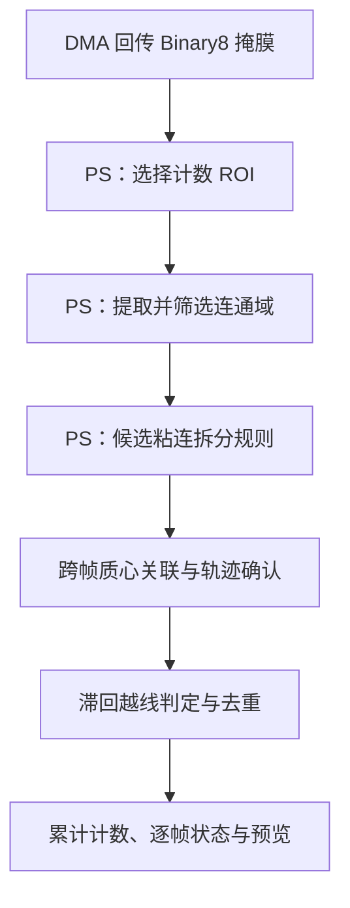

# 高速小型物料智能视觉计数系统

面向螺母、垫圈等小型物料连续输送场景的 PYNQ-Z2 视觉计数原型，探索由 FPGA PL 承担流式像素变换、ARM PS 承担区域分析与跨帧计数的实现路径。

> **当前状态：工程原型，尚未完成工业工况验收。** 已有板端图像流与 DMA 处理记录；最新 M6 螺母实测为 4/5（80%），计数准确率验收未通过。本文按代码和可追溯报告区分实现、离线验证、仿真与板端结果。

## 项目概述

生产线上螺母、垫圈等小零件连续移动时，目标可能相互接近、短时粘连或漏检。项目以 PYNQ-Z2（Zynq-7000 / XC7Z020）为平台，研究怎样把像素级、规则明确的处理放到 PL 数据流中，再由 PS 完成较灵活的区域提取、目标关联和越线计数。

目标应用基线是供料器、单条可调速输送带、摄像头、照明和 PYNQ-Z2。机械与相机的最终集成路线仍在验证；编码器测速目前属于计划功能。现阶段的板测是有限帧数的工程实验，不代表持续生产运行或通用物料准确率。

## 核心技术特色

- **PL 流式图像前端：** AXI4-Stream RTL 实现 RGB888 灰度化和 Gray8 阈值二值化，处理有效像素及视频行/帧标记，并遵守下游反压。
- **DMA 图像往返：** WO-0016 实验链路将 PS 准备的图像包经 MM2S 送入 PL，再通过 S2MM 把 Binary8 掩膜写回 PS 可访问的 DDR。
- **PS 端目标计数：** Python、NumPy 和 OpenCV 处理回传掩膜，执行 ROI 区域分析、连通域筛选、候选粘连拆分、跨帧质心关联、轨迹确认和越线计数。
- **模块级探索与验证：** ROI 裁剪、3×3 形态学等 RTL 模块有独立仿真或综合证据；它们尚未全部集成到本次板测数据通路。
- **计数与预览解耦：** WO-0016 提供 HTTP/MJPEG 预览实现；计数处理和 JPEG 编码分开调度。浏览器实际显示帧率尚未测定。

PL 流水线的工程价值在于可按像素顺序进行确定性处理，并有机会减少 PS 对每个像素执行重复运算的负担。当前没有同输入、同精度条件下的 CPU/PL 对比基准，因此不宣称已测得加速比或端到端性能优势。

## 系统架构：当前实验数据通路

下图描述 WO-0016 板测所用的实验路径，不代表摄像头路线或整机方案已经冻结。摄像头输入、解码、缩放和 RGB 封包都在 PS；PL 收到的是 PS 将 Gray8 强度复制到 R/G/B 三通道后形成的 RGB888 数据。

```mermaid
flowchart LR
    CAM["V4L2 摄像头输入<br/>WO-0016 请求 MJPG 640×400"]
    PSIN["ARM PS：读取解码帧<br/>取首通道并缩放为 320×240 Gray8"]
    PACK["ARM PS：Y 复制到 R/G/B<br/>封装 RGB888 AXI-Stream 包"]
    subgraph PL["PYNQ-Z2 FPGA PL"]
        GRAY["RGB888 → Gray8"]
        THRESH["阈值分割 → Binary8"]
        GRAY --> THRESH
    end
    DDR["AXI DMA S2MM → DDR<br/>320×240 Binary8 掩膜"]
    COUNT["ARM PS：ROI / 连通域<br/>目标关联与越线计数"]
    VIEW["计数与状态<br/>HTTP/MJPEG 实验预览"]

    CAM --> PSIN --> PACK
    PACK -->|"AXI DMA MM2S"| GRAY
    THRESH -->|"AXI DMA S2MM"| DDR
    DDR --> COUNT --> VIEW
```



axis_roi_crop 与 axis_morphology3x3 是独立 RTL 模块，不在上图的已验证 RGB→Gray→Binary8 板测流水线内。WO-0016 计数路径中的 ROI/连通域处理由 PS 执行。

### PS 端计数流程



当前粘连拆分规则是持续优化中的 PS 候选算法。最近的螺母录像分析使用相机 Gray8 在 PS 离线阈值化回放，不能等同于 PL Binary8 或已部署板端算法验收。

## PL 与 PS 的职责

| 层级 | 当前实现 | 边界 |
|---|---|---|
| **FPGA PL** | [axis_rgb2gray.v](fpga/rtl/axis_rgb2gray.v)、[axis_gray2binary.v](fpga/rtl/axis_gray2binary.v) 提供流式像素变换；[WO-0014 实验流水线](fpga/experimental/wo0014/axis_dma_image_pipeline.v) 串接 RGB 包适配、灰度、阈值和输出校验。另有 [ROI 裁剪](fpga/rtl/axis_roi_crop.v) 及 [3×3 形态学](fpga/rtl/axis_morphology3x3.v) RTL。 | RGB→Gray→Binary8 有 XSim 与独立黄金比对；ROI 和形态学有各自的模块级验证。后两者未接入 WO-0016 板测流水线，不能描述成整机已具备的 PL 功能。 |
| **ARM PS** | [WO-0016 运行入口](scripts/wo0016/run_stream_counter.py)、[计数与 DMA 流处理](scripts/wo0016/stream_counter.py) 实现 V4L2 帧读取、缩放、Gray8→RGB888 封包、DMA 控制与同步，以及回传掩膜的 ROI、连通域、粘连候选拆分、跨帧跟踪、越线计数及预览。 | 图像采集和缩放、计数算法及显示处理不是 FPGA RTL；不能把 OpenCV、NumPy 或 Python 算法称为 PL 硬件模块。 |
| **PS/PL 交互** | PS 通过 AXI DMA MM2S 发送图像包，PL 处理后由 S2MM 写回 Binary8 掩膜。 | 板测结果只适用于报告中绑定的 Overlay、软件和有限测试条件；不证明长期可靠性或其他位流配置。 |

## 硬件组成与连接

**板端实验路径：** PYNQ-Z2（XC7Z020）上运行 PS 端 Python/PYNQ 程序；V4L2 摄像头帧由 PS 读取和缩放；PS 经 DMA 向 PL 发送 RGB888 包；PL 输出经 S2MM 返回 DDR；PS 继续计数并提供实验预览。

**目标应用设备：** 供料器、单条可调速输送带、摄像头、固定照明和 PYNQ-Z2。输送机构的生产工况、最终摄像头接入方案和照明标定尚未完成验收。编码器采集及带速参与计数目前未实现，不能将目标硬件清单视为已连接或已验证系统。

## 软件、固件与开发环境

| 项目 | 当前仓库内容 |
|---|---|
| PL RTL | Verilog AXI4-Stream 模块、实验链路及仿真测试台，主要位于 fpga/rtl/、fpga/experimental/、fpga/sim/。 |
| PS 软件 | Python/PYNQ 运行脚本、计数器和参考模型，主要位于 scripts/wo0015/、scripts/wo0016/、python/refmodel/。 |
| 离线依赖 | scripts/delivery/requirements.txt；生成数据与基础回归依赖见 python/synth/requirements.txt。 |
| FPGA 工具 | XSim / Vivado Tcl 用于已记录的仿真和综合流程。当前工作环境未检测到 vivado 命令；运行完整 RTL 回放需配置 Vivado。 |
| 板端环境 | PYNQ-Z2 Linux、匹配的 WO-0015 Overlay、V4L2 摄像头及足够的 CMA 内存；需按工单核对 Overlay 与软件哈希。 |

## 部署、运行与复现

### 离线软件检查

从仓库根目录创建 Python 环境并安装脚本依赖：

```powershell
python -m venv .venv
.\.venv\Scripts\Activate.ps1
python -m pip install -r scripts/delivery/requirements.txt
```

运行 WO-0016 软件回归和纯模拟入口：

```powershell
python -m pytest -q scripts/wo0016
python scripts/wo0016/run_stream_counter.py --mode mock --mock-frames 8
```

Mock 模式使用合成目标，不连接 PYNQ、DMA 或摄像头，结果不能作为硬件性能或计数准确率证据。

### RTL 离线回放

按照 [scripts/delivery/REPLAY.md](scripts/delivery/REPLAY.md) 在新的空输出目录准备 H3 输入，再使用本机 Vivado/XSim 执行回放及独立黄金比对。该入口不访问开发板，也不会生成板端验收结论。

### 板端实验

WO-0016 板端模式是有限帧、单次授权的实验入口，需要先完成同一开机周期的 Overlay 准备、Manifest 哈希核验、一次性许可和证据路径检查。请按 [scripts/wo0016/README.md](scripts/wo0016/README.md) 与 [scripts/wo0015/README-board.md](scripts/wo0015/README-board.md) 的门禁流程操作；不要把 Mock 命令改成板端命令后直接运行。现有证据不是通用即插即用部署指南。

## 性能与验证状态

状态标签表示证据类型；“板端链路完成”不代表物料计数准确率验收通过。

| 状态 | 项目与结果 | 测量口径及限制 |
|---|---|---|
| **VERIFIED_ON_BOARD** | WO-0016 Stage A Attempt 8：30/30 帧完成；端到端吞吐 15.157 FPS（65.975 ms/帧）。 | 空载基线，0/0 目标不能证明物料准确率。49×320 计数带的 ROI 处理均值为 17.657 ms，高于 2.5 ms 目标；CCL 在 30/30 帧运行。 |
| **VERIFIED_ON_BOARD** | WO-0016 Stage B-2 Attempt-5 Recovery-2：165/165 帧完成；5 颗 M6 螺母计数为 4，准确率 80%；端到端吞吐 22.132 FPS。 | DMA/帧处理链路完成，但少计 1 次，物料准确率验收失败；报告未确定具体漏计原因，且本轮不重测。 |
| **VERIFIED_OFFLINE** | 2026-10-24 粘连候选诊断记录 pytest scripts/wo0016 为 288 passed、3 skipped。 | 这是报告中的离线测试记录，不是本次 README 修改后重跑的结果；见[诊断报告](data/results/wo0017-touching-diagnosis-20261024/README.md)。 |
| **SIMULATION_ONLY** | WO-0014 RGB→Gray→Binary8：15 项 XSim 场景；487 帧、37,401,600 像素，独立黄金比对 0 mismatch。 | 仅离线 RTL 仿真和输出比对，不代表板端同规模像素比对或物料计数准确率。 |
| **VERIFIED_OFFLINE** | WO-0014 实验链路 OOC 综合：668 Slice LUT、377 FF、0 BRAM、0 DSP；10 ns 寄存器间约束 WNS +2.354 ns、TNS 0。 | 仅该实验模块的综合后 OOC 结果；完整 Zynq 系统、布线后时序及板卡 100 MHz 运行未由此证明。 |
| **SIMULATION_ONLY** | ROI 裁剪与 3×3 形态学 RTL 各有独立测试和综合记录。 | 模块证据不表示已接入或通过整机板测；具体用例见[ROI 验证](docs/verification/wo-0008-handoff.md)和[形态学验证](docs/morphology-verification-20261013.md)。 |
| **NOT_VERIFIED** | 设计目标 320×240、≥30 FPS；最终摄像头路线、编码器带速、PL ROI/形态学整合、连续生产工况及浏览器显示帧率。 | 已记录的板端端到端吞吐为 15.157 FPS 和 22.132 FPS，均未达到 30 FPS 目标；目标清单不代表已实现或验收。 |

## 已知限制与后续优化

- **计数准确率仍需解决。** 板测样本为 4/5；目标间接近、粘连或分割变化可能导致少计，现有单轮证据不能建立通用准确率。
- **近期算法改进仍属候选。** 2026-10-24 的两颗/三颗螺母录像用 Gray8 离线阈值回放比较拆分规则；部分样本从旧规则的 1 次事件变为 2 或 3 次。录像没有 PL Binary8，不能作为部署后结果。
- **ROI 热路径需优化。** Stage A 的计数 ROI 平均耗时 17.657 ms，超过 2.5 ms 目标。
- **模块尚未整合。** PL ROI 和形态学逻辑有独立实现，但未串入当前板测图像链路；视频源最终路线仍未冻结。
- **系统级指标未齐。** 尚无已验收的输送带速度、生产照明、完整物料矩阵、持续运行可靠性或端到端 CPU/PL 对比数据；编码器测速也未实现。
- **许可证未声明。** 仓库根目录当前没有 LICENSE 文件。若希望社区明确复用权限，需要维护者补充许可证。

下一步建议围绕同步 Gray8/PL Binary8 采集和逐颗人工标注复现粘连问题，优化 PS ROI 计数耗时，再评估是否把 ROI/形态学接入 PL 链路，并以新一轮可追溯板测验证最终摄像头、DMA 和计数闭环。

## 项目目录

```text
fpga/rtl/                 可复用 AXI4-Stream RTL 模块
fpga/experimental/        Work Order 隔离的 PL 实验链路
fpga/sim/                 仿真测试台与用例
scripts/wo0015/           Overlay、DMA、相机适配与板端门禁
scripts/wo0016/           双缓冲流计数、PS 算法与预览
scripts/delivery/         离线回放、依赖和交付检查
python/refmodel/          PS 参考模型、实验及离线测试
docs/                     需求范围、接口、路线和验证报告
data/results/             追溯性测试与验收证据
```

## 文档索引

- [项目导航](PROJECT_INDEX.md)
- [系统范围与目标](docs/00_scope.md) · [接口定义](docs/02_interfaces.md) · [路线状态](docs/07_routes.md)
- [视频源路线 ADR](docs/adr/adr-0001-video-source.md)
- [WO-0016 板端验收](docs/verification/wo-0016-board-acceptance.md)
- [WO-0014 离线图像链路](docs/verification/wo-0014-offline-integration-20261014.md) · [OOC 时序优化](docs/verification/wo-0014-timing-acceptance-20261014.md)
- [WO-0017 紧邻螺母离线诊断](data/results/wo0017-touching-diagnosis-20261024/README.md)
- [WO-0016 运行说明](scripts/wo0016/README.md) · [离线 RTL 回放说明](scripts/delivery/REPLAY.md)

---

本 README 面向竞赛评审、FPGA/SoC 开发者及复现人员；具体能力和限制以链接的源代码、工作包与验证报告为准。
