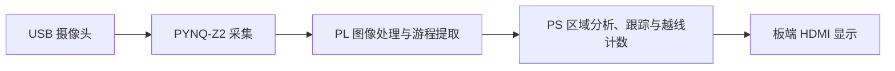

# 高速小型物料智能视觉计数系统

面向螺母、垫圈等连续输送场景，使用 AT-OV9281 USB 摄像头采集图像，在 PYNQ-Z2 上完成图像处理、粘连候选拆分、目标跟踪和越线计数，并通过 HDMI 输出现场画面。

[冻结源码 5438e0e1](https://github.com/POPO-so/material-counter/tree/5438e0e1f737fc426224f285a4c8b2454d225efc)

## 板端演示

| 入口 | 内容 |
| --- | --- |
| [独立运行与部署记录](scripts/standalone/DEPLOYMENT.md) | PYNQ 环境、配套 BIT/HWH、板端服务、部署检查和回退记录 |
| [RLE 运行及离线验证](scripts/rle/README.md) | 协议、运行入口、依赖和离线回归命令 |
| [JPEG 硬解候选包](data/results/jpeg-pl-board-20261102/README.md#v8-默认入口运行包) | 独立 v8 ZIP、SHA-256 和板端运行命令 |
| [RTL](fpga/rtl/) · [约束](fpga/constraints/) · [构建脚本](fpga/scripts/) | FPGA 源码及构建入口 |

## 验证范围

- 板端 V12 部署记录绑定较早的 LJ-01 源码和配套制品，记录了包完整性、运行环境和板端启动检查。
- JPEG 硬解候选制品完成 120/120 帧空场景处理，记录速率为 11.31 FPS。五帧合成序列另行验证了一次越线计数。外接显示器目视效果和真实物料准确率仍待验收。
- 冻结提交已合入软件粘连漏计修复。合并后的 JPEG 联合硬件设计仍需重新综合、布局布线并生成配套 BIT/HWH，再完成板端复验。复跑 v8 时使用候选包自带的源码与制品。
