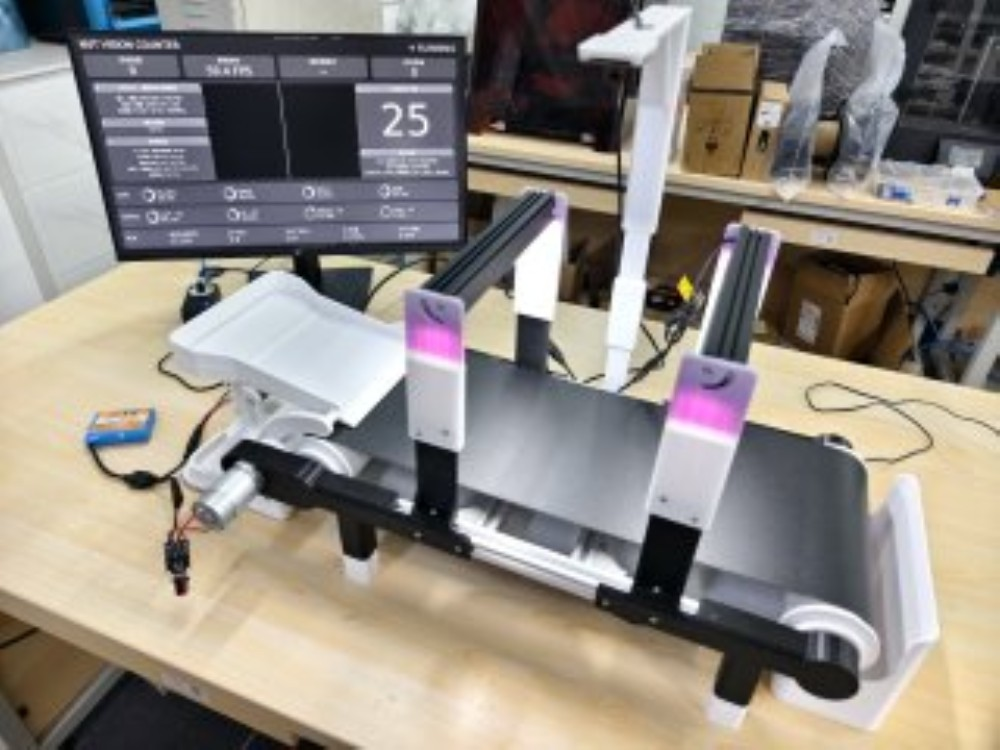
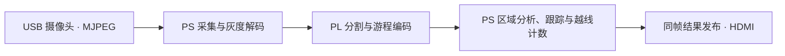

# 高速小型物料智能视觉计数系统

AT-OV9281 USB 摄像头采集输送带上的螺母、垫圈等小型物料。PYNQ-Z2 对前景进行分割、跟踪和越线计数，并通过 HDMI 显示画面和累计数量。

[冻结源码 5438e0e1](https://github.com/POPO-so/material-counter/tree/5438e0e1f737fc426224f285a4c8b2454d225efc) · [板端部署](scripts/standalone/DEPLOYMENT.md) · [JPEG v8 候选包](data/results/jpeg-pl-board-20261102/jpeg-pl-runtime-v8.zip)

从输送带入口投料，物料经过相机视野并跨越画面内的计数线后，查看显示器右侧的累计数量。照片中的数字为当时的界面读数。

## 软硬件分工

- **PL 图像前端**对 640×400 灰度图像执行 ROI、灰度偏移、阈值分割和可选形态学处理，将每行连续前景编码成游程，随投影和帧状态回传。
- **PS 计数**校验数据包，以 8 连通规则合并游程。对疑似粘连区域局部重建掩膜并拆分，随后关联轨迹，用越线滞回和已计数状态抑制重复计数。
- **板端显示**用帧号关联画面和计数结果，由 VDMA 扫描输出。JPEG 硬解候选把解码移入 PL，并单独记录其制品及验证结果。

## 实测记录

| 配置 | 输入与范围 | 结果 | 证据 |
| --- | --- | --- | --- |
| 640×400 RLE 独立入口 | 相机 300 帧，关闭完整像素调试比对 | 300/300 帧，20.57 FPS，回传 4,088–4,176 B/帧，无溢出 | [原始相机记录](data/results/rle-20261028-board/camera-300-native-v2.json) |
| RLE 50 MHz 位流 | XC7Z020 布局布线 | LUT 5,809/53,200（10.92%），WNS +3.366 ns，WHS +0.036 ns | [构建及验收记录](data/results/rle-20261028-board/README.md) |
| JPEG 硬解候选 | 相机空场景 120 帧 | 120/120 帧，11.31 FPS，输出监视器逐帧核对身份 | [板测记录](data/results/jpeg-pl-board-20261102/board-run.json) |
| JPEG 硬解候选 | 五张合成 JPEG 连续输入 | 模拟目标越线后累计数从 0 变为 1 | [合成样本验证](data/results/jpeg-pl-board-20261102/README.md) |

上述测试分别绑定各自的源码与制品。真实物料准确率需结合独立人工真值，按批次核对漏计和重复计数。

## 上板运行

准备 PYNQ-Z2（XC7Z020）、AT-OV9281 USB 相机、HDMI 显示器和配套的 Linux/PYNQ 环境。

- **板端独立演示**按[部署记录](scripts/standalone/DEPLOYMENT.md)选择已有的部署版本，核对其 BIT/HWH、配置与运行环境，使用该版本记录的板端入口。V12 记录对应较早的 LJ-01 源码和配套制品。
- **JPEG 硬解候选**下载 [v8 ZIP](data/results/jpeg-pl-board-20261102/jpeg-pl-runtime-v8.zip)，按[启动命令](data/results/jpeg-pl-board-20261102/README.md#v8-默认入口运行包)核对 SHA-256、解压并运行包内入口。板端需已有匹配的原生库，或具备 `g++` 用于构建该库。
- **离线复现**在具备 NumPy、OpenCV、pytest 和 `g++` 的环境中，按 [RLE 运行说明](scripts/rle/README.md)执行离线样例和软件回归。

## 从源码构建

| 构建路径 | 源码与入口 | 产物与验证边界 |
| --- | --- | --- |
| RLE 基线 | [RTL](fpga/rtl/) · [约束](fpga/constraints/) · [Vivado 构建 Tcl](scripts/rle/build.tcl) | 脚本要求先通过 XSim 与综合后仿真门禁，按 Tcl 配置板卡仓库和辅助脚本路径。已有 [BIT/HWH 和 manifest](data/results/gray8-rle-20261028-verified-build/export/) 可用于核对。 |
| 板端 HDMI 集成 | [集成构建 Tcl](scripts/standalone/build_g2_integration.tcl) · [部署记录](scripts/standalone/DEPLOYMENT.md) | 按实际部署版本核对集成 BIT/HWH 和显示 manifest。 |
| JPEG 硬解联合设计 | [联合构建 Tcl](fpga/experimental/jpeg_integration/joint_build.tcl) · [候选构建和板测记录](data/results/jpeg-pl-board-20261102/README.md) | 冻结源码 `5438e0e1` 中的合并设计仍需重新综合、布局布线并生成配套 BIT/HWH，随后上板复验。v8 ZIP 的制品对应独立候选快照。 |
