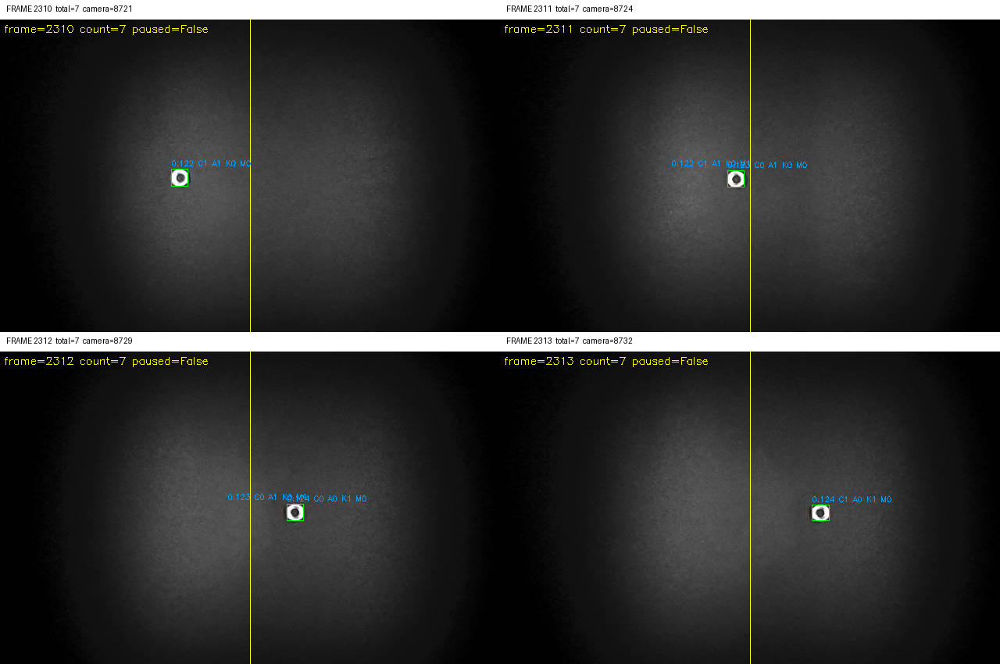
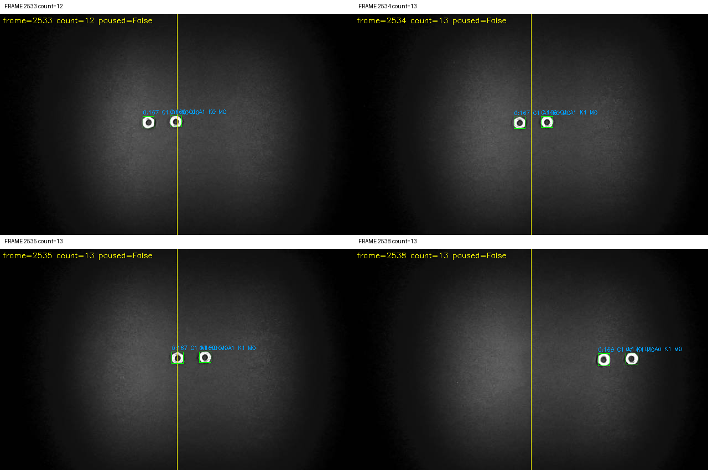
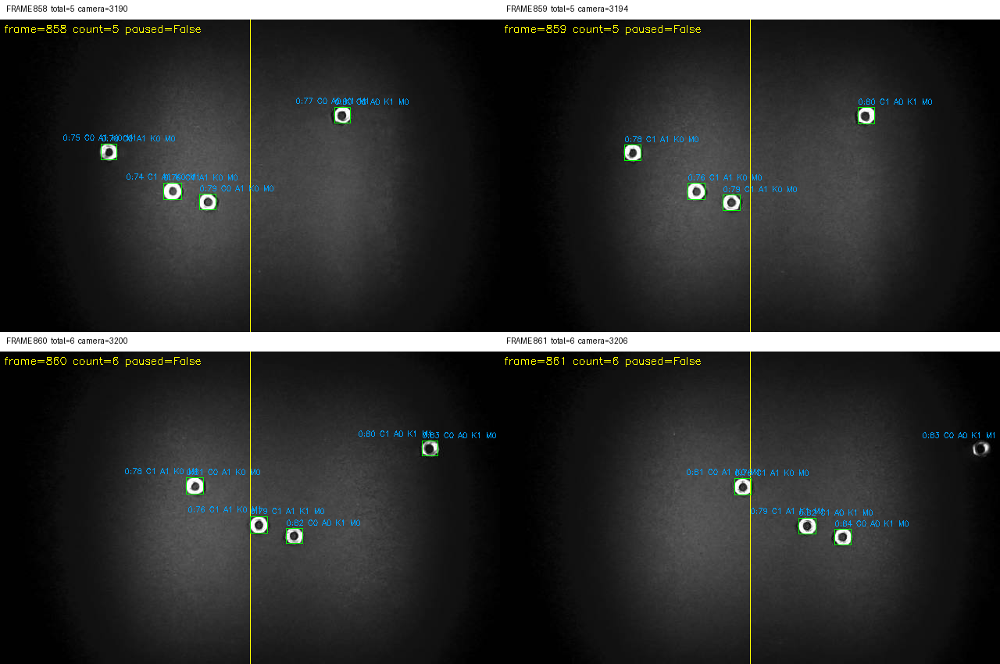
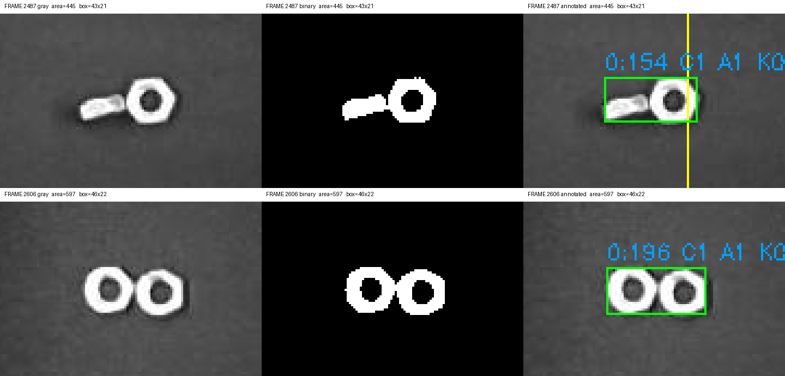

# 现场快照分析：有框漏计、同排漏计和双螺母合框

分析对象为 2026-10-31 用户分批过料后，从 v6 会话下载的 **59 组完整快照、164 个不同处理帧**。用户无法确认每批投入数，因此本报告只验证具体可见案例，不给整轮准确率。原始数据保存在本机 `data/recorded/crossing-20261031-v6/`；两次归档分别为 41,246,720 和 16,158,720 字节，下载后均通过归档 SHA-256 核对，板端打包前逐一核对原组内所有图像/NPZ 摘要。

来源索引：[第一批导出](sample-export.json)、[第二批增量导出](sample-export-2.json)、[全部帧元数据](all-metadata-current.json)、[样本摘要](analysis-sample-summary.json)。两次原始归档合计 57,405,440 字节；包含 tar 元数据，不等于截图内容字节数。

这批样本足以确认：**检测到螺母不等于稳定跟踪到它；跟踪关联失败、目标间串号、粘连区域没有拆分，是同时存在的三个问题。** 所有样本帧均未暂停、无控制命令，阈值统一为 128、灰度偏移 0、形态学 0；本批案例不由暂停或清零引起。

## 1. 单个螺母始终有框，因固定步长限制换 ID 而漏计

同一个画面内只有一个正常大小的螺母，可见轨迹如下：

| 处理帧 | 质心 x | 质心 y | 当前可见 ID | 状态 | 累计数 |
| --- | ---: | ---: | ---: | --- | ---: |
| 2310 | 229.13 | 202.12 | 122 | 已确认、已武装 | 7 |
| 2311 | 301.40 | 203.80 | 123 | 新 ID，未确认 | 7 |
| 2312 | 377.43 | 205.33 | 124 | 新 ID，未武装，防重复标志已置位 | 7 |
| 2313 | 410.05 | 206.10 | 124 | 确认后仍未武装 | 7 |

当前 `max_step=48` 像素按处理帧计算，2310→2311 位移 72.27、2311→2312 位移 76.03，均超限；第二次换 ID 发生在线后。计数方向为 x 正向、线 x=320、滞回 4，ID 124 首次出现时已在 x=377.43。新 ID 的上游过线历史已经丢失；防重复规则设置 `armed=false/counted=true`，后续即使继续出现框也不会产生计数事件。

这里的 `counted=true` 是去重状态，不代表累计数真的增加。图上 `K1` 应结合事件记录解释。

依据：[原组清单](selected-manifests/event-000034-e0-f2312.json)。源码位置：`scripts/wo0016/stream_counter.py` 的关联位移门限与新轨迹初始化；`scripts/standalone/count_controls.py` 的运行配置。

## 2. 同一水平线两个螺母，只记前一个：既有丢 ID，也有 ID 串接

帧 2533 中后方螺母是 ID 167，前方是 ID 169，两者有独立框，没有粘连。2534 前方 ID 169 计数，累计 12→13。2535 后方螺母 x=320.44，尚未到 x=324 的计数边界；前方 x=370.41，已计数。

到 2538，两物体仍分开、前后次序不变：后方 x=451.82 被分配为 **ID 169，`counted=true`**，前方 x=502.08 则成为新 ID 170。原本属于前方螺母的已计数身份被后方接走，因此后方过线不再增加累计数，仍为 13。这与用户“同一水平线只能记第一个”的现象一致。

2536/2537 没有完整落盘，不能精确断言串号发生在其中哪一帧；两侧已保存图像和状态足以确认串接结果。依据：[2533 组](selected-manifests/event-000058-e0-f2533.json)、[2540 组含 2538 上下文](selected-manifests/event-000063-e0-f2540.json)。

另一组完整连续样本 2645–2649 中，两个同排螺母均有独立框。前方在 2648 计数，后方在 2649 过线，但位移 48.31 略超 48 的门限，转为未武装的新 ID 209，漏掉第二个。这说明同排漏计有不止一种跟踪路径。依据：[2647 组](selected-manifests/event-000079-e0-f2647.json)。

多目标画面还可见不同 y 位置之间的串接：

当前匹配允许横向差 40 像素，连续帧主要按当前位置距离贪心选择；同排后一个目标接近前一个旧位置时，或不同排的目标碰巧接近旧位置时，都可能选错身份。运动预测目前仅用于有缺帧的路径，不能靠单纯放大 `max_step` 解决这些串号。

## 3. 两个螺母在二值图中连成一个区域，拆分没有执行

第二行第 2606 帧可以清楚看到两个带孔螺母：原图中相接，二值图为单个 8 连通区域；检测框 **46×22**、面积 **597**，内部孔面积为 85、89，但 `raw_detections` 和 `detections` 均只有一个目标。不是显示层把两个独立框画成了一个。

第一行第 2487 帧为侧向螺母与正向螺母相接，框 **43×21**、面积 **445**。2485–2489 持续保持一个检测，2488 只产生一次计数。两个物体的图像形态不同，不能只依赖“孔数=2”的规则。

当前运行参数：`guarded_merge=false`，因此局部拆分没有调用；`max_split_area=260`，而这批正常单螺母常见面积约 240–340、合并例为 445/597（另一帧达 664）。**只打开开关仍会被旧面积上限挡住。** 需要同步用现场尺寸重新标定拆分触发区间。

离线直接调用仓库已有拆分函数，绕过运行开关和面积门限：

| 样本 | 现有拆分函数输出 | 连通性与覆盖 |
| --- | --- | --- |
| 2487：侧向+正向 | 2 个子区域，面积 157、288 | 两者连通，完全覆盖原区域，无重叠 |
| 2606：两个正向螺母 | 2 个子区域，面积 305、292 | 两者连通，完全覆盖原区域，无重叠 |

依据：[连通区域复核](component-checks.json)、[拆分函数实验](splitter-only-experiment.json)、[2607 组含 2606 上下文](selected-manifests/event-000074-e0-f2607.json)。这证明已有函数能处理这两个正例，不证明它不会误拆单个螺母，也未将其启用到板端。

## 4. 关联层离线对照，验证距离限制的因果作用

使用保存的第一帧轨迹状态初始化当前 `MaskCounter`，随后逐帧重放保存的检测结果。所有原始门限（48）的计数事件与现场记录一致。这个实验只重放关联层，不重新运行阈值、连通分析，也不是完整视频回放。

| 连续窗口 | 原门限 48 的新增计数 | 仅改为 120 的新增计数 |
| --- | ---: | ---: |
| 2310–2317：单螺母 | 0 | 1 |
| 2325–2331：单螺母 | 0 | 1 |
| 2380–2387：单螺母 | 0 | 1 |
| 2645–2649：两个同排独立框 | 1 | 2 |
| 2485–2489：双螺母单框 | 1 | 1 |

结果见[关联层重放记录](association-only-replay.json)。这支持固定门限造成了这些实例的漏计，同时说明关联门限不能把一个合并检测变成两个物体。120 仅为隔离原因的实验值，不是已推荐或已部署的新参数；大门限可能增加其他多目标串号风险。

## 5. 采集能力与分析边界

- 140.49 秒运行快照记录 processed=1473、count=7、invalid=0、recoveries 空；当时触发 28、完整保存 21、队列丢弃 5、排队 1，采集和写盘错误为 0。[原始快照](session-snapshot-1.json)、[摘要](running-summary-1.json)。下载时文件继续增加，导出组数与较早状态快照不是同一时刻。
- 后续取得 59 组，序号最大 106；完整组号存在缺口。未将序号差直接当成总丢弃数，2536/2537 的缺片已在相关结论中说明。新 ID 频繁产生时会连续触发五帧整组写盘，造成明显重复工作；不能保证当前采集实现保存每个事件。
- 帧 1472→1473 的采集时间差为 3.502 秒，与本轮用于读取状态的 SIGUSR1 大报告导出窗口重合。现有导出在主循环同步写 JSON；这段长间隔不应作为相机通常帧率的证据，也提醒诊断导出本身可能干扰现场。后续取样通过读取已完成事件文件进行，没有为采样再触发大报告导出。
- 本批是围绕触发事件保存的稀疏窗口，既有漏掉的组，又没有独立人工真值；14 个已保存 `counted` 触发不能当作整轮真实数量或最终累计。用户不能确认分批投入数，本轮不计算准确率。

## 后续修改的重点

1. **先修跟踪关联**：按实际时间间隔和速度预测位置，给物理合理的运动范围；结合运动预测、目标间相对顺序和全局一对一约束防串号，保持已计数身份与真实目标一致。新 ID 在线后不能简单一律补计，需避免重复统计。
2. **接入经过标定的粘连拆分**：用本批单体和双体区域重新设定面积/尺寸区间，复用已有局部拆分并增加单体负例与不连通/不守恒拒绝验证，再检查拆分前后跟踪和计数连续性。
3. **降低诊断采集开销**：同一个源帧只保存一次灰度和 RLE，组之间引用；标注图和重复二值图可在电脑端生成，减少密集触发时的 PNG 编码和 SD 写入。大报告导出也需从计数主循环移开。

本轮已完成证据采集和上述分析/离线实验，**没有修改或切换板端计数算法**；v6 诊断版本继续运行，后续优化应以这些真实反例及单体、同排、粘连、重复计数负例一起回放验收。
