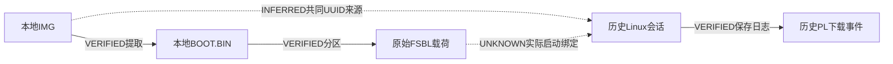

# WO-0015 阶段A：离线启动镜像、FSBL及OS来源取证

日期：2026-10-16（Asia/Shanghai）。最终状态：**STOPPED_PRECONDITION_UNVERIFIED**。

本轮建立了“本地IMG → FAT启动文件 → BOOT头/分区 → 原始FSBL载荷”的可信字节关系；尚不能建立“该IMG/FSBL → 历史实际启动 → 当前PS初始化状态”的完整关系。用户已说明板卡断开连接，本轮未尝试连接、上电、复位、SSH/Jupyter、MMIO、Overlay或DMA；也没有挂载镜像、写SD、执行任何目标二进制/初始化脚本或重生成硬件工件。未提交、未合并。

## 1. 来源与启动身份的证据表

所有SHA-256针对原始字节。文件creation/mtime、FAT时间或嵌入字符串只是辅助，不能当作刷卡回执或执行记录。

| 工件/证据 | 位置/来源 | 字节数 / SHA-256 | 版本、时间及关系 |
|---|---|---|---|
| 本地主机IMG | `C:/Users/POP/Desktop/FPGA赛/pynq_z2_v3.1.1/pynq_z2_v3.1.1.img` | 8,337,309,696 / `4a6ac1cdbb413d768fcb059b7182e1f53aa7f728b898b7f5061cbb0b7cc93aab` | VERIFIED当前本地内容。CreationUTC=2025-09-24 02:57:36；mtimeUTC=2026-10-08 07:54:00.267157。真实镜像生成时间/官方下载校验/刷卡记录UNKNOWN |
| BOOT.BIN | IMG第1分区FAT根目录，经只读解析提取到`extracted/BOOT.BIN` | 1,165,852 / `3bf9c24025a489926fd76872754977c5954e2ab25c91957373386e1f20915af6` | VERIFIED与该IMG的文件字节对应；不是当前或历史板卡BOOT文件实测 |
| FSBL原始载荷 | BOOT分区0，头内名称`zynq_fsbl.elf`，提取`extracted/partition-00.raw.bin` | 98,320 / `16081243af5ed1d5b908b0c038c13c3e205c131b31d538690786a530dba82161` | VERIFIED原始装载载荷；不是完整ELF。原ELF、BIF、链接map、构建源码提交/编译选项及生成时间UNKNOWN |
| U-Boot原始载荷 | BOOT分区1，头内名称`u-boot.elf` | 1,041,824 / `0821d755f1941d9603065b1be0f687da69d4d791e50d525bdb20a8cc8fc3fed1` | 字符串含U-Boot 2024.01及May 14 2024 03:31:48 +0000；VERIFIED为嵌入字符串，不能当作历史运行版本已证实 |
| DTB载荷 | BOOT分区2，名称`system.dtb` | 19,740 / `3f16c67252ed274eaa2bb7ab6500a820a2fe88fd0352e9bba1ab919defac1798` | VERIFIED本地载荷；板端使用的具体DTB身份UNKNOWN |
| image.ub | 同一FAT根目录，`extracted/IMAGE.UB` | 7,147,780 / `8e380cb96c2803e1d5d1c46b1f2f8e505b4c31dcf24d68da4669be7502c6bbae` | 文件头为FIT结构，包含PYNQ ARM kernel描述；未执行、未解压运行内核，不将其与历史内核自动绑定 |
| boot.py | 同一FAT根目录，`extracted/BOOT.PY` | 991 / `b2653ef809c3271231c78772342c2be728d39686a877d3c6fe8cdabfd4ac1d42` | VERIFIED有实际BaseOverlay("base.bit")调用和LED操作；是否被实际启动服务执行UNKNOWN |
| REVISION | 同一FAT根目录，原件限制访问保存在`restricted-raw/` | 197 / `7988c8799349762dae727464388ad952f42a3bdc74e3897b50f57bf35809ce25` | 自报Release 3.1 (Carlisle)、2025_09_24、1d2ac96；无供应商签名/下载回执。目录v3.1.1与内部粗粒度3.1不能证实精确补丁版本 |
| 项目ZIP备份 | `F:/FPGA/backups/pynq_counter_lab.xpr.zip` | 13,921,750 / `9a03b1a60867ef076a1ff4ded238869209d3f15400c064b579c039ec7a7afab9` | 472成员，仅命中旧项目ps7_init.c/html/tcl；未发现BOOT/FSBL ELF/BIF，不能替代启动来源 |
| WO-0015生成PS7代码 | 上轮已锁定Vivado2026.1导出 | ps7_init.c SHA `7dc2df18d874d2fa56fa4c4ca28a85730ffbbd54b567e56fd2a741ad7fb9eab8` | VERIFIED保存设计代码；没有它被链接进本地候选FSBL或历史启动FSBL的证据 |
| SDK FSBL模板 | `F:/AMDDesignTools/2026.1/Vitis/data/embeddedsw/lib/sw_apps/zynq_fsbl/src/` | 6个关键源码逐文件hash/时间在`init-chain/evidence.json` | VERIFIED当前安装源码。它是对照模板，不是候选镜像或板端FSBL的已证源码 |

镜像旁没有伴随校验/下载说明。8个明确目录的文件名清点已留`discovery/search-scope.json`，均完成；命中4个候选，其中两个小ZIP为板卡/XDC资料名称候选，未读取其内容。没有全盘搜索、没有物理设备或可移动卷读取；负结果只适用于记录的范围，不声称全机不存在ELF/BIF。AMD安装器“Offline Image”没有当作SD系统镜像。

REVISION含疑似凭据URL，未使用、验证或向外发送。普通报告只引用脱敏副本`extracted/REVISION.redacted.txt`；原字节及其sidecar保留在新建受限目录，ACL仅当前用户、SYSTEM、Administrators。该敏感URL不作为可信下载来源证明。本轮没有修改原IMG。

## 2. BOOT.BIN实际结构与解析验证

只用普通主机文件rb读取，不挂载、不触发文件系统journal replay，不执行Arm代码。MBR两个非空分区：

| 分区 | MBR类型 | 起始LBA / 字节偏移 | 扇区数 / 字节数 |
|---|---|---|---|
| 1 | 0x0C | 8 / 4096 | 266240 / 136314880 |
| 2 | 0x83 | 268288 / 137363456 | 16015520 / 8199946240 |

第1分区BPB实际建立FAT16：512B/sector、8sectors/cluster、33241clusters、两份FAT完全一致。MBR0x0C标签与FAT16结构有标记差异，不能据标签使用FAT32解析；未修改该差异。解析器检查MBR边界/不重叠、BPB容量、FAT副本、链边界/循环/EOC、根文件唯一性及尺寸限制。

BOOT头：宽度识别字与Zynq签名有效，header version=0x01010000，key source=0，FSBL偏移5888，长度98320；IHT偏移2240，PHT偏移3200。三个分区的header checksum有效，数据均在文件内、互不重叠，image-header链接与分区对应数量一致。FSBL装载/入口地址0；U-Boot为0x04000000；DTB装载0x00100000、入口0。分区详情和原始摘要见`BOOT.BIN-analysis.json`。

**校验和有效是结构一致性，不是来源认证或执行证明。** 头内elf名字不保留原ELF的完整调试/符号/section字节，无法据此计算原ELF SHA，也不构造一个伪ELF充数。BootROM Register Initialization Table的256项均为skip，无有效地址值对；只说明本地BOOT头没有通过该表提供额外初始化，不能排除BootROM/FSBL/U-Boot/Linux其他路径。

格式依据：[UG1283 Zynq Boot Header](https://docs.amd.com/r/en-US/Bootgen-User-Guide-UG1283/Zynq-7000-SoC-Boot-Header)、[Image Header](https://docs.amd.com/r/en-US/Bootgen-User-Guide-UG1283/Zynq-7000-SoC-Image-Header)、[UG821 Partition Header Table](https://docs.amd.com/r/en-US/ug821-zynq-7000-swdev/Partition-Header-Table)、[Register Initialization Table](https://docs.amd.com/r/en-US/Bootgen-User-Guide-UG1283/Zynq-7000-SoC-Register-Initialization-Table)。本机Bootgen宿主检查工具因依赖不可用未能启动成功；本轮实际结果来自本目录已审阅、测试的数据解析器，不声称Bootgen工具验证通过。

## 3. 初始化调用链：定义、条件与真实执行分层

### 本地2026.1参考模板（不是镜像源码身份）

静态main.c:243–264调用ps7_init；该函数本身不调用post_config（定义已由上轮核验）。SD等路径LoadBootImage在main.c约560处，随后FsblHandoff。

- image_mover.c:172先把BitstreamFlag置0；只有遇到PL属性分区才在约335处置1。
- FsblHandoff中main.c:729起要求BitstreamFlag；且未定义NON_PS_INSTANTIATED_BITSTREAM时，PS7_POST_CONFIG宏存在才调用ps7_post_config（738–739）。否则对应分支直接写level shifter及FPGA_RESET_REG（约749–760）。
- JTAG分支另在main.c:482–503检查PCFG_DONE后受宏控制调用post_config。不能把JTAG分支自动套到SD启动。
- fsbl_hooks.c默认Before/AfterBitstreamDload及BeforeHandoff仅打印/成功返回；定制hook可以改变行为，但当前实际FSBL是否使用这些默认实现UNKNOWN。
- pcap.c的FabricInit路径会配置level shifter等PCAP状态。以上都是有写操作的源码，只静态审阅，未执行。

**条件式推断**：本地候选BOOT的三个分区均无PL bitstream属性（0x20）。若它使用这个模板及相同分支/宏，SD加载不会因PL分区置BitstreamFlag，Handoff中的post_config调用可能被跳过。实际编译源码/宏/调用不明，故只标INFERRED，不能声称历史FSBL确已跳过或执行过post_config。

### 本地候选FSBL二进制中的字节证据

原始载荷存在3个完全相同60B数据块，偏移67448、67508、67568。按保存ps7_init.h的指令编码，其字节形状对应：SLCR unlock、level-shifter mask-write、FPGA_RST_CTRL全掩码写0、SLCR lock、EXIT。该模式及SHA见`init-chain/fsbl-table-patterns.json`。

VERIFIED是这些原始字节；INFERRED是它们形似默认PS7 post-config数据表。没有符号或控制流证明将它们命名为某个函数/硅版本、证明可达或被执行。该FSBL载荷未出现AFI1两个绝对地址的小端4字节字面量；这**不能排除用基址+偏移等方式间接访问AFI**。它也不支持把WO-0015新生成含AFI1位宽写入的数据表直接认作已链接进该FSBL。

### 其他可能路径与历史实测边界

- boot.scr经过uImage header/data CRC检查；静态脚本会枚举启动目标、可加载uEnv.txt并运行uenvcmd，或加载image.ub/uImage/DTB等。它允许不同启动来源，文件存在不等于被执行。内容只存为static文本，未运行。
- BOOT.PY的BaseOverlay("base.bit")是实际非注释语句。如果被系统启动服务调用，可触发PL下载/时钟或库内部配置；该服务是否调用、库具体版本源码与AFI动作均UNKNOWN。
- 历史postflight-dmesg.txt:229附近直接记录11781s时fpga_manager写wo15.bin，随后xclbin UUID `444d4c49-7c99-ec8f-b75a-33d7ed50b28d`加载返回0；更早还有base.bin相关记录。这是VERIFIED的**历史Linux/PL下载事件**，不是FSBL或AFI寄存器执行记录。具体BIT字节/回执关系沿用历史锁定证据，不由UUID单独决定。
- PYNQ库、Linux FPGA驱动、U-Boot环境/脚本、定制FSBL hook均可能影响启动和PL/PS状态。本轮没有这些实际运行实例的完整来源/trace，不以当前安装模板或网络默认版本填补。

## 4. 本地镜像与历史DMA会话的可建立关系

历史记录boot_id=`822a9c29-37c0-438c-81c4-da998d57073b`，Linux报告`6.6.10-xilinx-v2024.1-g3c0eca68c652`、armv7l。历史内核日志的mmcblk0p2 UUID为`63b8b04d-af08-419a-a9dc-16f374e283dc`。

本地IMG第2分区ext4 superblock magic=0xEF53，0x68位置UUID与上述历史UUID**完全一致**。原始1024B superblock及来源偏移137364480、hash和对比在`init-chain/rootfs-uuid-comparison.json`；按[Linux ext4 superblock定义](https://www.kernel.org/doc/html/latest/filesystems/ext4/super.html)只读解释，未挂载、修复或回放journal。

**VERIFIED**：两份来源的UUID字节/文本匹配。**INFERRED**：可能具有共同镜像/克隆谱系。**UNKNOWN**：是否就是该IMG完整刷入该SD、是否后来修改BOOT或根分区、BootROM当时选哪个介质/偏移、FSBL确切字节、镜像构建源码、boot.py及post_config实际执行。

UUID随克隆保留，同一根分区也可配不同启动分区；不能把匹配升级为唯一硬件/镜像认证。历史16GB卡与本地8.3GB镜像大小不同也不能证明不对应，刷入后扩容属于可能情况，但本轮没有扩容/刷卡记录，不推测补全。

## 5. 分类总表及仍缺证据

| 分类 | 本轮结论 |
|---|---|
| VERIFIED | 本地IMG及提取BOOT/分区字节、结构校验、PS模板条件调用、历史PL下载日志、根UUID匹配 |
| INFERRED | 镜像/历史根文件系统有共同克隆来源；FSBL有post-config形状表；若符合参考模板，无PL分区时SD handoff可能不调用该分支 |
| UNKNOWN | 实际启动BOOT/完整FSBL ELF/BIF/链接来源、当前/历史silicon分支、post_config及AFI实际访问、精确PYNQ补丁版、用户断开是否包含断电 |
| CONFLICT / 差异 | AFI前置字段与reserved定义的既有文档冲突未解除；镜像MBR类型标签与BPB类型不同；目录版本标签与内部粗版本信息未完成来源协调，不据此断言内容被篡改 |

生成代码、当前磁盘、历史捕获文件和真实硬件执行没有混用。没有建立实际启动身份充分证据，因此**不批准、不执行AFI读取**，更不修改AFI/SLCR或续跑DMA。

## 6. 下一轮最小授权、白名单与失败路径

精确白名单、完整命令argv/源码摘要与审计见`command-audit-and-whitelist.md`、`future-command-plan.json`。推荐只申请B1一次：6个proc文件来源采集，不读/boot、sysfs、任何设备/MMIO或旧采集器。B1完成后仍STOP，不自动进入B2。

B2仅是独立后续提案：单个/boot/BOOT.BIN，须事先已挂载ro、核对固定挂载源与钉住文件fd的ro状态，不remount、不尝试旁路。采到的当前磁盘hash也不能倒推出历史实际启动字节。SSH/sudo本身可能写系统认证日志，不能承诺整张SD绝对零写入；若要求介质零写入则继续离线。

用户已断开板卡，当前不请求立即重连。下次若实际已重启，旧boot基线不会自动更新；首读不匹配即保留该样本停止，需单独重授权。新计划nonce全零只是审阅示例，真正授权执行时必须重新生成随机nonce并核验SSH主机密钥/源码摘要；没有凭据回退或自动重试。

全部解析器与提案仅在本地主机验证，未调用真实板端后端。测试结果见本目录XML/日志；旧459项/前轮76项不冒充本轮重跑。疑似凭据原件受限保存，普通交付内容脱敏；原IMG、SD和既有硬件工件未改。

本轮定向测试实际结果：**43 passed**（镜像解析11项、OS文件提案27项、固定命令生成5项），无真实板端后端执行。完整历史及交付摘要核验结果在`summary.json`、`evidence-sha256.json`。
