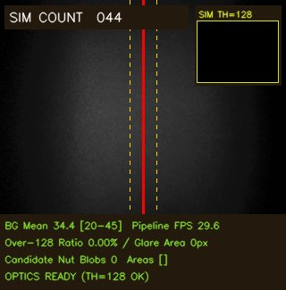

# WO-0017 相机预处理、反光过滤与现场校准总结报告

**报告日期：**2026-10-22  
**最后现场核验：**2026-10-22 21:57:10（Asia/Shanghai）  
**工作目录：**`C:\wt\w17`  
**工作分支：**`codex/wo0017-algo-accuracy`

## 一、结果概览

本次对话完成了相机灰度预处理优化、大面积反光组件过滤、实时校准 HUD、受控曝光/亮度接口、自动化测试和板端部署。随后处理了预览因 CMA 水位退出的问题，最终启动校准专用预览 `-06`，供现场调光练习使用。

报告生成时，板端 `-06` 仍处于 `READY_WAITING_FOR_OPERATOR_OBSERVATION`，HUD 显示绿色 **`OPTICS READY (TH=128 OK)`**。当前背景均值约 **34.42**，大反光面积为 **0**，曝光 **50**、亮度 **0**；Windows 客户端连续接收180帧，实测送达 **28.88 FPS**。

已完成的软件和现场校准工作，不能替代正式物料计数准确率验收。预处理耗时虽显著下降，但 **≤2.5 ms 的实时目标尚未稳定达到**；CMA 下降的根因也尚未确认。

## 二、完成的功能与代码改动

### 1. 单色相机预处理优化

按本次确认的 OV9281 单色输入约定，删除重复三通道画面的冗余 `BGR2GRAY` 转换。三通道输入通过 `frame[:, :, 0]` 直接取得共享内存的灰度视图，同时支持原生二维灰度及单通道三维数组。

缩放固定为640×400到320×240，采用三组 NumPy 切片复制实现最近邻采样：横坐标为 `2*j`，纵坐标为 `floor(5*i/3)`。这样避免 OpenCV 为跨通道视图整理整帧数据的开销；Gray8 和阈值输出缓冲区均预分配并复用。已在 Windows 和板端 OpenCV 4.5.4 上核对，与 `INTER_NEAREST` 逐像素一致。

该采样与正式计数器使用的最近邻方法一致，但不与旧预览的 `INTER_AREA` 缩放逐像素等价。

### 2. 大面积反光组件过滤

在组件进入聚类和跟踪前增加上限过滤，默认参数为：

| 参数 | 默认值 | 含义 |
|---|---:|---|
| `max_area` | 900 | 组件最大面积，像素 |
| `max_bbox_width` | 85 | 最大边界框宽度，像素 |
| `max_bbox_height` | 85 | 最大边界框高度，像素 |

超限组件不进入正常跟踪，并提供 `glare_rejected_count`、`glare_area_px`、被拒组件和轮廓。诊断数值同时进入正式计数结果及采样元数据；正式入口的参数也纳入计数配置，避免只在预览中生效。

测试覆盖了限值边界、非法参数、面积/宽/高分别超限、反光旁正常组件、轮廓坐标、逐帧重置和检测记录回放。现场强反光画面中，大亮斑被标成红色虚线区域，合格候选数为0。

过滤基于计数 ROI 内可见组件。如果螺母在二值图中已经与反光连成同一个超限组件，整体会被拒绝；该规则不能恢复被反光淹没的独立物料轮廓，也不能据此宣称漏计问题已经解决。

### 3. 实时光学校准 HUD

预览越线中心统一为 `line_x=160`，迟滞带为 **[145,175]**。计数 ROI 为 x=[0,320)、y=[96,145)。

HUD 和 `/state.json` 提供以下指标：

| 指标 | 当前实现与解释 |
|---|---|
| `BG Mean` | ROI内≤128像素的均值，作为排除亮目标后的背景估计；目标20～45 |
| `ROI Mean` | ROI全部像素的平均灰度 |
| `Over-128 Ratio / Area` | ROI内>128像素的比例及面积；包含物料和反光 |
| `Glare Area` | 被组件上限规则拒绝的亮组件面积 |
| `Candidate Nut Blobs` | 当前通过过滤的候选组件数及面积列表 |
| `Pipeline FPS` | 最近60帧的相机/处理循环速率 |

存在超限反光组件时，显示 `GLARE >128: ADJUST LIGHT/EXPOSURE`，并用红色虚线标出轮廓。背景均值位于20～45且无超限反光组件时，显示绿色 `OPTICS READY (TH=128 OK)`。

绿色状态仅表示当前ROI满足这套光学校准规则，不表示全画面均匀、物料身份已确认或计数准确率已通过。

### 4. 受控曝光与亮度调参

只有显式启用 `--calibration-mode` 才开放调参。接口为本地 JSON POST `/api/calibration`，限制环回访问、同源请求和字段白名单。

- `exposure_time_absolute`：50～10000，采用驱动原生单位。
- `brightness`：-64～64。
- Restore：恢复曝光50、亮度0，并读回核验。

已验证降权到 xilinx、清空补充组后，`sudo -n v4l2-ctl` 仍可使用；板端本地恢复接口实测返回标准配置，局域网直接提交调参会被拒绝。

预览正常退出或捕获异常时会恢复并核验标准配置。强制杀死进程或断电可能跳过清理，因此正式相机入口另设独立检查：相机打开前、首帧交给后续链路前都要求手动曝光、曝光50和亮度0；不符即拒绝。正式服务不开放校准回调。

### 5. 长时预览资源管理

预览使用单帧相机缓冲设置；已结束轨迹可在预览模式清理，轨迹尾迹随活动目标裁剪，时间统计限制为最近300项。图像快照在锁内复制后交给后台编码，避免预处理复用缓冲区时覆盖正在编码的图像。

`-06` 还采用单进程 OpenCV 线程限制，并每5秒追加内存遥测；文件属主为 xilinx、权限0600，降权后持续写入已核验。网页提供当前内存值和告警状态。

## 三、测试与性能结果

### 1. 自动化验证

最终完整命令：

```powershell
C:\fpga\material-counter\.venv\Scripts\python.exe -m pytest python scripts -q
```

最终结果：**668 passed、1 skipped、5 subtests passed**。预览相关集合为184项通过，`git diff --check` 通过。测试结果已保存为 JUnit XML。

隔离工作树最初缺少被Git忽略的487张H3测试图片。已从原工作目录只读复制到工作树，并逐一核对源/目标SHA-256一致；未修改原始图片。补齐后完整回归通过。

### 2. 预处理性能

| 测量条件 | 旧路径中位耗时 | 新路径中位耗时 | 结论 |
|---|---:|---:|---|
| Windows，500次离线合成输入 | 0.23545 ms | 0.02610 ms | 约9.02倍 |
| 板端，500次离线合成输入 | 18.94838 ms | 2.57642 ms | 约7.35倍 |
| 板端采样方法微基准 | — | 2.34383 ms | 三组切片快于另外两种索引方案 |
| `-04` 实时预览早期快照 | 历史记录22.08 ms | 约2.57～2.75 ms | 显著下降，未稳定≤2.5 ms |
| `-06` 本报告生成时实时快照 | — | 3.36334 ms | 当前版本和场景下的实测值 |

离线合成基准、历史预览和当前实时测量的负载不同，不能混作同一次严格对照实验。≤2.5 ms目标保留为未达项。

### 3. 网页实际送达帧率

以下均为客户端连续读取180帧HTTP multipart JPEG的测量，不是仅从循环次数推算：

| 预览与场景 | 实测送达FPS |
|---|---:|
| `-04`，当时画面 | 30.55 |
| `-06`，强反光场景 | 8.71 |
| `-06`，现场调整后、报告生成时 | **28.88** |

最后一次测量历时6.1974秒，同期 Pipeline FPS 约29.60。两个现场场景的差异不构成严格单变量性能因果验证。

## 四、板端预览历程与内存处理

| 阶段 | 实际结果 | 处理与保留证据 |
|---|---|---|
| `-03` | 本次优化的既有参考，存在冗余转换和反光伪目标问题 | 原截图、状态和部署清单保留 |
| `-04` | 启动成功；约14分钟后因CMA降到32 MiB水位而退出 | 保存FAILED状态与退出日志，恢复标准曝光/亮度 |
| `-05` | 相机返回首帧后，CMA为32616 KiB，比旧门槛少152 KiB；启动被拒绝 | 未成为可用网页服务，失败目录保留且未复用 |
| `-06` | 校准专用预算下成功就绪；报告生成时仍运行 | 新目录、新启动标记，持续内存日志及最新截图已保存 |

`-05` 首帧后同时记录 MemAvailable=396800 KiB、RSS=99836 KiB。进程退出后CMA回升，但这些现象仍不足以判定内存泄漏。另做的离线GC/自身堆回收试验降低了RSS，没有改善CMA；没有据此声称修复根因，也未清理全局缓存。

最终 `-06` 策略仅适用于不分配PL DMA缓冲区的校准预览：

| 阶段/指标 | 规则 |
|---|---|
| 相机打开前 | CMA严格高于32768 KiB |
| 相机成功分配后的校准阶段 | CMA至少16384 KiB |
| CMA≤32768 KiB | 显示校准告警，提示正式DMA前必须停止校准并重新门禁 |
| 系统可用内存 | MemAvailable至少65536 KiB |
| 进程内存 | RSS最多196608 KiB |
| 非校准预览及正式采样 | 不采用上述校准放宽；原严格CMA规则保留 |

Boot变化、硬内存底线、相机读取失败或控制读回失败仍按异常退出。该改动是校准预览分配预算的区分，**不是CMA根因已经解决的证明**。

本次部署使用 `0x40400000` 基址、偏移 `0x04/0x34` 的只读DMA状态门禁，`-06`记录的两路DMASR均为 `0x00000001`。未发起DMA传输、未重载Overlay、未执行正式物料采样或传送带控制。SSH曾短暂中断，恢复后Boot ID未变，没有把该中断解释成板卡重启。

## 五、报告生成时的现场状态

| 项目 | 核验值 |
|---|---|
| 预览 | `camera-preview-06`，READY |
| 地址 | http://192.168.2.99:8080/ |
| 光学校准状态 | **OPTICS READY (TH=128 OK)** |
| BG Mean | **34.42** |
| Over-128比例、面积 | **0%、0px** |
| Glare Area | **0px** |
| 当前候选组件数 | **0** |
| 曝光、亮度 | **50、0** |
| 网页送达FPS | **28.88**，180帧实测 |
| 预处理阶段中位耗时 | **3.36334 ms** |
| CMA / MemAvailable / RSS | 24676 / 390924 / 104296 KiB |
| 历史RSS峰值 | 104420 KiB |
| 进程 | PID 7009，UID/GID 1000 |
| Boot ID | `35983d66-bb1d-4a8a-85e5-802170825515` |

最新内存日志覆盖约1630秒，即约27分钟，证明服务已持续运行到这个检查点；这不等同数小时耐久性验收。CMA仍低于32 MiB，页面的CMA告警与绿色光学校准提示含义不同：光学已满足当前规则，正式DMA资源门禁仍未进行。



截图中的 `SIM COUNT 044` 是软件预览累计调试值；没有独立Ground Truth和逐物料对应关系，不能据此认定通过了44颗实物的准确率测试。

## 六、现场使用方法

直接查看画面：http://192.168.2.99:8080/ 。状态JSON：http://192.168.2.99:8080/state.json 。

使用本地调参按钮时，在电脑PowerShell运行以下命令，保持窗口打开，再访问 http://127.0.0.1:18080/ ：

```powershell
ssh -o BatchMode=yes -N -L 127.0.0.1:18080:127.0.0.1:8080 xilinx@192.168.2.99
```

本次自动建立SSH转发曾被审批策略拒绝，只返回 `blocked by policy`；没有绕过该拒绝。手动转发后，通过本地页面使用Apply和Restore。直接从局域网访问8080时，调参接口仍拒绝写入。

推荐练习顺序：

1. 先用标准曝光50、亮度0观察空带，保持相机位置和拍摄物不变。
2. 每次只改变一个变量，先调整光源角度，让Glare Area降到0。
3. 让背景均值处于20～45，观察绿色提示。
4. 放一颗静止螺母，检查候选组件及面积；不把候选数直接当作实物准确率。
5. 曝光/亮度调参实验结束后点击Restore。正式采样前停止预览、确认相机释放、恢复标准配置，并重新执行当前Boot/资源/Guard门禁。

## 七、文件交付与仓库状态

### 1. 主要代码文件

| 文件，均位于 `scripts/wo0016/` | 作用 |
|---|---|
| `live_calibration.py`（新增） | 单色视图、预处理缓冲、校准指标、受控参数和标准配置检查 |
| `benchmark_monochrome.py`（新增） | 可重复的旧/新预处理离线基准 |
| `camera_only_preview.py` | 校准预览、阶段内存策略、状态和日志、相机恢复 |
| `mjpeg_preview.py` | HUD、虚线轮廓、后台快照、状态/调参接口和页面 |
| `stream_counter.py` | 组件上限过滤、反光诊断、可选结束轨迹清理 |
| `run_stream_counter.py` | 参数绑定、诊断元数据、正式相机标准配置核验 |
| `test_live_calibration.py`（新增） | 零拷贝、复用、采样一致性、指标、权限及控制测试 |
| `test_camera_only_preview.py` | 校准内存策略及边界测试 |
| `test_stream_counter.py` | 过滤、轮廓、轨迹清理回归 |
| `test_run_stream_counter.py` | 正式入口回归适配 |

### 2. 证据目录

- `data/results/wo0017-live-calibration-04-20261022/`：预处理基准、`-04`部署、截图和测试。
- `data/results/wo0017-preview04-exit-diagnosis-20261022/`：`-04`退出状态及只读诊断。
- `data/results/wo0017-calibration-preview05-20261022/`：`-05`启动拒绝、内存试验及测试。
- `data/results/wo0017-field-calibration06-20261022/`：`-06`部署、现场练习说明、内存日志和最终完整测试。
- 本目录：汇总报告、现场调整后的新截图、状态JSON、180帧客户端测量、当前源码哈希及内存日志尾部。

板端部署目录为 `/home/xilinx/wo0017/app/`。13个运行文件在本报告生成时再次核对，本地、部署清单和板端SHA-256一致；旧版本分别保存在 `app-before-calibration04/05/06`。各尝试使用独立目录和启动标记，没有覆盖失败证据。

当前工作分支HEAD仍为 `ddefbe6c40e96763192c5154f52a1ecd4893d6e6`，本次改动尚未提交。本地 `main` 与 `origin/main` 均为 **`1d32593610c2643b3f022ce048d31f70fd7a4417`**；原工作目录 `C:\fpga\material-counter` 的Git状态干净。

板端墙钟仍显示历史日期，原始日志未改写；报告按客户端时间归档，FPS和运行时长采用单调时钟。没有修改板端系统时间。

## 八、未完成项与后续验收

1. **实时预处理≤2.5 ms尚未稳定达到。** 本次最新快照为3.36 ms，应在固定场景、相同负载下继续剖析。
2. **CMA下降根因未确认。** 现已补齐持续遥测，后续可结合系统内存分配与进程使用继续分析；校准预算调整不等同根因修复。
3. **强反光场景网页帧率偏低。** 已记录8.71 FPS的历史样本；当前光学调整后为28.88 FPS，尚无严格单变量因果分析。
4. **未进行正式物料准确率验收。** 没有新增DMA闭环采样、独立Ground Truth、逐目标对应或最终准确率结论。
5. **未完成长期耐久性验收或Git集成。** 本次证明约27分钟内仍运行，代码保留在隔离工作树，尚未提交、创建PR或合并到main。
