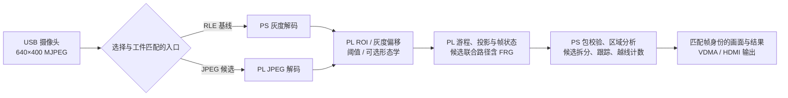

# 系统架构与代码对应

[作品首页](../../README.md) · [文档目录](../README.md)

## 数据通路

比赛提交以[队友 V13](V13.md)的 standalone 整合链路为主线：PS 解码 MJPEG，PL 完成像素前端与游程输出，PS 执行区域、跟踪计数及 HDMI 仪表盘组织。应用源码固定 5438e0e1，硬件构建源码分别固定 037d38d1。

开发分支 `LJ-01` 还包含 JPEG 硬解候选，它把解码移入 PL。两条路径处理 640×400 图像，不沿用旧 `main` 的 320×240 全帧 Binary8 往返架构；开发入口的默认值不能替代 V13 包内入口。

图中汇总功能分工；独立 RLE 测试入口和带 HDMI 的集成包仍需分别核对其构建与 manifest。JPEG 候选的实现和板测不自动覆盖当前合并后的源码。

## 职责与源码

| 层级 | 职责 | 主要入口 |
| --- | --- | --- |
| PS 输入与运行 | 相机读帧、入口选择、参数与结果报告 | [run_counter.py](../../scripts/rle/run_counter.py) |
| PS 灰度解码 | RLE 基线的 MJPEG → Gray8 | [RLE 运行说明](../../scripts/rle/README.md) |
| PL 像素处理与 RLE | ROI、灰度偏移、阈值、可选腐蚀/膨胀、游程和投影 | [RLE 构建清单](../../scripts/rle/build.tcl) |
| PL JPEG 候选 | 压缩流解码及联合数据通路 | [联合构建](../../fpga/experimental/jpeg_integration/joint_build.tcl) · [JPEG 运行器](../../scripts/experiments/run_jpeg_counter.py) |
| PS 协议与传输 | 严格包校验、DMA 长度和帧身份 | [protocol.py](../../scripts/rle/protocol.py) · [transport.py](../../scripts/rle/transport.py) |
| PS 区域与计数 | 原生 8 连通游程合并、局部掩膜、轨迹与越线事件 | [components.py](../../scripts/rle/components.py) · [native](../../scripts/rle/native/rle_components.cpp) · [counter.py](../../scripts/rle/counter.py) |
| 显示与运行控制 | 帧关联、显示集成、所有权及部署 | [standalone](../../scripts/standalone/) · [部署记录](../../scripts/standalone/DEPLOYMENT.md) |

## 关键边界

PL 输出游程不等于 PL 已完成通用二维 CCL。RLE 基线中的二维连通关系由 PS 原生模块合并；疑似粘连目标可以局部重建掩膜。异常密集前景可能导致游程溢出，溢出帧应按协议拒绝更新计数，平均约 4.1 KB 的样本结果不能代替最大容量设计。

`run_counter --mode camera` 当前默认转入 JPEG PL 候选；显式 `--software-decode` 才选择旧 PS 解码路径。这个软件默认值不意味着任意 BIT/HWH 都可互换。JPEG v8 包绑定独立候选快照，合并到 LJ-01 后的设计需要重新构建并复验，详见[证据边界](../../data/results/jpeg-pl-board-20261102/README.md#合入-lj-01-后的证据边界)。

上述默认值描述开发分支的通用运行器，不是队友 V13 的 standalone 整合入口。复现 V13 时先取得并核对该版本实际包，不能从当前分支的相机默认值反推 V13 应加载 JPEG 位流。

接口和路线治理以[接口文档](../02_interfaces.md)、[路线记录](../07_routes.md)及相关 ADR 为准，本页不作新的冻结决策。
