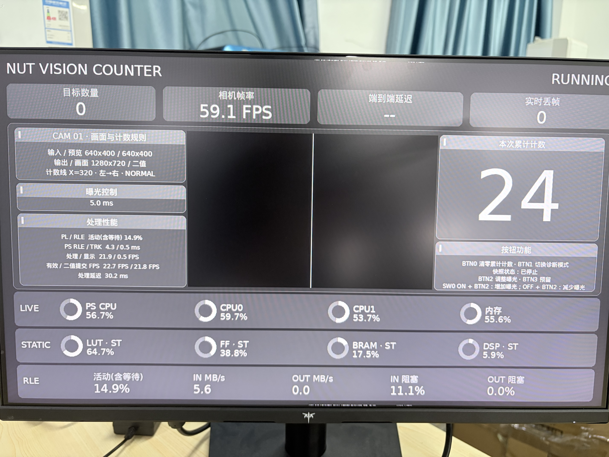

# 演示指南

[作品首页](../../README.md) · [文档目录](../README.md)

## 本地离线体验

在具备 Python、NumPy、OpenCV 和 `g++` 的环境中，从仓库根目录运行：

```powershell
python -B -m scripts.rle.run_counter --mode offline --frames 12 --output data/results/rle-demo/offline.json
```

输出文件必须不存在。运行器在结果目录构建本机原生库，用合成图像生成 RLE 数据包，再进行解析、掩膜黄金比对和计数。成功报告应为 `OFFLINE_VERIFIED`，完成 12 帧、验证 12 帧像素，默认移动目标越线后累计数为 1。环境准备及软件回归见[开发说明](../DEVELOPMENT.md)。

此命令不连接相机、PYNQ、DMA 或 HDMI；离线耗时包含软件编码与验证，不能作为 PL 性能。重复体验时更换输出目录，保留先前报告。

## 实物演示顺序

1. 展示[整机及接线](HARDWARE.md)，说明本轮物料、独立真值、视野、ROI、计数线和运动方向。
2. 按[部署说明](../DEPLOYMENT.md)选择版本，核对源码、BIT/HWH、运行包和配置，不混用 V12 与 JPEG 候选制品。
3. 在获准的运行条件下让物料完整经过计数线，同时记录实物运动和显示屏累计数。
4. 保存该轮报告及获准采集的证据，将每次计数事件与实物逐件配对。
5. 报告系统计数、漏计、重计和歧义项，分别记录帧处理、物料准确率和显示效果。

多件物料可能在同帧越线，累计数一次增加多件不一定是漏计。是否正确应由物料真值、帧和事件共同判断。

## HDMI 界面实拍



照片可见累计计数、相机帧率、处理状态、CPU/内存及资源信息。当时累计数显示为 24，缺少该轮独立真值与逐件事件，不能据此写成“24 件准确率验收通过”。屏幕中的 FPS 和延迟也只表示拍摄时的界面读数，正式性能以相同版本的原始报告为准。

照片证明显示屏上有相应界面外观，尚未绑定当前源码和候选工件。它不替代 JPEG 板载像素监视器的记录，也不将其历史“未观察外接屏幕”结论回写为已完成验收。来源见[素材说明](../assets/photos/README.md)。

## 正式视频

当前文档未纳入与最终提交版本绑定的视频链接。正式视频需同时展示实物经过计数线与界面反馈，并标注版本、物料条件和原始证据路径。提交前缺口见[结果页](RESULTS.md#提交前待补资料)。
