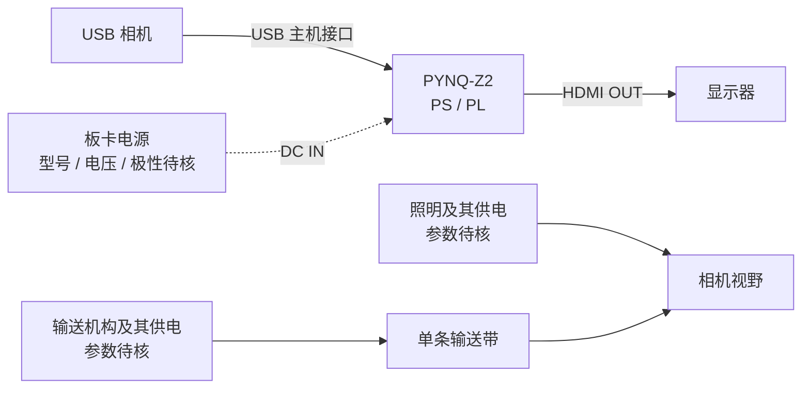

# 硬件组成与实物照片

[作品首页](../../README.md) · [文档目录](../README.md)

## 硬件组成

| 部件 | 用途 | 资料状态 |
| --- | --- | --- |
| PYNQ-Z2 / XC7Z020 | PS/PL 协同处理与显示 | 板卡可由照片辨识，测试工件见[结果页](RESULTS.md) |
| AT-OV9281 USB 摄像头 | 获取 640×400 MJPEG 物料图像 | 型号与采集链路见当前首页及[RLE 记录](../../scripts/rle/README.md)；实际运行格式以报告为准 |
| 输送机构与进料结构 | 形成单向物料运动 | 实拍可见输送带、驱动和进料结构；速度范围及生产工况仍需测量 |
| 条形照明、相机支架 | 保持视野与前景可辨识 | 照片可见安装位置，参数和光学标定需对应运行记录 |
| HDMI 显示器 | 显示画面、累计数与运行状态 | 已有实拍；连续显示效果和最终包仍需配对验收 |
| 供电及线缆 | 板卡、相机、照明和机械供电与连接 | 有接口近照；完整型号、电压及接线图仍需补齐 |

照片展示团队提供的装置，不单独确定其中运行的软件 commit、BIT/HWH 或配置。编码器采集和实际带速不能仅凭电机外观认定已实现。

## 实物照片

### 正面全景

可见单条输送带、进料结构、上方相机、两侧条形照明和外接显示屏。

### 斜侧视与安装关系

从斜侧视查看视野上方的支架及照明安装位置。照片记录外观和安装状态，不证明特定输送速度或连续运行结果。

### PYNQ-Z2 板卡

可辨识 PYNQ-Z2 标识、散热片、接口、插接线缆和指示灯。原文件名含“处理板、相机、HDMI、供电接线”，但实际画面主要为板卡近照，不作为完整接线图。

### HDMI 与 USB 接口

照片可辨识 `HDMI OUT`、`USB HOST` 丝印和相应插头。线缆另一端未完整入镜，设备对应关系仍需接线资料核对。

### 供电接口

可见 `DC IN` 与电源插头；供电电压、电流、极性和各部件供电关系需由型号及接线资料确认。

## 接线与资料索引

### 连线草图与待核参数

下图依据当前运行说明和团队提供的《技术文档_专业版_20261104_硬件FPGA软件版》§2.2.3 整理，展示逻辑连接关系。它不是完成电气核验的接线图。

来源文件的 SHA-256 和章节记录见[资料来源记录](../verification/submission-source-notes-20261104.json)。

技术文档称输送机构和光源独立供电；本轮未现场核对。文档中的板载按键/开关 3.3 V 输入电平不是整机或电机供电电压，不据此填写电源参数。相机在仓库首页标称 AT-OV9281，Word 硬件章节只写 USB 相机；特定 V12 运行的 USB 设备标识也不能单独证明传感器型号。

| 全景中的位置 | 功能 | 当前可确认内容 |
| --- | --- | --- |
| 左侧白色进料结构 | 将物料引向输送带入口 | 照片可见外形与安装位置，供料参数待核 |
| 中部黑色输送带及驱动部件 | 单向传送物料 | 照片可见装配关系，速度和电机型号待测/待核 |
| 画面上方相机支架 | 观察输送带上的物料 | 支架位置可见，镜头和安装标定待核 |
| 输送带两侧条形灯 | 改善前景照明条件 | 照片可见，光源额定参数待核 |
| 左侧外接屏幕 | 显示画面、累计数及运行状态 | 界面实拍可见，最终包连续显示验收待补 |

器件/线缆记录可先按“设备—接口—另一端—电源型号及额定值—证据”填写；未知字段保留待核，不能由照片外观推断额定值。

HDMI 仪表盘实拍见[演示页](DEMO.md#hdmi-界面实拍)。六张原图的来源和 SHA-256 见[素材说明](../assets/photos/README.md)，文件未经裁剪或重新编码。

原有[引脚预算](../../hw/pin_budget.md)包含 DVP 等早期候选映射，不是当前 USB 相机的接线验收表。提交前还需补齐完整器件型号、线缆两端及供电关系、视野与计数线标注，并将照片绑定最终运行包。
