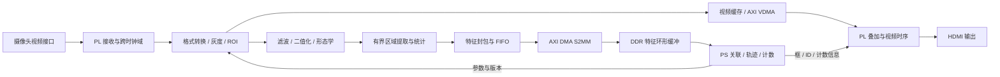
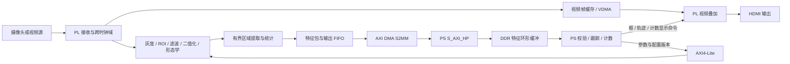
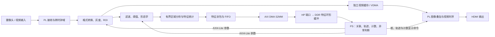

建议采用“PL 做逐像素处理和有界区域提取，PS 做跨帧理解与计数决策”的分工。可以让 PL 只向 PS 返回目标特征；但对你当前项目，最合适的是分阶段推进：先保留已有的“PL 前处理与 RLE、PS 原生区域分析”链路，再把经过验证的区域统计移入 PL。

这样既能减少 PS 的图像处理开销，也能保留处理粘连、漏检和跨帧关联的灵活性。

先明确当前代码基础：standalone 使用 640×400 Gray8 做算法处理、1280×720 做显示；USB/MJPEG 在 PS 解码，PL 返回 RLE，C++ 做游程连通域分析，Python 做后续关联与计数。对应实现见 [integrated_run.py (line 348)](C:/Users/14173/Documents/material-counter/scripts/standalone/integrated_run.py:348)、[摄像头解码 (line 51)](C:/Users/14173/Documents/material-counter/scripts/rle/run_counter.py:51) 和 [counter.py (line 46)](C:/Users/14173/Documents/material-counter/scripts/rle/counter.py:46)。下文是推荐设计，不代表已完成改造或正式冻结 Route。

1．围绕 Zynq-7000，首先确定三条设计原则

以项目使用的 PYNQ-Z2／XC7Z020 为例，它有双核 Cortex-A9、约 630 KiB BRAM、220 个 DSP，以及板载 512 MB DDR3。适合把规则、重复、吞吐量大的计算放入 PL，把分支多、状态多、需要迭代的逻辑放入 PS。TUL 板卡资料

由此得到三个约束：

- PL 优先使用行缓存和流式处理。 一帧 1280×720 Gray8 就需要 921,600 字节，超过该器件全部 BRAM；全帧缓存应放 DDR。
- 随机访问不等于一定放 PS。 小型标签表、区域统计表可以放 PL BRAM；大规模、不规则、难以限定最坏情况的访问，更适合 PS。
- 跨帧状态优先放 PS。 目标身份、轨迹、是否已计数等状态规模较小，但规则复杂，经常需要调整。
  推荐目标架构如下。图中摄像头直入 PL 的入口，需要另行验证实际接口与引脚条件。

如果继续使用当前 USB/MJPEG 摄像头，入口应保留为：

USB → PS 驱动与原生解码 → DDR Gray8 → AXI DMA MM2S → PL 前处理

只传特征能减少 PL→PS 的返回数据，但不会消除 USB 输入侧的 PS 解码和整帧输入传输。
2．PL 应该完成哪些工作
工作	推荐位置	处理方式与存储需求
摄像头时序接收、像素解包、跨时钟域	摄像头接 PL 时由 PL 完成	顺序数据流，接收 FIFO；USB 摄像头仍由 PS 驱动
RGB/YUV 转灰度、通道选择、灰度偏移	PL	固定运算，适合流水线
ROI 裁剪、坐标生成	PL	计数器和范围比较；保留原图坐标映射
固定阈值二值化	PL	每像素比较，适合流水线
3×3 均值、中值、Sobel 等局部滤波	PL	若干行缓存与滑动窗口
腐蚀、膨胀、开闭运算	PL	每一级使用行缓存；多级串联增加延迟
行游程 RLE、行列投影	PL	顺序扫描、累加器和有界输出缓存
面积、边界框、一阶矩	PL，跟随区域提取实现	需要区域统计表和正确的区域归属
连通域等价合并	分阶段迁移	小型随机访问；必须限定标签数、游程数和合并工作量
复杂粘连拆分、分水岭、轮廓推理	PS C/C++ 优先	分支多、局部随机访问多
HDMI 时序、像素输出、简单 OSD	PL	固定像素速率流水线；必要时经 DDR 帧缓存

这里需要区分三类算法。

第一类：适合纯流水线，或“流水线＋行缓存”。

格式转换、灰度化、ROI、固定阈值，以及固定窗口的滤波和形态学，都属于这一类。正常设计可以争取每拍处理一个像素，但必须把多级处理、输出背压和跨时钟域一起验证。

螺母场景尤其要注意形态学核大小：闭运算可以填小缺口，也可能把相邻两个螺母连接起来；腐蚀可以分开窄连接，也可能破坏细小目标。参数应按实际像素尺寸标定。

第二类：需要表访问和不规则合并，但未必需要整帧图像。

连通域提取属于这一类。行游程方案通常需要：

- 当前行、上一行的游程；
- 临时标签与等价关系；
- 每个区域的面积、坐标和、边界框；
- 区域结束判断，以及帧尾尚未完成的合并。
  不能把“前处理能一像素一拍”直接扩展成“连通域分析也一定一像素一拍”。 多次标签合并、BRAM 读写冲突和帧尾收尾，都可能形成瓶颈。

对于 XC7Z020，建议使用有界行游程区域提取，分别限制：

每行最大游程数、临时标签数、最终候选数、合并队列长度

这些上限必须独立设置。最终只输出 256 个目标，并不意味着中间过程只会产生 256 个标签。任何上限被突破，都应设置溢出标志，并使该帧退出正常计数路径。

这也符合项目当前对“无资源边界的通用二维 CCL”的范围限制，见 [00_scope.md](C:/Users/14173/Documents/material-counter/docs/00_scope.md)。

第三类：需要整帧或跨帧存储。
算法／功能	原因	推荐处理
用本帧 Otsu 阈值处理本帧	通常要先完成直方图，再处理像素	DDR 两遍处理；或上一帧阈值用于下一帧，并明确时延
背景建模、帧差、时域滤波	需要历史图像或背景模型	DDR 保存历史状态
通用几何重映射、任意角度旋转	输入访问顺序可能不再连续	DDR 或专用缓存结构
同帧图像与检测框精确叠加	框往往在扫描完成后才确定	保存该帧，再读取叠加
跨帧跟踪	需要历史目标状态	PS 保存轨迹表，通常无需历史整帧

因此，计数算法可以不保存跨帧整图，但显示和诊断可能仍然需要图像缓存。
3．PS 应该完成哪些工作，Python 与 C/C++ 如何分工

PS 的主要价值是把单帧检测结果转换为连续运动目标和可靠计数事件。
工作	PS 应负责的内容	实现建议
参数管理	ROI、阈值、面积范围、计数线、方向、配置版本	Python 管理界面；底层提供原子提交接口
跨帧匹配	根据位置、面积、预测位移、时间间隔建立关联	先测现有 Python；超预算时迁入 C++
轨迹管理	新建、确认、丢失、恢复、合并挂起、退出	PS；性能关键部分建议 C++
计数状态机	方向判定、越线、滞回、防重复计数	PS，规则应能独立回放验证
异常检测	漏帧、时间异常、区域溢出、目标合并、处理超时	数据路径用 C/C++，告警展示可用 Python
UI、配置、日志	显示累计数、速率、状态和参数	Python 合适
采集、解码、DMA	驱动、缓冲所有权、完成通知、批量解析	内核驱动／C/C++／现有原生库
外设管理	相机控制、网络、存储、普通 GPIO/I²C/UART	PS
高频编码器采集、精确触发	边沿计数、时间戳、硬件事件锁存	PL；PS 做标定和运动解释

Python 适合做系统编排，也可以调用 OpenCV、NumPy、C++ 扩展完成重计算。应迁移的是实测耗时和抖动明显的路径，而不是因为入口是 Python 就整体重写。

生产链路建议把以下部分放在原生层：

DMA 完成处理 → 特征包校验 → 批量特征解析 → 关联与计数更新

再向 Python 暴露每帧结果或低频状态快照，减少逐目标跨语言调用。

轨迹表至少应保存：

track_id、最近位置、预测速度、面积范围、last_seen_time、漏检状态、合并状态、是否已计数

计数应由轨迹状态推进，例如：

已在线前确认 → 进入计数带 → 按指定方向越线 → 标记已计数

需要明确：PL 的单帧 component_id 与 PS 的跨帧 track_id 是两种身份。 不能用当前帧区域编号防止跨帧重复计数。

发生漏帧后，预测应使用实际时间间隔；发生临时合并时，应保留原轨迹并进入不确定状态。单个大连通域不能直接按“一个框”认定为“一颗螺母”。
4．PS 与 PL 的通信：控制、特征、视频分开设计
通道	推荐机制	用途
参数与状态	PS M_AXI_GP0 → AXI4-Lite	配置寄存器、运行控制、错误状态
目标特征	AXI4-Stream → AXI DMA S2MM → HP → DDR	每帧一个特征包
USB／回放图像输入	DDR → AXI DMA MM2S → PL	向 PL 注入 Gray8
视频帧缓存与显示	AXI VDMA → HP → DDR	二维视频帧读写
完成与异常通知	PL→PS 中断、DMA 中断	唤醒消费者、报告故障
少量绘制命令	AXI-Lite 双缓冲表，或独立小型 DMA	框、ID、计数线、文字索引

Zynq-7000 提供四个 HP 接口，支持 32／64 位配置；它们适合高吞吐量 DDR 访问。GP 适合控制，ACP 提供通向处理器缓存一致性域的另一

建议采用“PL 处理像素与有界区域统计，PS 处理跨帧关系与计数决策”的架构。正常计数链路可以只向 PS 回传目标特征；同时保留按需回传局部 RLE 或图像的通道，用于粘连拆分和异常诊断。

对当前项目，建议分两步落地：

- 近期沿用已有链路：PL 前处理与 RLE → PS C++ 连通域分析 → PS 跟踪计数。
- 后续评估：PL 前处理与有界区域特征提取 → PS 跟踪计数。
  将连通域完全移入 PL，需要先证明资源、最坏处理时间和粘连场景能力。当前项目明确不承诺无资源边界的通用二维 CCL，因此下面给出的是推荐设计，不代表正式 Route 或接口已冻结。

1．先明确 Zynq-7000 与本项目的实际约束

PYNQ-Z2 使用 XC7Z020，具有双核 Cortex-A9、约 630 KiB BRAM、220 个 DSP，以及板载 512 MB DDR3。适合让 PL 承担规则、重复的像素运算，让 PS 承担分支较多、状态复杂且需要迭代的逻辑。TUL PYNQ-Z2 硬件资料

一个直接影响架构的例子是：

- 1280×720 Gray8 单帧为 921,600 字节，已经超过芯片全部 BRAM 的容量。
- 同分辨率的一行 Gray8 只有 1,280 字节。
- 所以 3×3、5×5 空间处理适合使用行缓存；完整视频帧、多帧背景和显示缓存通常应放在 DDR。
  当前 standalone 源码的实际分工是：
  环节	当前实现
  摄像头	USB/MJPEG，由 PS 采集并解码为 640×400 Gray8
  图像前处理	PL 执行 ROI、灰度偏移、阈值、可选形态学
  PL 回传	RLE 游程与投影
  连通域	PS 原生 C++
  跨帧跟踪与计数	PS Python
  显示	PS 合成仪表盘，PL/VDMA 输出 1280×720 视频

依据见 [摄像头解码代码 (line 51)](C:/Users/14173/Documents/material-counter/scripts/rle/run_counter.py:51)、[区域与跟踪入口 (line 46)](C:/Users/14173/Documents/material-counter/scripts/rle/counter.py:46)、[集成运行器 (line 348)](C:/Users/14173/Documents/material-counter/scripts/standalone/integrated_run.py:348)。

因此，在现有 USB 相机路线下，“PL 只回传特征”可以实现，但摄像头整帧仍会先经过 PS 解码。 如果进一步要求像素从采集开始就不经过 CPU，需要选择经验证的 PL 视频输入路线。

2．PL 应完成哪些工作
工作	推荐分配	数据访问特点与实现方式
摄像头接收、同步信号解析	视频源直连 PL 时放 PL；现有 USB 相机仍放 PS	接收时序、跨时钟域 FIFO、帧行计数
RGB/YUV 格式转换、灰度化	PL	逐像素定点流水线；输入有 Y 分量时优先直接使用
ROI 裁剪、灰度偏移、阈值	PL	坐标比较、加减与比较运算，基本不需要随机访问
均值、高斯、Sobel、小窗口中值	PL	使用行缓存和滑动窗口
腐蚀、膨胀、开闭运算	PL	多级窗口流水线，每级配置所需行缓存
行游程 RLE、行列投影	PL	顺序扫描；投影需要计数数组
有界区域提取、面积和矩统计	可放 PL，需专项验证	需要游程匹配、标签等价表和区域统计表
复杂粘连拆分、轮廓分析	优先 PS C++	数据依赖、随机访问和迭代较多
HDMI 时序、像素输出、简单图像叠加	PL	持续输出视频，按坐标绘制线、框、字符或叠加图层
跨帧匹配、轨迹生命周期、计数规则	PS	主要处理目标关系和历史状态

这里需要区分三种处理类型。

适合纯流水线的算法

格式转换、灰度化、ROI、固定阈值、局部空间滤波和固定窗口形态学，都可以设计为稳定的流处理链。流水线充满后，可争取每拍接收一个像素。

但“前处理达到一像素一拍”不能直接证明整机达到目标帧率。DMA 停顿、区域合并、摄像头解码和显示仍可能限制吞吐量。

需要随机访问，但不一定需要整帧图像的算法

连通域就是典型例子。

采用基于行游程的 8 连通分析时，可以保存：

- 上一行和当前行的游程。
- 标签等价关系。
- 各区域的面积、边界框和一阶矩。
- 待合并或待结束的区域状态。
  这些表可以放在 BRAM，未必需要保存整帧标签图。不过，等价标签查找、多个游程合并和统计表读改写，均会产生数据依赖。不能未经验证就承诺任意场景下持续一像素一拍。

建议分别设定以下上限：

- 每行最大游程数。
- 最大临时标签数。
- 最大标签合并工作量。
- 每帧最大候选数。
- 帧结束后的最大收尾时间。
  任何上限被突破，都应输出显式溢出状态，避免将截断结果作为完整检测结果。

螺母还有一个特别容易出错的地方：一个带孔螺母在同一行可能产生多段游程，所以游程数不能当作目标数。 单纯的一维投影也不能可靠处理横向错位、并排和接近目标。

需要帧缓存或跨帧存储的算法
算法或功能	存储需求
同帧全局 Otsu 阈值	阈值到帧末才确定；应用到同一帧通常需要缓存并重放
使用上一帧直方图确定阈值	保存直方图与阈值即可，但有一帧响应延迟
相邻帧差分	保存上一帧或相关 ROI
背景建模	保存背景模型，可能还需要方差等状态
常见迭代分水岭、距离变换	通常需要区域或整帧工作存储、多次访问
将本帧检测框精确叠加到本帧视频	保存视频帧，等待相应检测结果
目标跨帧跟踪	通常只需目标状态，不必保存历史整帧

对本项目，建议优先利用受控光照、ROI 和空间处理建立稳定分割，再根据现场证据决定是否引入背景模型。

3．PS 应完成哪些工作，Python 与 C/C++ 如何选择

PS 应拥有最终轨迹与计数状态。PL 输出的是单帧区域，PS 判断区域是否属于同一个持续运动的物料。
工作	推荐实现
参数界面、配置文件、实验管理	Python
阈值、ROI、面积范围等参数下发	Python 管理，底层接口完成原子提交
DMA 接收、描述符与缓冲所有权	驱动或经过验证的底层库
特征包严格校验、批量解析	C/C++，或避免逐对象开销的批量接口
RLE 连通域、局部掩膜、粘连拆分	C/C++
跨帧关联、运动预测	目标较少且满足预算时可保留 Python；性能受限时迁入 C++
轨迹状态与计数状态机	PS；优先保持逻辑清晰和可验证
UI、日志、统计汇总、网络接口	Python
看门狗、DMA 故障处理、系统恢复	驱动与系统服务配合
编码器脉冲捕获、精确触发	PL 捕获；PS 标定、解释和使用

Python 可以继续调用 OpenCV、NumPy 和原生模块；这类调用的大量计算实际发生在原生代码中。应优先迁移的是逐像素循环、大量游程对象转换、密集关联循环和高频内存复制。

当前项目已经采用“C++ 游程分析、Python 跟踪”的分工。是否进一步迁移跟踪，应由同输入性能测量决定。

PS 的计数状态机建议至少维护：

- track_id、最近观测时间、位置、速度和运动方向。
- 确认、暂失、合并挂起、离开等轨迹状态。
- 计数线两侧的历史状态与滞回区。
- 是否已经计数。
- 检测帧缺失、区域合并和计数不确定状态。
  关联距离应结合真实时间差，例如：
  \[
  d_{\max}=v_{\max}\Delta t+\text{定位与预测余量}
  \]
  这样才能应对帧率波动和漏帧。PL 的单帧区域编号不能代替 PS 的 track_id；轨迹短暂丢失后重新出现，也不能简单作为新物料再次计数。

4．推荐的数据通路

如果视频源能够直接进入 PL，目标架构可以是：

保留现有 USB 相机时，前端替换为：
USB 相机
→ PS V4L2 采集与 MJPEG 原生解码
→ Gray8 DMA 输入缓冲
→ AXI DMA MM2S
→ 同一条 PL 前处理链
显示支路独立调度。UI 绘制、视频刷新和诊断写盘不应阻塞计数主链。

5．AXI4-Lite、DMA、HP 与中断各自负责什么
机制	负责内容
AXI4-Lite	启停、参数、配置提交、状态和错误计数
AXI4-Stream	PL 模块之间传递像素、游程或特征包
AXI DMA	通用流与 DDR 之间的传输，适合特征包和回放输入
AXI VDMA	带行宽、步长和帧结构的视频缓存
PS S_AXI_HP	PL DMA 主设备访问 PS DDR 的入口
PL→PS 中断	接收完成、DMA 错误、硬件异常通知
轮询	调试、状态监控、超时检测及有限的低延迟等待

Zynq-7000 有四个 HP 接口，可配置为 32 位或 64 位；它们适合突发访问和视频帧缓存。PS 通过 M_AXI_GP 控制 PL 寄存器，PL 的 DMA 经 S_AXI_HP 访问 DDR，符合官方推荐的控制与数据通路划分。UG585：HP DMA 通路

本项目已有拓扑是输入 MM2S 经 HP0/64 位、RLE 输出 S2MM 经 HP1/32 位。新设计应校验实际 BIT/HWH、互连和 PS AFI 配置，尤其是 HP 读写位宽；不能只修改 DMA 端参数。[当前拓扑校验代码 (line 73)](C:/Users/14173/Documents/material-counter/scripts/rle/artifacts.py:73)、UG585：HP 位宽配置

不同 HP 端口最终仍共享 DDR 控制器。分配端口有助于组织流量，但不能把四个端口带宽简单相加当作实际 DDR 吞吐量。

建议的控制寄存器草案

以下是建议接口，不是现有寄存器定义：
偏移	名称	用途
0x00	ID_VERSION	IP 身份与接口版本
0x04	CONTROL	启动、帧边界停止请求
0x08	STATUS	运行、待提交、异常状态
0x0C	IRQ_STATUS	中断状态，写 1 清除
0x10	IRQ_ENABLE	中断使能
0x14	CFG_SHADOW_ID	待应用的参数版本
0x18	CFG_COMMIT	请求提交影子参数
0x1C	CFG_ACTIVE_ID	当前生效版本
0x20	ROI_XY	ROI 原点
0x24	ROI_WH	ROI 宽高
0x28	PREPROCESS_CFG	阈值、极性、形态学模式
0x2C/0x30	AREA_MIN/MAX	候选面积范围
0x34	MAX_OBJECTS	本次运行允许的目标上限
后续状态区	帧数、丢帧数、溢出数、时间快照	监控与诊断

PS 修改影子参数后提交，PL 在下一次 SOF 原子应用，并把 config_id 写入该帧结果。这样不会出现一帧前半使用旧阈值、后半使用新阈值的问题。

6．可以只传螺母特征，但应传“候选区域特征”

对于分割稳定、目标可分离的工作包线，PS 完成跨帧匹配和计数，通常只需要：

- 位置。
- 面积。
- 边界框。
- 时间。
- 少量质量与形状指标。
  不过，两个粘连螺母形成单区域时，仅有一个质心、面积和边界框，通常不足以恢复两个真实目标。因此建议提供三种输出模式：
  模式	数据内容	用途
  正常模式	每帧特征包	跟踪、计数
  歧义模式	特征包＋选定区域 RLE/局部掩膜	粘连拆分、质量判断
  诊断模式	有界灰度图、二值图或原始 RLE	标定、回归和故障分析

若要求事后获取某一帧的局部图像，必须提前保留该帧或其 RLE。 PS 在帧处理结束后才提出请求，而 PL 没有缓存时，无法补取已经流过的像素。

建议的特征协议：64 字节头＋N×48 字节记录＋16 字节尾

采用小端序，明确字段偏移，不直接依赖编译器结构体布局。

帧头：
偏移	字段	类型
0	magic	u32
4 / 6	version / header_bytes	各 u16
8	packet_bytes	u32
12	frame_flags	u32
16	session_id	u32
20	frame_id	u32
24	capture_ticks	u64
32	config_id	u32
36 / 38	object_count / record_bytes	各 u16
40 / 42	image_width / image_height	各 u16
44 / 46	roi_x / roi_y	各 u16
48 / 50	roi_width / roi_height	各 u16
52	timestamp_hz	u32
56	dropped_frames_total	u32
60	保留，置零	u32

每个区域记录：
偏移	字段	类型与含义
0	component_id	u16，仅在本帧内有效
2	object_flags	u16，触边、疑似合并、可选指标有效位等
4	area	u32，前景像素数
8 / 10 / 12 / 14	xmin/ymin/xmax/ymax	各 u16
16	sum_x	u64，前景像素横坐标之和
24	sum_y	u64，前景像素纵坐标之和
32	perimeter_edges	u32，可选的网格边界边数
36	run_count	u32，区域包含的游程数
40	sum_gray	u64，可选灰度累加值

所有坐标统一为原始算法图像坐标，ROI 偏移在 PL 或协议转换层中处理；边界框最大坐标采用包含端点的定义。

PS 计算：
\[
c_x=\frac{\mathrm{sum_x}}{\mathrm{area}},\qquad
c_y=\frac{\mathrm{sum_y}}{\mathrm{area}}
\]
PL 只需要累加，PS 进行每目标两次除法。这样通常比在 PL 为质心配置除法单元更经济。宽高、长宽比、填充率和平均灰度也可由 PS 计算。

perimeter_edges 应明确定义为离散网格边界长度，不能直接等同于亚像素轮廓周长。未实现的可选统计通过有效位标识。

帧尾为四个 u32：重复的 frame_id、packet_bytes、CRC32 和结束标记。CRC 是否启用由协议标志明确。

还应规定：

- 无目标帧仍发送 80 字节空结果包。
- 标签、游程或目标数量溢出时，将该帧标为不完整，禁止按完整检测帧计数。
- component_id 与 PS track_id 分开管理。
- 重启或重新初始化采集链后更新 session_id。
- 帧号保留源帧序列关系，不能用“已处理帧数”掩盖采集丢帧。
  带宽量级

假设每帧 100 个目标、30 FPS：
\[
64+100\times48+16=4,880\ \text{字节/帧}
\]
即约 0.146 MB/s。

| 回传内容 | 128

推荐采用“PL 完成逐像素处理和有界区域特征提取，PS 完成跨帧理解、跟踪与计数”的架构。正常计数链路可以只向 PS 传输目标特征；视频显示与诊断留图使用独立通道。

对当前项目，还应分清两个阶段：

- 近期可沿用的实现：USB/MJPEG 在 PS 解码，Gray8 经 DMA 送入 PL；PL 返回 RLE，PS 的 C++ 模块完成连通域分析，Python 完成跟踪和计数。
- 推荐演进方向：PL 在前处理后进一步输出有界的候选目标特征，PS 主要处理目标列表。摄像头是否改为直入 PL，单独根据接口、引脚和实测证据决定。
  当前 standalone 源码使用 640×400 Gray8 做算法处理、1280×720 做显示，不能将显示分辨率当作算法分辨率。相关实现见 [integrated_run.py (line 348)](C:/Users/14173/Documents/material-counter/scripts/standalone/integrated_run.py:348)、[相机解码入口 (line 51)](C:/Users/14173/Documents/material-counter/scripts/rle/run_counter.py:51) 和 [区域分析与跟踪入口 (line 46)](C:/Users/14173/Documents/material-counter/scripts/rle/counter.py:46)。以下是架构建议，不代表项目 Route、摄像头方案或新 ABI 已冻结。

1．为什么这样划分符合 Zynq-7000 的硬件特点

以项目使用的 PYNQ-Z2 / XC7Z020 为例，PS 是双核 Cortex-A9，PL 有约 630 KiB BRAM 和 220 个 DSP；板载 DDR 为 512 MB。这种配置适合让 PL 持续处理规则像素流，让 PS 处理规模较小、分支较多、需要长期保存状态的目标列表。TUL PYNQ-Z2 硬件资料

这里最重要的约束是存储规模：

- 一帧 1280×720 Gray8 需要 921,600 字节，已经超过芯片全部 BRAM 容量。
- 3×3 灰度滤波的典型实现只需保存两条历史扫描线及窗口寄存器，历史行数据约 2.5 KiB。
- 几百个候选目标的面积、边界框和矩统计，存储量通常远小于一帧图像。
  因此，PL 应优先采用行缓存、局部窗口和有界统计表；需要整帧或跨帧图像时，再通过 HP 端口访问 DDR。

推荐目标架构如下，图中摄像头采用“直入 PL”的条件：

现有 USB 摄像头可以继续使用：

USB → PS 驱动与 MJPEG 解码 → DDR Gray8 → AXI DMA MM2S → 同一套 PL 前处理

只让 PL 回传特征，可以减少 PL→PS 的返回数据；如果输入仍是 USB/MJPEG，PS 的采集、解码和整帧输入搬运开销仍然存在。

2．PL 应该完成哪些工作
工作	推荐位置	实现方式及存储特征
摄像头数据接收	取决于物理接口	DVP、HDMI 等直入 PL 时由 PL 接收；当前 USB 摄像头继续由 PS 驱动
像素格式转换、灰度化	PL 优先	固定运算，可流水线化；摄像头已输出亮度时直接取 Y，避免重复转换
ROI 裁剪、灰度偏移	PL	坐标比较、饱和运算，少量寄存器
小窗口空间滤波	PL	3×3 均值、中值、Gaussian 等使用行缓存
固定阈值、双阈值判断	PL	每像素比较，适合流水线
小窗口腐蚀、膨胀、开闭运算	PL	行缓存与局部窗口；串联算子增加缓存与延迟
行游程 RLE、行列投影	PL	按扫描顺序处理，适合流式实现，但必须限制最坏输出量
连通域合并、候选区域提取	PL 有条件承担	需要标签等价表、统计表和冲突处理，必须限定资源上限
面积、边界框、一阶矩	PL	随区域合并累加统计
周长、二阶矩、方向等	按价值逐项加入	周长定义、位宽、乘法器和统计表代价需要单独评估
视频时序、像素输出、简单叠加	PL	持续、确定的像素级工作；框列表和显示内容由 PS 决定

纯流水线、随机访问、跨帧存储需要分别考虑。

适合纯流水线的算法包括灰度化、ROI、阈值、小窗口滤波、形态学和 RLE 编码。这些算法能按光栅扫描顺序处理，通常无需保存整帧。设计目标可以是一像素一拍，但最终吞吐还受实际时钟、反压、输入空白期和实现时序约束。

需要随机访问的算法包括连通域标签合并、区域统计表更新、轮廓追踪、分水岭和复杂粘连拆分。这里的随机访问不一定指 DDR：有界的标签表可以放在 BRAM。困难在于同周期多次读写、标签等价链和最坏场景执行时间。

因此：
“前处理一像素一拍”不能直接推导出“完整连通域提取也始终一像素一拍”。

连通域模块至少要分别限制：

- 每行最大游程数。
- 最大临时标签数。
- 最大最终候选数。
- 等价合并与帧尾整理的处理预算。
  超过任何上限，必须输出明确的溢出状态。项目范围本身也排除了无资源边界的通用 CCL，因此更适合评估有界游程连通域分析，见 [项目 Scope (line 1)](C:/Users/14173/Documents/material-counter/docs/00_scope.md:1)。

需要整帧或跨帧存储的操作主要包括：
操作	存储要求	建议
用本帧直方图计算阈值，再处理同一帧	整帧缓存或第二遍读取	或改为上一帧统计决定下一帧阈值，并明确适应延迟
帧差	至少保留上一帧	PL＋DDR，只有检测确实需要时加入
逐像素背景模型	跨帧模型存储	需要评估 DDR 带宽和模型更新成本
同帧图像与检测框严格对齐显示	图像帧缓存	等本帧特征完成后再显示对应图像
目标跟踪与计数	跨帧目标状态	PS 保存轨迹表即可，通常无需保存历史整帧

对于螺母，还要特别注意：螺母内孔会让一行产生多个游程，但不意味着存在多个目标。 相邻行的连通关系必须正确合并。形态学核过大则可能把相邻螺母粘成一个区域，不能单纯以“二值图更干净”为优化目标。

3．PS 应该完成哪些工作，Python 与 C/C++ 如何分工

PS 应负责需要上下文、动态决策和长期状态的部分。
工作	PS 职责	语言建议
参数管理	ROI、阈值、面积范围、形态学模式、计数线、标定参数	Python 适合；底层统一提交配置
特征接收与校验	DMA 完成、长度检查、版本检查、帧连续性检查	稳定运行路径建议 C/C++ 或驱动
跨帧匹配	预测、距离门控、面积变化约束、匹配消歧	原型可 Python，性能关键路径建议 C++
轨迹状态管理	创建、确认、丢失、合并挂起、恢复、退出	初期可 Python；需要控制抖动时迁入 C++
计数状态机	方向、过线、滞回、去重、异常跨越	放 PS；可与跟踪一起形成原生模块
异常检测	帧缺失、候选溢出、区域合并、带速异常、数据过期	快速判断用原生模块，告警管理用 Python
UI 数据更新	总数、速率、运行状态、参数面板	Python
运行监控	看门狗、温度、日志、磁盘、服务状态	Python＋系统服务
外设管理	摄像头配置、串口、网络、I²C、存储	PS 驱动与 Python/C++ 控制层
编码器边沿采集	PL 计数、时间捕获；PS 标定与速度解释	PL＋PS 协作，作为待接入设计

Python 适合低频控制和开发迭代；C/C++ 适合每帧必经、需要限制延迟的计算与数据路径。 Python 调用 OpenCV、NumPy 或原生扩展时，主要计算本身可以已在原生代码中执行，不能仅根据文件扩展名判断性能。

对当前项目，原生 C++ 已承担游程连通域分析，而跟踪仍在 Python。建议先按阶段耗时决定迁移顺序，优先处理：

1. RLE 或特征包的重复解析、复制和对象创建。
2. 候选筛选与复杂局部拆分。
3. 关联计算及轨迹更新。
4. 高频绘图和整帧格式转换。
   不必为了分工形式一次重写所有 Python。

计数状态至少应表达：

待确认 → 已确认 → 接近计数线 → 已越线计数 → 离开

同时保存 track_id、时间戳、预测位置、已计数标志和丢失状态。计数依据应是同一轨迹的有方向越线事件。一帧中的连通域编号不能承担去重职责；临时合并也不能直接当成一个独立螺母计数。

4．PS 与 PL 的通信：控制、特征、视频分别处理
通道	推荐机制	承载内容
控制通道	PS M_AXI_GP → AXI4-Lite → PL 寄存器	参数、启停、状态、错误计数
特征通道	AXI4-Stream → AXI DMA S2MM → S_AXI_HP → DDR	每帧候选目标列表
当前 USB 输入通道	DDR → AXI DMA MM2S → PL	PS 解码后的 Gray8
视频缓存通道	AXI VDMA＋HP＋DDR	图像帧与显示帧
完成通知	DMA 中断；PL 错误中断	缓冲完成、异常通知

Zynq-7000 有四个 HP 接口，支持配置为 32 位或 64 位，适合面向 DDR 的突发传输。GP 适合 CPU 配置 PL 寄存器。HP 本身是访问通路，数据搬运仍由 DMA、VDMA 或自定义 AXI 主设备完成。AMD UG585：HP DMA 拓扑

当前 RLE 拓扑已经有明确配置：输入 MM2S 走 HP0 64 位，输出 S2MM 走 HP1 32 位，见 [artifacts.py (line 73)](C:/Users/14173/Documents/material-counter/scripts/rle/artifacts.py:73)。特征流量较小，32 位输出通路通常足够；没有必要仅为传特征就改成 64 位。硬件设计与 PS AFI 的读写位宽必须一致，两个方向的位宽使能是分别配置的。AMD UG585：HP 位宽配置

多个 HP 端口最终共享 DDR，不能把四个接口的理论带宽简单相加当成整机可用带宽。

AXI DMA 适合特征等通用数据包；AXI VDMA 适合具有行宽、步长和帧同步的视频。AXI4-Stream Video 的 TLAST 表示行结束，而特征 DMA 包的 TLAST 应表示整个特征包结束，两者需要分别定义，不能直接混用。AMD UG934：视频行结束信号

5．AXI4-Lite 寄存器建议

下面是可供实现评审的寄存器草案，偏移均相对该 IP 基地址：
偏移	寄存器	用途
0x00	ID_VERSION	IP 标识、寄存器版本
0x04	CONTROL	运行、帧边界停止、错误恢复请求
0x08	STATUS	运行中、配置待应用、溢出、故障
0x0C	IRQ_STATUS	中断原因，写 1 清除
0x10	IRQ_ENABLE	中断使能
0x14	CFG_SHADOW_ID	待提交参数版本
0x18	CFG_APPLY	请求在下一帧 SOF 应用
0x1C	CFG_ACTIVE_ID	当前生效版本
0x20	ROI_XY	两个 16 位坐标
0x24	ROI_WH	两个 16 位尺寸
0x28	PREPROCESS_CFG	阈值及形态学模式
0x2C / 0x30	MIN_AREA / MAX_AREA	候选面积范围
0x34	MAX_OBJECTS	输出候选上限，不能超过综合上限
0x38	TIMEBASE_HZ	时间基准频率，只读
0x40…	COUNTERS_SNAPSHOT	帧数、丢帧、标签溢出等原子快照

参数使用影子寄存器＋帧边界提交：

PS 写完全部参数 → 写配置版本 → 提交 → PL 在下一帧 SOF 一次应用 → 特征包携带生效版本

这样可以避免一帧前半部分使用旧阈值、后半部分使用新阈值。64 位时间和多项统计应支持快照读取，避免分次读取时发生变化。

6．可以只传螺母特征，但必须明确特征的信息边界

可以。 PL 完成区域分析后，可以仅传面积、位置、边界框和矩统计，PS 无需读取整帧图像即可完成多数跨帧关联和计数。

更准确地说，PL 输出的是候选物料区域。只有区域筛选和工作包线经过验证，才能把这些候选可靠地解释为螺母。

特征通道建议采用以下固定格式：
64 字节帧头
N × 48 字节目标记录
16 字节帧尾
所有整数使用小端序；明确字段偏移，避免直接依赖 C/C++ 编译器的结构体布局。

64 字节帧头：
偏移	字段	类型	含义
0	magic	u32	协议标识
4 / 6	version / header_bytes	u16 / u16	版本、帧头长度
8	packet_bytes	u32	实际包长度
12	frame_flags	u32	有效、溢出、不完整、时间来源等
16	session_id	u32	本次运行或复位代次
20	frame_id	u32	输入帧序号
24	capture_ticks	u64	采集时间戳
32	config_id	u32	生效参数版本
36 / 38	object_count / record_bytes	u16 / u16	候选数、单记录长度
40 / 42	image_width / image_height	u16 / u16	算法输入尺寸
44 / 46	roi_x / roi_y	u16 / u16	ROI 原点
48 / 50	roi_width / roi_height	u16 / u16	ROI 尺寸
52	tick_hz	u32	时间戳频率
56	dropped_frames_total	u32	本会话累计丢帧
60	reserved	u32	保留，置零

每个目标 48 字节：
偏移	字段	类型	含义
0 / 2	component_id / object_flags	u16 / u16	帧内编号、疑似合并及边缘截断等标志
4	area	u32	前景像素数量
8 / 10 / 12 / 14	xmin / ymin / xmax / ymax	各 u16	边界框
16	sum_x	u64	前景像素横坐标之和
24	sum_y	u64	前景像素纵坐标之和
32	perimeter_edges	u32	可选的四邻域像素边界边数
36	run_count	u32	区域包含的游程数
40	sum_gray	u64	可选的前景灰度累加

约定如下：

- 坐标统一使用算法输入图像坐标，ROI 内计算时补回原点；边界框两端均包含。
- area 表示前景面积，螺母孔洞不自动计入面积。
- 可选字段通过有效位标识，未实现时置零。
- component_id 只在当前帧有效；PS 另外生成跨帧 track_id。
- PL 输出矩统计后，PS 计算质心：\[
  c_x=\frac{\mathrm{sum_x}}{\mathrm{area}},\qquad
  c_y=\frac{\mathrm{sum_y}}{\mathrm{area}}
  \]
  这样可以省去 PL 中的质心除法器。
  16 字节帧尾包含：重复 frame_id、重复 packet_bytes、CRC32 和结束标识。CRC 可通过协议标志声明启用；它不能替代 DMA 完成判断。

每帧 100 个目标时：
\[
64+100\times48+16=4,880\ \text{字节}
\]
30 FPS 时约 0.146 MB/s。作为量级比较，1280×720 Gray8 在 30 FPS 时的有效像素数据为 27.648 MB/s，约为上述特征流的 189 倍。这是数据量计算，不代表整机帧率能提升 189 倍；输入解码、区域提取、显示等成本仍然存在。

仅传这些特征的限制是： 两个粘连螺母如果被合成一个连通域，PS 只有面积和边界框时，通常无法可靠恢复两个独立目标。

所以推荐保留一个按需启用的局部 RLE／ROI 通道，用于疑似粘连、异常诊断和离线复核。它必须保存对应帧的数据或在该帧处理时直接分支输出；不能等 PS 发现问题后，向已经流走的像素索取历史图像。

7．缓冲、同步和数据一致性

建议分三层缓冲：
层次	推荐机制	目的
PL 内部	行缓存、跨时钟 FIFO、区域统计双缓冲	像素处理与上一帧特征封包并行
特征输出	DDR 有所有权管理的环形缓冲	吸收 PS 调度抖动
视频输出	独立双缓冲或三缓冲	摄像头、处理与 HDMI 速率解耦

以每帧最多 256 个候选为例，最大特征包为：
\[
64+256\times48+16=12,368\ \text{字节}
\]
可以先采用 16 个 16 KiB 槽位，合计 256 KiB。30 FPS 下约能容纳 0.53 秒的帧包，但实际允许积压时间应由计数延迟预算决定。

稳定运行建议采用 AXI DMA Scatter/Gather，按槽位投递接收描述符。描述符按 64 字节对齐；驱动只有在处理完成后才重新投递对应槽位。AMD PG021：描述符与尾指针规则

所有权状态应明确为：

空闲 → 已交 DMA → DMA 完成 → PS 正在处理 → 空闲

不要让 DMA 自动循环覆盖尚未消费的槽位。 环形结构与“允许无条件覆盖的循环 DMA”是两回事。

原型阶段可使用 Simple DMA＋双缓冲，但连续接收需要软件重新挂接；若现有驱动不支持 SG，必须先补齐驱动能力，不能只修改缓冲数组。

还需要处理四个问题：

- 完成通知：正常采用 DMA 完成中断，经 IRQ_F2P → GIC → 驱动 唤醒接收线程。中断处理只确认状态和入队，跟踪在工作线程执行。轮询适合调试和超时监控；一次中断后应检查所有已完成描述符。
- 缓存一致性：HP 通路不提供 CPU 缓存一致性。使用 Linux DMA API 管理映射和所有权；使用 PYNQ 时根据缓冲及驱动行为调用 sync_to_device/flush、sync_from_device/invalidate。一致性内存仍需要正确的内存屏障。Linux DMA 指南、PYNQ Buffer 文档
- 时间语义：直入 PL 时可在输入 SOF 捕获硬件时间；USB 路径应传递 PS 采集序号和采集时间，并标注时间来源。DMA 到达 PL 的时间不能冒充摄像头曝光时间。
- 错误与反压：摄像头通常无法被无限反压。FIFO 或描述符耗尽时，必须采用受控整帧丢弃、记录缺口并告警；超出可恢复范围时停止计数。零目标帧仍要发一个合法空包，不能与丢帧混淆。
  PL 完成统计，不等于 DDR 特征包已经可读。 PS 应以 DMA 完成状态为入口，再进行缓存同步、长度和包内容校验。Simple DMA 的接收容量必须不小于最大包，完成后再核对实际接收长度。AMD PG021：S2MM 接收长度

8．完整调用链路

推荐按以下顺序执行：

1. 初始化：PS 校验 BIT/HWH、IP/ABI 版本及 HP 位宽，分配特征槽位、描述符和独立视频缓冲。
2. 配置：PS 设置 ROI、阈值、形态学和资源上限，提交 config_id。
3. 先准备接收：挂好 S2MM 描述符并启动接收，再允许 PL 输出；当前 USB 路径随后启动 MM2S。
4. 绑定输入身份：输入帧携带或捕获 session_id、frame_id、采集时间及生效配置版本。
5. PL 前处理与区域分析：完成像素流水线、连通关系合并和统计；帧尾整理完成后冻结本帧结果。
6. PL 封包：输出帧头、目标记录、帧尾，在包末尾产生 TLAST；下一帧可切换到另一统计缓冲。
7. DMA 写入 DDR：完成后更新描述符并产生中断。
8. PS 校验：同步缓存，检查 DMA 错误、实际长度、版本、帧号、CRC、配置和溢出标志；无效包不能当作空场景。
9. PS 跟踪计数：用采集时间差预测位置，完成匹配、合并挂起、轨迹恢复及有方向越线去重。
10. 发布与回收：发布计数、状态和叠加命令；不再引用包数据后归还槽位。诊断任务使用自己的有界副本或引用机制。
    显示链独立运行。PS 向 PL 提供框、轨迹编号、计数和状态，PL 完成像素级叠加与 HDMI 输出。

若要显示图像 N 与目标框 N，必须保留图像 N，等待其特征完成后选择对应帧显示；只用几条行缓存无法解决帧尾才得到完整边界框的问题。VDMA 多帧缓存及 Genlock 可避免读写同时使用同一帧，但图像与特征的帧号配对仍需要额外管理。AMD PG020：Genlock

9．为什么推荐方案更合适
分配方式	优点	主要问题	对本项目的判断
PS 完成全部图像处理与计数	开发快、算法灵活	A9 承担逐像素处理、解码和显示，吞吐与抖动压力大	适合作为参考模型
PL 前处理，PS 做 RLE 连通域与跟踪	已有实现证据；保留局部形状信息	PS 开销随游程数、粘连复杂度变化	近期最合适的基线
PL 有界特征提取，PS 跟踪计数，按需传局部 RLE	返回数据少，PS 负载更接近目标数量，仍保留异常处理能力	需要验证标签资源、帧尾预算和溢出路径	推荐演进目标
连跟踪和计数全部放 PL	时延可控	动态轨迹、合并恢复、规则调整复杂，验证成本高	当前收益不足以支持优先采用

对当前项目，最合理的下一步是：保留已经有板测证据的 RLE＋C++ 连通域路径作为对照，评估有界 PL 特征提取，并让两条路径使用同一批带真值的视频验证。 重点比较密集及粘连场景准确率、端到端延迟、持续帧率、资源和溢出行为，再决定是否切换。

本次仅进行了源码、项目记录和官方资料核对，未修改代码或操作板卡。当前记录尚不能证明密集场景持续 30 FPS 或物料计数准确率已验收，见 [最新性能证据及边界 (line 16)](C:/Users/14173/Documents/material-counter/data/results/standalone-20261031-performance/README.md:16)。
