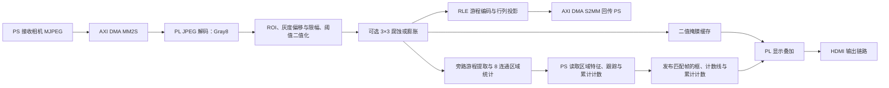

# PL 图像处理电路设计介绍

> 分析节点：`5438e0e1f737fc426224f285a4c8b2454d225efc`
>
> 平台：PYNQ-Z2 / Zynq-7020
>
> 整理日期：2026-11-04
>
> 用途：说明该节点包含的 PL 设计思路、组合逻辑与时序逻辑分工，并提供可用于技术报告的正文。

## 1. 设计定位与版本边界

PL 的核心思路是：将图像中规则、重复的像素处理和区域统计映射为硬件数据通路，采用流式传输、局部缓存及状态机完成处理；PS 根据区域结果进行粘连处理、跨帧跟踪和累计计数。

整套 PL 包含组合逻辑、寄存器、存储器和状态机，因此报告的大标题建议采用“PL 图像处理电路设计”，再分别介绍“组合逻辑设计”和“时序控制设计”。JPEG 解码、形态学、游程编码及连通区域提取均不能整体归类为纯组合逻辑电路。

目标提交本身合入的是软件粘连漏计修复。本文介绍该节点所包含的 PL 设计体系，不表示这些硬件模块全部由该次提交新增。

仓库同时保留两类运行路径：

- **PS 解码 + PL-RLE 路径**：PS 将相机 MJPEG 解码为 Gray8，PL 进行预处理、RLE 编码及相应的特征提取和显示。
- **联合 JPEG 硬解路径**：PS 接收压缩 MJPEG 后通过 DMA 送入 PL，PL 先解码为 Gray8，再进入图像处理数据通路。该节点的 `scripts/rle/run_counter.py` 相机／硬件入口默认分发到联合 JPEG runner；显式使用 `--software-decode` 时选择 PS 解码路径。这项默认行为不代表所有桌面或 standalone 入口均已切换。

两类路径及其不同构建快照的证据应分别说明，不能将旧 G2 位流描述成已包含 JPEG 解码器。入口依据见 [RLE 使用说明](../scripts/rle/README.md) 和 [运行入口](../scripts/rle/run_counter.py)。

## 2. 总体架构与设计理由

以下为联合 JPEG 方案的功能关系图，箭头表示数据或结果的流向，不表示各模块均处于同一时钟域。

设计采用以下思路：

1. **按流处理图像。** 像素按扫描顺序进入处理模块，逐步完成判断、编码和统计，减少处理阶段之间的整帧数据搬运。显示侧仍保留必要的帧缓存，不能据此宣称系统完全不使用整帧存储。
2. **只保存当前运算需要的信息。** 邻域处理保存图像行和窗口，区域分析保存相邻行游程、标签关系和统计结果，显示模块保存二值掩膜。
3. **按任务特点划分 PS/PL。** PL 执行重复运算；PS 执行粘连处理、目标身份维护、跨帧关联和计数策略。最终累计计数值由 PS 决策，PL 负责相应显示。
4. **用握手协调模块速度。** AXI4-Stream 通过有效与就绪信号决定数据是否被接收；旁路特征 tap 不向像素主通路反压，内部容量不足时报告溢出或丢弃状态。
5. **采用有界资源。** 游程数、标签数、每行游程数和结果记录数均有容量限制。超限应作为异常状态处理，不能把截断结果当作完整统计结果。

联合接线依据见 [joint_connect.tcl](../fpga/experimental/jpeg_integration/joint_connect.tcl)，原 G2 集成依据见 [create_g2_integration.tcl](../scripts/standalone/create_g2_integration.tcl)。

## 3. 组合逻辑与时序逻辑分工

| 功能 | 主要组合逻辑 | 配合使用的时序部分 |
|---|---|---|
| ROI 判断 | 坐标比较器、与逻辑 | 行列计数器、ROI 参数寄存器 |
| 灰度偏移与限幅 | 有符号加法器、范围比较器、多路选择器 | 参数与数据寄存器 |
| 阈值二值化 | 大小比较器、输出选择器 | 流接口控制 |
| 3×3 腐蚀／膨胀 | 九位归约与／归约或 | 行缓存、窗口移位寄存器、行阶段控制 |
| RLE 编码与投影 | 前景判断、游程结束判断、字段拼接、增量加法 | 游程起点寄存器、计数器、投影存储、状态机 |
| 连通区域统计 | 区间重叠比较、加法、乘法、最小／最大值选择 | 标签表、统计存储、查根与合并状态机 |
| 显示叠加 | 线框坐标比较、字形译码、像素选择 | 掩膜双缓冲、跨时钟握手、视频流水寄存器 |

以上是 RTL 功能层面的划分。加法、乘法和选择逻辑的最终资源映射应以对应快照的综合报告为准，不能仅凭表达式断言它们全部使用 LUT 或全部使用 DSP。

## 4. 主要电路设计

### 4.1 JPEG 解码与灰度输出

联合方案在 DMA MM2S 与图像流水线之间插入 `jpeg_axis_gray_0`。该模块由 HLS 实现，完成受支持 JPEG 格式的解析、熵解码、逆变换及像素重排，并输出 Gray8 数据。

这部分包含数据流任务、FIFO、缓存和控制逻辑，应作为独立硬件解码模块介绍。当前候选支持有约束的 640×400 JPEG 子集，不能写成支持任意 JPEG 格式；例如 runner 会在访问硬件前检查输入头，不支持的格式应拒绝。

源码依据见 [jpeg_axis_gray.cpp](../fpga/experimental/jpeg_axis/jpeg_axis_gray.cpp) 和 [JPEG runner](../scripts/experiments/run_jpeg_counter.py)。

### 4.2 ROI、灰度偏移与阈值二值化

对输入灰度像素 \(G(x,y)\)，首先进行可配置灰度偏移：

\[
G'(x,y)=\operatorname{clip}\bigl(G(x,y)+\Delta,\ 0,\ 255\bigr)
\]

其中，\(\Delta\) 为有符号灰度偏移量，`clip` 表示饱和限幅。通过加法器、上下限比较器和选择器完成运算，防止负值或大于 255 的结果发生回绕。

ROI 判断为：

\[
R(x,y)=(x_0\le x<x_1)\land(y_0\le y<y_1)
\]

阈值二值化为：

\[
B(x,y)=
\begin{cases}
255,&R(x,y)\land G'(x,y)\ge T\\
0,&\text{其他情况}
\end{cases}
\]

对应电路为“灰度加法 → 限幅比较与选择 → 阈值比较 → ROI 门控”。输入位于 ROI 外时输出背景 0。这里主要是 ROI 掩蔽，输出流仍保持原有图像尺寸及扫描结构。

当前像素坐标由时序计数器保存，并在有效像素被接收时更新；比较器利用当前坐标和参数产生组合结果。源码依据见 [axis_dma_rle_pipeline_bd.v](../fpga/experimental/rle/axis_dma_rle_pipeline_bd.v)。

### 4.3 3×3 形态学处理

设窗口中的九个二值像素为 \(p_0,\ldots,p_8\)，则腐蚀和膨胀分别表示为：

\[
E=\bigwedge_{i=0}^{8}p_i,\qquad D=\bigvee_{i=0}^{8}p_i
\]

腐蚀通过九位归约与逻辑实现，膨胀通过九位归约或逻辑实现，再将一位结果扩展为 Binary8 的 `0x00` 或 `0xFF`。腐蚀可去除孤立前景点，膨胀可扩展前景或填补小间隙，其对粘连目标的影响需要结合场景判断。

九像素运算是组合逻辑，窗口形成依赖行缓存和寄存器。当前实现使用三组轮换行缓存，分阶段接收和输出图像行，边界使用零填充。因此不能将整个模块描述为无缓存的纯组合电路，也不能直接声称它持续每时钟接收并输出一个像素。

顶层支持旁路、腐蚀、膨胀三种选择；报告应按实际配置描述，不能写成已串联实现开运算或闭运算。源码依据见 [axis_morphology3x3.v](../fpga/rtl/axis_morphology3x3.v)。

### 4.4 游程编码与行列投影

同一行连续的前景像素被表示为一条游程：

\[
r=(y,x_s,x_e)
\]

电路根据当前像素是否为前景、此前是否处于游程中以及是否到达行尾，判断游程开始与结束。组合逻辑生成结束条件和输出记录字段，时序逻辑保存游程起点、行列坐标及累计值。

编码器同时累计每行、每列的前景像素数。输出包包括帧身份、参数、游程、投影及状态等信息，便于 PS 检查结果完整性。RLE 对连续前景可减少数据表达量，但数据量随场景变化，不能写成固定压缩比或所有场景均压缩。

源码依据见 [axis_rle_encoder.v](../fpga/experimental/rle/axis_rle_encoder.v)。

### 4.5 8 连通区域特征提取

区域分支从被主通路接收的二值像素中提取游程，通过 FIFO 送入区域核心。当前行游程与上一行游程比较，判断是否属于同一连通区域。

对于两个区间 \([a_s,a_e]\)、\([b_s,b_e]\)，8 连通的区间判断为：

\[
(a_e+1\ge b_s)\land(b_e+1\ge a_s)
\]

在相邻行条件下，端点扩展一像素使斜向接触的前景也可连通。行间关系由状态机管理，不能将这一表达式单独用于任意两行。

每条游程可直接计算面积及一阶矩：

\[
A_r=x_e-x_s+1
\]

\[
S_{x,r}=\frac{(x_s+x_e)A_r}{2},\qquad S_{y,r}=yA_r
\]

区域合并时累加面积、一阶矩，并利用最小值和最大值选择更新包围框。比较与算术表达式构成组合运算，标签分配、查根、等价合并及结果保存由状态机和存储器完成。

PL 输出区域面积 \(A\)、一阶矩 \(S_x,S_y\) 和包围框；PS 使用 \(\bar{x}=S_x/A\)、\(\bar{y}=S_y/A\) 计算质心，再执行跨帧判断。因此当前帧的连通区域数不能直接当作累计物料数。

仓库中原 G2 与 JPEG 联合候选存在不同 region 实现：原 G2 使用 [rle/rle_region_features.v](../fpga/experimental/rle/rle_region_features.v)，联合候选准备流程可选用 [jpeg_integration/rle_region_features.v](../fpga/experimental/jpeg_integration/rle_region_features.v) 的同步 BRAM 统计版本。介绍具体存储结构和资源时应绑定所用源码快照。旁路结构见 [rle_feature_tap.v](../fpga/experimental/rle/rle_feature_tap.v)。

### 4.6 显示叠加与帧同步

显示电路将当前扫描坐标与目标框边界、计数线及数字笔画位置比较，产生叠加使能，再选择输出背景、二值掩膜或叠加像素。

JPEG 联合候选的 overlay 包含累计计数字形绘制：PS 发布累计计数值，PL 完成数值转换和字形输出。数值转换本身包含多周期处理，字形译码与坐标判断形成组合逻辑。

掩膜和配置通过缓冲、跨时钟握手及帧边界更新机制协调，框与掩膜使用帧身份约束。最终 HDMI 由既有视频链路输出，不能将整个显示系统描述为只有自定义 overlay 模块。

原 G2 与联合候选的显示 RTL 应分别引用。联合候选依据见 [overlay RTL](../fpga/experimental/jpeg_integration/overrides/video_binary_overlay.v)，PS 区域读取、质心计算和发布关系见 [jpeg_runtime.py](../scripts/rle/jpeg_runtime.py)。

## 5. 可直接用于技术报告的正文

### 5.1 PL 图像处理电路设计

本系统基于 PYNQ-Z2 开发板，采用 PS 与 PL 协同的图像处理架构。在 JPEG 联合方案中，PL 侧承担 JPEG 解码、图像预处理、游程编码、连通区域特征提取及显示叠加等任务；PS 侧负责相机数据接收、处理参数配置、粘连目标处理、跨帧跟踪和累计计数。通过按任务特点划分处理职责，将规则、重复的图像运算映射为硬件数据通路。

PL 图像预处理电路以流式灰度像素为输入，利用坐标比较器完成感兴趣区域判断，利用有符号加法器和限幅选择电路完成灰度偏移，再通过阈值比较器生成二值图像。对于可选的 3×3 形态学处理，电路使用轮换行缓存和窗口寄存器形成邻域，并通过九位归约与、归约或逻辑分别实现腐蚀和膨胀。

二值图像进入游程编码和区域特征提取模块。游程编码模块记录每行连续前景像素的起止坐标，同时统计行列投影；区域特征模块根据相邻行游程的区间关系进行 8 连通判断，通过标签等价合并获得区域面积、包围框及一阶矩。比较、算术及数据选择由组合逻辑实现，游程状态、标签关系和统计结果由寄存器、存储器及状态机维护。

主数据通路通过 AXI4-Stream 有效与就绪握手协调传输，通过 AXI4-Lite 接口接受 PS 参数配置和状态读取；区域旁路采用有界缓存及溢出报告机制。显示侧缓存二值掩膜，并将 PS 发布的目标框、计数线和累计计数叠加到视频输出中。整体采用组合运算与时序控制相结合的方式，实现图像处理、区域分析和结果显示的协同运行。

### 5.2 组合逻辑电路设计

本系统 PL 侧的组合逻辑主要包括坐标范围判断、灰度饱和运算、阈值比较、二值邻域归约运算、游程连通判断及显示像素选择。ROI 电路利用坐标比较器和逻辑与运算生成区域使能；灰度处理电路利用加法器、限幅比较器及多路选择器生成校正灰度；二值化电路通过阈值比较器输出前景或背景。3×3 邻域中的二值像素经归约与、归约或逻辑分别得到腐蚀和膨胀结果。

在区域分析中，组合逻辑完成相邻行游程区间比较、面积与一阶矩计算，以及包围框最小值和最大值选择；在显示处理中，组合逻辑根据扫描坐标判断线框和数字笔画位置，并生成输出像素。上述运算嵌入同步时序数据通路，由寄存器、缓存和状态机保存历史信息、协调处理顺序及结果更新。

## 6. 验证结果在报告中的写法

设计说明与实现验收需要分开表述：

- 仓库已有原 G2 offload 候选的构建记录，其位流不包含联合 JPEG 解码器。该记录不能直接作为 JPEG 联合方案的构建证据。
- 独立 JPEG 联合候选已有综合、布局布线和板端链路验证记录；120 帧相机测试为空前景场景，另有五帧合成 JPEG 越线补测。这些证据不代表真实物料准确率验收。
- HDMI 像素监视器的帧身份和扫描检查不等同于外接显示器肉眼验收，也不等同于对所有 mask、框和计数字形像素的核验。
- 文档明确记录：JPEG 结果合入含 SW1 更新的 LJ-01 后，合并源码组合尚未重新进行联合综合／route，也没有对应的新 BIT/HWH。因此旧候选的时序、资源和板测数据不能直接标为目标提交 `5438e0e1` 的验证结果。

可采用以下表述：

> 本文依据提交 `5438e0e1f737fc426224f285a4c8b2454d225efc` 的源码及已有候选验证资料介绍电路设计。独立 JPEG 联合候选已有构建和部分板端链路验证证据；这些结果绑定其原始候选快照。合并节点的整体硬件实现状态应以重新构建的匹配 BIT/HWH 及相应验收记录为准。

证据见 [原 G2 构建说明](../data/results/standalone-20261102-033000-g2-integration/README.md)、[G2 构建清单](../data/results/standalone-20261102-033000-g2-integration/export/build-manifest.json)、[JPEG PL 板测及合并边界](../data/results/jpeg-pl-board-20261102/README.md) 和 [最终 route CDC 复核](../data/results/jpeg-pl-board-20261102/route-cdc-review/README.md)。

本次整理仅涉及文档，没有重新执行仿真、综合、布局布线或板端测试。
