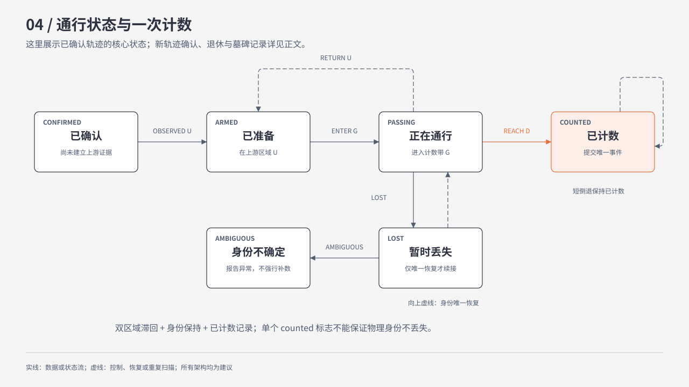
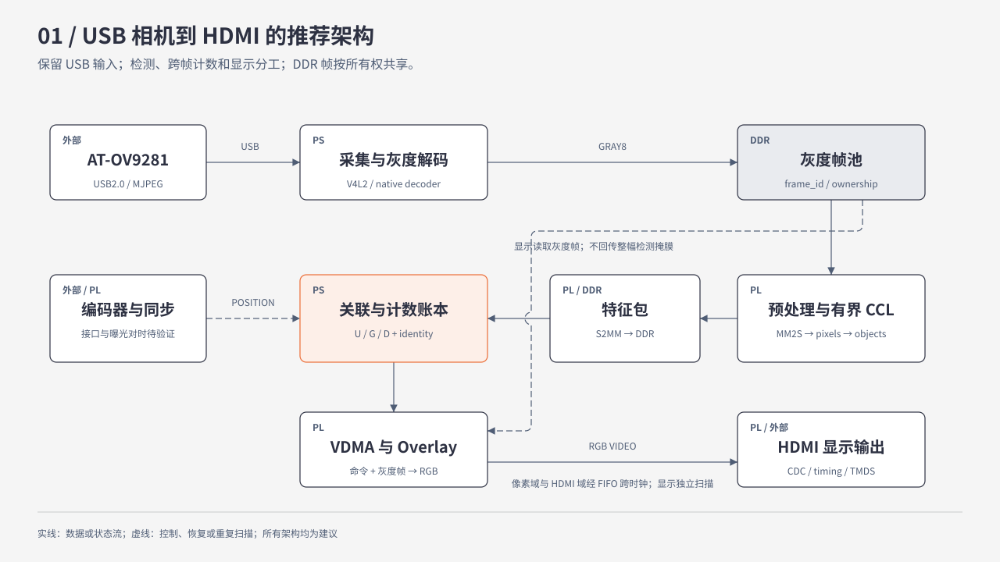
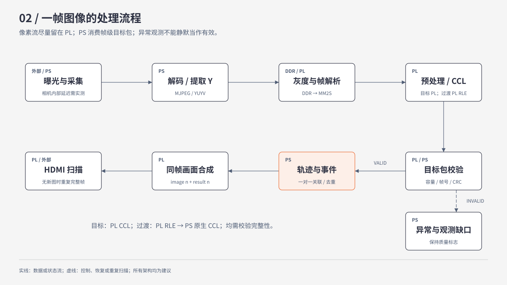
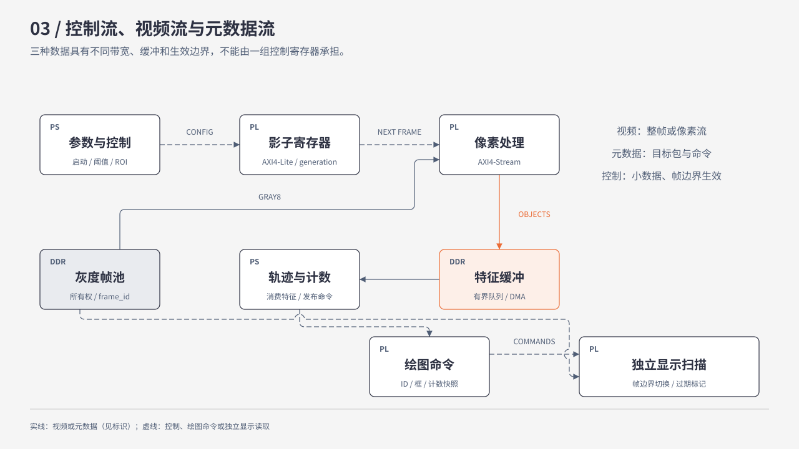
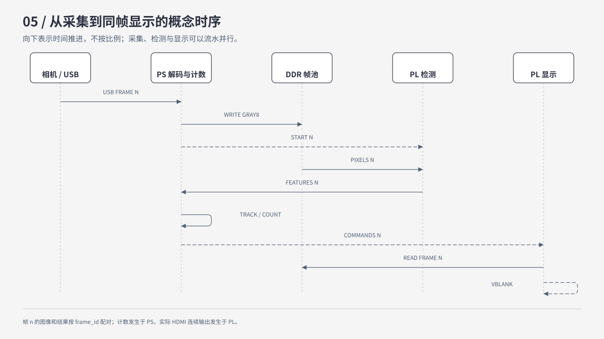

# PYNQ-Z2 螺母视觉计数系统：问题与架构评审

- 整理日期：2026-10-31，北京时间。
- 内容来源：用户粘贴的完整问题、用户补充的相机资料、同轮架构回答，以及后续源码只读核查。
- 文档性质：头脑风暴与工程评审建议。本文没有冻结项目 Route、修改现有接口协议或宣告新方案已实现。
- 证据分类：原厂规格、模组标称、仓库历史实测、设计建议与理论估算分别标注。
- 配套评估：[现有仓库演进与新仓重建对比](现有仓库演进与新仓重建对比_20261031.md)。
- 阅读方式：原始问题完整保留；回答按原要求的十部分整理。原聊天 Mermaid 图重绘为五张可离线查看的 SVG 图片，HTML 图稿及生成脚本保存在同一图片目录。

## 一、用户问题与补充事实

### 1. 原始完整问题

#### PYNQ-Z2 高速螺母视觉计数系统：架构设计与技术方案头脑风暴

##### 一、项目背景

我正在开发一套基于 **PYNQ-Z2（Zynq-7000 XC7Z020）** 的高速螺母智能视觉计数系统。

基本工作流程：

**螺母进入传送带 → 摄像头实时采集 → FPGA/ARM 协同处理 → 识别并计数 → HDMI OUT 实时显示结果。**

当前硬件条件：

- 开发板：PYNQ-Z2，包含 PS（ARM 处理系统）和 PL（FPGA 可编程逻辑）。
- 摄像头：OV9821（请核实型号、输出接口及其关键技术规格，不要直接假设兼容）。
- 传送机构：螺母在传送带上连续移动，速度可能变化。
- 显示设备：通过 PYNQ-Z2 的 HDMI OUT 连接显示器。
- 软件与开发环境：Vivado/Vitis、PYNQ Linux、Python、Verilog/SystemVerilog。
- 最终目标：对连续运动的螺母进行高速、稳定、准确的实时计数，并直观展示整个系统的工作状态。

**核心任务只有计数，不需要识别螺母型号、分类或进行尺寸测量。**

请以资深 FPGA 架构师、机器视觉算法工程师和嵌入式系统工程师的身份，对整个方案开展深入的技术头脑风暴。

不要局限于常规的二值化、连通域检测和越线计数，鼓励提出不同的算法架构及创新方案，但所有推荐都必须评估其在 XC7Z020 上的可实现性。

---

##### 二、任务一：准确计数的算法方案

这是整个项目最重要的部分。

请充分考虑以下实际场景：

1. 单个螺母正常通过。
2. 多个螺母同时进入摄像头视野。
3. 螺母之间距离非常近。
4. 两个甚至多个螺母相互接触。
5. 螺母出现部分重叠。
6. 螺母旋转、倾斜或姿态变化。
7. 螺母在传送带上发生抖动、停顿或短距离倒退。
8. 传送带运行速度变化。
9. 螺母在计数线附近反复移动。
10. 光照不均匀、反光、阴影和运动模糊。
11. 相邻视频帧中目标丢失或错误匹配。
12. 多个螺母同时跨越计数线。

请展开头脑风暴，提出不少于 5 种具有明显差异的计数方案，例如：

- 基于二值化、形态学和连通域分析的计数。
- 基于目标质心跟踪和虚拟计数线的计数。
- 基于轨迹状态机和跨帧目标匹配的计数。
- 基于时间空间图像（Time-Space Image）的计数。
- 基于检测区域状态变化的事件驱动计数。
- 基于传送带编码器、位置预测和视觉信息融合的计数。
- 其他适合 FPGA 的创新算法。

以上仅作为启发，不限制方案探索范围。

对每种方案分析：

- 核心原理。
- 完整计数流程。
- 需要哪些图像特征。
- 是否依赖跨帧处理。
- 适合由 PS 还是 PL 执行。
- 对 BRAM、LUT、FF、DSP、DDR 和 ARM CPU 的需求。
- 对速度变化、粘连、遮挡、抖动的鲁棒性。
- 容易造成重复计数、漏计数的情况。
- 实现复杂度与预期实时性。

请以对比表总结，并选出最适合该硬件平台的主方案和备选方案。

**重点：明确解释如何保证一个物理螺母只被计数一次，而不是每帧识别到一次就加一。**

如果某些场景不能仅凭单目摄像头可靠解决，请明确说明其可观测性限制，并提出机械分离、补光、编码器等必要改进，而不是假设软件算法可以解决所有问题。

---

##### 三、任务二：摄像头到计数结果的完整数据处理链路

请从摄像头曝光开始，一直分析到视频经过处理、由 HDMI OUT 显示器输出为止。

完整说明一帧图像在整个系统中经历了什么。

需要涵盖：

**摄像头曝光 → 图像数据传输 → 视频接口接收 → 像素流解析 → 图像预处理 → 目标提取 → 特征计算 → 跨帧跟踪 → 计数判定 → 视频叠加 → HDMI 视频输出。**

请注意：

1. 核实 OV9821 的真实输出协议和 PYNQ-Z2 的物理接口是否兼容。
2. 如果不能直接连接，分析需要什么桥接硬件，以及对应的时钟与协议转换。
3. 明确哪些阶段处理连续 AXI4-Stream 像素流，哪些阶段处理帧缓存，哪些阶段只传递目标元数据。
4. 明确 AXI4-Lite、AXI4-Stream、AXI DMA、VDMA、AXI HP 等接口在不同阶段的实际作用。
5. 明确哪些操作需要访问 DDR，哪些可以在 PL 内部使用 BRAM、行缓存和流水线直接完成。
6. 分析各阶段的数据吞吐量、处理延迟和潜在瓶颈。
7. 说明视频输出如何保证连续性，以及计数结果如何同步到显示画面。

请至少提供：

- 一张端到端系统架构图。
- 一张视频数据处理流程图。
- 一张控制流、视频流和目标元数据流的关系图。

要求图区分 PS、PL、DDR、摄像头、HDMI 和外部硬件。

不能只给模块名称，必须解释每个模块的输入、输出、处理内容以及前后依赖关系。

---

##### 四、任务三：PS 与 PL 的最佳分工

请围绕 Zynq-7000 的硬件特性设计 PS/PL 协同架构。

重点回答：

###### 1. PL 应该完成哪些工作？

例如：

- 摄像头数据接收。
- 像素格式转换。
- 灰度化和图像裁剪。
- 空间滤波、二值化、形态学。
- 连通域或候选目标提取。
- 几何特征计算。
- 高吞吐量数据流处理。
- HDMI 视频流生成及图像叠加。

分析哪些算法适合纯流水线、哪些需要随机访问、哪些需要跨帧存储。

###### 2. PS 应该完成哪些工作？

例如：

- 算法参数管理。
- 目标跨帧匹配。
- 轨迹状态管理。
- 计数状态机。
- 异常检测。
- UI 数据更新。
- 系统运行监控。
- 外设管理。

分析哪些操作适合 Python，哪些建议使用 C/C++。

###### 3. PS 与 PL 如何交换数据？

设计具体的通信和同步机制，至少考虑：

- AXI4-Lite 控制寄存器。
- AXI DMA 或其他适用的数据传输机制。
- AXI HP 高带宽访问 DDR。
- 中断与轮询。
- 双缓冲、环形缓冲或 FIFO。
- 帧号、时间戳与数据一致性。

尤其回答：

**能否让 PL 只把螺母的坐标、面积、边界框等特征传给 PS，而不是将整帧图像送入 PS？**

如果可行，请设计目标特征数据格式、缓冲策略和完整调用链路。

推荐架构必须说明为何比其他 PS/PL 分配方式更合适。

---

##### 五、任务四：HDMI OUT 实时显示系统

我希望通过 PYNQ-Z2 的 HDMI OUT 接口连接显示器，让它成为整个视觉计数系统的实时监控终端。

请设计适合实际演示和调试的显示方案。

###### 1. 视频画面应该显示什么？

至少考虑：

- 摄像头实时原始画面。
- 目标检测框或轮廓。
- 每个螺母的唯一跟踪 ID。
- 目标质心与运动方向。
- 虚拟计数线及有效计数区域。
- 螺母越线后的计数反馈。
- 当前累计计数值。
- 当前检测到的目标数量。
- 当前有效跟踪目标数量。
- 实时输入 FPS 与输出 FPS。
- 计数吞吐量（个/秒）。
- 系统处理延迟。
- 丢帧数与异常状态。

请评估哪些适合常驻显示，哪些适合调试模式，以避免画面过于杂乱。

###### 2. 如何在 HDMI 视频画面上叠加 UI？

研究并比较：

- PL 实时像素流 Overlay。
- PS 生成 UI 图层后，由 PL 合成。
- PS 软件绘图后写入帧缓冲。
- 使用 PYNQ 现有 HDMI/视频处理模块进行扩展。

对比这些方案的：

- 实时性。
- 资源占用。
- 内存带宽。
- 开发复杂度。
- UI 灵活性。
- 对视频帧率的影响。

推荐一个适合长期维护且具备实时性的方案。

###### 3. 设计显示界面

请规划至少三种显示模式：

**模式 A：演示模式**

突出实时画面与总计数，界面简洁。

**模式 B：算法调试模式**

显示检测框、轨迹、计数线、目标 ID、算法运行状态与异常标记。

**模式 C：系统性能模式**

显示 PS、PL、DDR、视频链路以及资源占用情况。

请给出每种模式的具体信息布局，并说明哪些数据可以逐帧更新，哪些数据适合低频更新。

---

##### 六、任务五：板端硬件资源使用情况监测

我希望通过 HDMI 显示器实时查看 PYNQ-Z2 的系统资源使用情况，以便判断系统是否达到硬件极限。

但请严格区分：

- FPGA 综合/实现阶段的静态资源占用。
- FPGA 运行期间可以实时测量的性能指标。
- PS Linux 能直接读取的运行指标。
- 需要额外设计硬件性能计数器才能测量的指标。

请分别设计以下监测功能：

###### 1. PL 资源

- LUT 使用量及占比。
- FF 使用量及占比。
- BRAM 使用量及占比。
- DSP 使用量及占比。
- 时钟频率。
- 时序裕量。

请说明哪些只能从 Vivado 报告得到，不能像 CPU 占用率一样实时变化。

###### 2. PS 资源

- ARM CPU 总体与每核心利用率。
- 内存使用量。
- 进程 CPU 与内存占用。
- Linux 系统负载。
- CPU 温度（若硬件及系统支持）。
- PS 工作频率。

请说明数据来源、读取方式、权限要求及采样开销。

###### 3. DDR 与 AXI 总线

- DDR 带宽使用情况。
- PS/PL 数据交换速率。
- AXI HP 接口吞吐量。
- DMA/VDMA 数据传输速率。
- FIFO 占用率。
- 缓冲区溢出或欠载次数。

请设计可落地的监测方案，明确哪些需要额外计数器、AXI Performance Monitor 或其他硬件 IP。

###### 4. 视频处理链路

- 摄像头实际帧率。
- 输入与输出分辨率。
- 各流水线处理阶段的周期数或延迟。
- 图像处理模块吞吐量。
- 实时丢帧数。
- PS 特征处理耗时。
- 整体端到端延迟。

请设计低开销统计机制，避免监控系统本身明显影响计数性能。

---

##### 七、任务六：资源、带宽、延迟与性能可行性

以 XC7Z020 的实际资源规格为基础，分析以下目标：

- 640×400 @ 30 FPS。
- 1280×720 @ 60 FPS。
- 如摄像头支持，进一步探索更高帧率的可行性。

请计算和分析：

1. 每帧数据量。
2. 原始视频流带宽。
3. 灰度与彩色视频的吞吐量区别。
4. 不同像素时钟下的流水线处理能力。
5. DDR 带宽压力。
6. PS/PL 数据交换开销。
7. 计数算法可能达到的理论处理上限。
8. HDMI 输出可能产生的额外开销。
9. 资源预算和潜在时序瓶颈。

计算必须列出假设、公式、单位，并区分理论结果与硬件实测数据。

请不要凭空声称系统能够达到某个 FPS 或计数准确率。

---

##### 八、任务七：最终推荐架构

在充分比较所有方案后，给出你认为最合理的一套系统架构。

必须回答：

1. 最终推荐使用哪种螺母计数算法？为什么？
2. PL 需要设计哪些核心 IP 模块？
3. PS 需要运行哪些程序或服务？
4. 摄像头数据如何进入 FPGA？
5. 目标特征如何从 PL 传到 PS？
6. PS 如何完成跟踪、去重和计数？
7. PS 的计数结果如何返回 PL？
8. HDMI 如何叠加检测信息和系统 UI？
9. 硬件性能监控如何采集和显示？
10. 当出现带宽不足、目标粘连、丢帧等情况时，系统如何诊断和降级？

最终提供：

- **推荐架构总图**：明确数据通路、控制通路和跨时钟域接口。
- **完整帧处理时序**：从曝光、采集、检测到显示的时序关系。
- **PS/PL 模块分工表**：每个模块的功能、输入输出、资源需求。
- **资源预算表**：预计资源占用、带宽、关键时钟和不确定性。
- **风险清单**：硬件兼容、算法可靠性、系统稳定性及性能风险。
- **分阶段实现路线**：优先验证最关键的技术风险，再逐步完善功能。
- **测试验收方法**：包括计数准确率、漏计/重计、帧率、延迟、资源占用等。

---

##### 九、分析原则与约束

1. **先核实硬件事实，再设计系统。** 不得虚构 OV9821 或 PYNQ-Z2 的接口、功能、资源与带宽。
2. **先头脑风暴，再收敛架构。** 不要一开始就锁定某一种算法。
3. **区分已验证、理论可行和待实测。** 不得将估算当作实测。
4. **优先发挥 FPGA 并行流水线优势。** 避免不必要的整帧 PS 处理和 DDR 往返。
5. **计数准确性优先于花哨功能。** HDMI UI 和性能监测不能反过来损害计数稳定性。
6. **明确复杂场景的能力边界。** 对遮挡、粘连、目标不可分辨等问题，不允许作出无依据的准确率承诺。
7. **避免过度设计。** 所有模块必须有明确价值，优先选择可在 PYNQ-Z2 上落地的方案。
8. **充分利用开源生态。** 可以参考成熟的 PYNQ、AMD/Xilinx 视频处理和 FPGA 图像处理架构，但要确认版本与硬件适配性。
9. **分析优先，暂不编写工程代码。** 本轮重点是算法探索、总体架构、模块分工、性能论证和技术决策。
10. **不要直接给出泛泛而谈的方案。** 对关键选择必须解释技术依据、权衡和实施条件。

##### 十、期望输出顺序

请严格按照以下顺序回答：

1. **硬件事实核查与关键限制**
2. **螺母计数算法头脑风暴及对比**
3. **最佳算法选择及完整计数逻辑**
4. **摄像头至 HDMI 的端到端数据流**
5. **PS/PL 详细分工与通信架构**
6. **HDMI 实时可视化界面设计**
7. **板端资源监控方案**
8. **带宽、延迟与 FPGA 资源预算**
9. **最终推荐架构及理由**
10. **分阶段开发路线与验收指标**

请以工程设计评审报告的深度回答，充分展开技术细节，使用流程图、架构图、对比表和必要的计算。

最终目标不是得到一个看起来先进的系统，而是得到一套**可以实际部署在 PYNQ-Z2 上、计数准确、处理实时、可观察、可调试、可验证的完整技术架构**。

### 2. 用户补充

用户随后明确：摄像头参数见 [AT-OV9281 摄像头参数](AT-OV9281_摄像头参数_20261027_152201.md)，通过 **USB** 与开发板连接。因此原问题中的“OV9821”按用户补充修正为 **AT-OV9281 模组，内部传感器 OV9281**；不能把未核实的 OV9821 规格套入方案。

用户另要求：探索代码、委派 Worker，但头脑风暴不受现有代码方案约束；将问题与答案保存到 `文档/`，包括图片；委派 Worker 评估在现有基础上实施与另建仓库哪个更容易。

## 二、回答整理

### 1. 硬件事实核查与关键限制

#### 1.1 相机：传感器和整机模组分开看

| 项目             | 已知信息                                        | 证据等级与边界                             |
| ---------------- | ----------------------------------------------- | ------------------------------------------ |
| 实际模组         | AT-OV9281，USB2.0 High Speed                    | 用户确认；本地参数图片转录                 |
| 内部传感器       | OV9281，黑白全局快门                            | 用户资料与 OMNIVISION 原厂资料一致         |
| 传感器原生输出   | RAW8/RAW10，双通道 MIPI 或 DVP                  | 原厂规格；不是 USB 协议                    |
| 模组输出         | MJPEG、YUYV                                     | 产品图片转录；应以实际 V4L2 枚举为准       |
| 高速标称         | MJPEG 1280×720@120、640×400@220、640×360@220 | 模组标称，不等于板端持续交付或处理能力     |
| 原厂全分辨率能力 | 1280×800@120                                   | 传感器规格，不能直接外推 USB 模组能力      |
| 控制与触发       | 标称曝光、增益等可调                            | UVC 控件、硬触发和闪光同步是否导出仍待核实 |

原厂资料见 [OV9281 产品页](https://www.ovt.com/products/ov9281/)及[产品简报](https://www.ovt.com/wp-content/uploads/2024/05/OV9281-PB-v1.4-WEB.pdf)。模组资料见[本地转录文档](AT-OV9281_摄像头参数_20261027_152201.md)。转录中的重复 image area、AEB 拼写及电流/功率单位等歧义没有被当作可靠设计参数。

现有硬件输入链为：**OV9281 → 模组内部处理/USB 桥接 → PS USB 控制器 → Linux UVC/V4L2 → MJPEG 解码或亮度提取**。USB 相机不能直接向 PL 输出 AXI4-Stream。全局快门改善行间运动畸变，短曝光才限制曝光期间的拖影。

#### 1.2 PYNQ-Z2 的资源与接口

| 项目     | 硬件事实                                              | 设计影响                                         |
| -------- | ----------------------------------------------------- | ------------------------------------------------ |
| PL       | XC7Z020：53,200 LUT、106,400 FF、220 DSP、140 RAMB36  | 适合流式传统视觉；复杂网络及全帧随机访问需谨慎   |
| BRAM     | 140×36 Kib，总位容量约 630 KiB，实际组织影响有效容量 | 720p Gray8 的 921,600 B 超过全部 BRAM 总容量     |
| PS       | 双核 Cortex-A9                                        | 元数据关联合适；MJPEG 解码和整帧绘图可能成为瓶颈 |
| DDR      | 512 MB，16 位，板级最高 1050 MT/s                     | CPU、USB、DMA、显示共享                          |
| HP       | 四个最高 64 位 AXI HP 接口                            | 多端口不等于四份独立 DDR 带宽                    |
| HDMI     | 连接 PL 引脚，需 PL 前端与时序逻辑                    | 推荐以官方支持的 720p 范围作为基线               |
| 扩展排针 | Raspberry Pi 扩展排针不是 CSI 摄像头插座              | MIPI 摄像头不能直接插接                          |

来源：[AMD DS190](https://docs.amd.com/v/u/en-US/ds190-Zynq-7000-Overview)、[TUL PYNQ-Z2 手册](https://dpoauwgwqsy2x.cloudfront.net/Download/PYNQ_Z2_User_Manual_v1.1.pdf)、[UG585 HP 接口](https://docs.amd.com/r/en-US/ug585-zynq-7000-SoC-TRM/PL-DMA-via-AXI-High-Performance-HP-Interface)。PYNQ 官方说明 Z1/Z2 的差分引脚速度等级限制了正式支持范围，不能把部分设备可工作的 1080p 当保证：[视频子系统说明](https://github.com/Xilinx/PYNQ/blob/master/docs/source/pynq_libraries/video.rst)。

#### 1.3 输入路线选择

| 路线                | 必要转换                               | 评价                                      |
| ------------------- | -------------------------------------- | ----------------------------------------- |
| 保留现有 USB        | PS 采集/解码，DDR→DMA→PL             | 首选部署路线，风险集中在解码、复制与排队  |
| 更换 DVP 模组       | 专用转接、电平匹配、PCLK/同步接收、CDC | 可直接流入 PL；需重新验证引脚、电气与时序 |
| 更换 MIPI/HDMI 输入 | 合适的主动接收/桥接硬件及驱动          | 性能升级候选；普通转接线不能转换协议      |

尚需核实：格式/FPS 枚举、持续有效帧率、自动曝光能否关闭、最短曝光、触发信号、时间戳对应阶段。本文不预设这些问题已解决。

### 2. 螺母计数算法头脑风暴及对比

计数分三层：单帧可分辨数量、跨时刻物理身份、可提交的通行事件。完整系统需要组合这些能力。

| 方案               | 原理与流程                                      | 特征/跨帧                       | 适用与失败边界                                   |
| ------------------ | ----------------------------------------------- | ------------------------------- | ------------------------------------------------ |
| A 连通域区域占用   | 分割→形态学→区域由空到有/由有到空→事件       | 面积、占用；保留区域状态        | 单件依次通过容易；接触、并排、连续占用会合并事件 |
| B 质心单线越线     | 检测→质心→最近邻→跨线→轨迹锁存              | 质心、框、面积；跨帧            | 简单；密集、丢帧、质心跳变可能换 ID              |
| C 全局关联与状态机 | 预测→门控→一对一关联→轨迹确认→双区域通行    | 框、质心、面积、运动历史；跨帧  | 适合停顿、变速与短丢失；身份不可观测时仍有边界   |
| D 窄条带时空图     | 条带采样→横向位置×时间/位移图→时空事件→计数 | 灰度/二值条带；跨帧小缓存       | FPGA 友好；同位置相接目标会融合                  |
| E 分道双门事件     | 机械分道→各道 A/B 占用序列→方向/去抖→计数    | 每道占用及门间时间；事件状态    | 极低开销；依赖每道不能并排且有间隙               |
| F 编码器空间融合   | 检测→对时带位移→带面坐标→身份关联→过门      | 图像位置、带位移；跨帧          | 变速/停止/倒退自然；滑移与对时误差限制效果       |
| G 中心孔与局部分离 | 外轮廓/孔洞→种子→局部距离变换或分水岭→验证   | 内孔、凹点、距离峰值、局部 mask | 平放且孔可见时有价值；堵孔、倾斜、遮挡时失效     |
| H 面积通量         | 检测带前景面积→速度积分→按单件面积换算        | 面积、速度、标定；跨帧          | 适合作独立校验；不能稳定逐件去重                 |
| I 小型学习检测器   | 量化网络→中心/框/实例→关联→事件              | 学习特征；跨帧                  | 可改善外观适应；训练、DSP、DDR 与部署成本最高    |

以下仅为资源倾向，不是综合结果。

| 方案 | LUT/FF     | BRAM             | DSP      | DDR               | ARM 与实时性             |
| ---- | ---------- | ---------------- | -------- | ----------------- | ------------------------ |
| A    | 低～中     | 行缓存/标签      | 低       | 特征化后低        | 低，容易实时但场景受限   |
| B    | 前端中     | 行缓存/目标表    | 低       | 元数据小          | 低～中，稀疏场景合适     |
| C    | 前端中     | 行缓存/目标表    | 低       | 短历史与元数据    | 中，需要限制关联规模     |
| D    | 低～中     | 条带/时空缓存    | 低       | 可很低            | 低～中，适合 FPGA        |
| E    | 很低       | 极少             | 通常无   | 极低              | 很低，机械条件满足时稳健 |
| F    | 增量低     | 位移历史 FIFO    | 少量或无 | 很低              | 增量低，需同步验证       |
| G    | 全 PL 较高 | 局部 mask/工作区 | 低～中   | PS 局部处理时增加 | 中～高，限制候选数量     |
| H    | 低         | 统计缓存         | 低       | 很低              | 低，作为监测而非主计数   |
| I    | 高         | 权重/特征图压力  | 高       | 中～高            | 必须以具体网络证明可行性 |

| 工况           | 更有效的方法                 | 条件                         |
| -------------- | ---------------------------- | ---------------------------- |
| 多目标同时越线 | C 的逐轨迹提交、E 的分道事件 | 目标可分辨                   |
| 停顿/倒退/变速 | C 状态机＋F 位移融合         | 身份保留、时间基准正确       |
| 接触且孔可见   | G 辅助分离＋历史轨迹         | 孔仅作辅助证据               |
| 暂时合并再分开 | 合并组成员保持与恢复         | 合并前已观察成员，无未知进出 |
| 部分重叠       | 多帧、局部分离、改善视角     | 数量信息未彻底消失           |
| 完全叠放/遮挡  | 机械分离、其他视角或传感器   | 单目无法恢复不存在的观测信息 |
| 反光/阴影/模糊 | 光学、背景、短曝光           | 输入需保留稳定轮廓           |

推荐主方案为 **C＋F**，前端采用有界流式提取，G 只处理少量复杂候选。D 是算法备选；若机械允许，E 可能更容易达到高可靠性。H 可交叉检查，I 暂不作为首条开发路线。

### 3. 最佳算法选择及完整计数逻辑

#### 3.1 先定义业务计数

建议默认：在一个批次内，完成规定正向通行的物理螺母累计一次；计数区附近抖动和短倒退后再前进不再累计。它不同于正向越线次数，也不同于正向减反向的净通量。

`counted` 只保证同一轨迹不重复，物理去重还要求身份连续、合并/拆分可恢复、已计数目标短倒退不重建新身份。若无特征物料完全离开观测范围后再次进入，单目无法保证识别为旧物；需机械单向约束、受控回流或外部身份信息。

#### 3.2 U/G/D 状态机

处理顺序：标定→检测→运动预测→物理门控→一对一匹配→轨迹确认→上游 U 建立准备状态→通过 G→到达下游 D→提交唯一事件→保留已计数身份。

计数条件为：

\[
confirmed\land observed(U)\land completed(U\to G\to D)\land\neg counted\land valid
\]

- U/D 使用由定位噪声和速度确定的空间滞回；不使用全局固定时间冷却压制相邻真实目标。
- 新轨迹需多次可信观测；同一帧多件分别提交，不按“这帧加一”。
- 丢失只在唯一恢复时续接；歧义转异常，不强行补数。
- 合并前的多条轨迹保留成员，分离后恢复；未知新大块不能按面积直接认定件数。
- 已计数轨迹退休后按最大允许回退范围保留墓碑记录。任意远距离回流不在单目身份保证范围内。
- 事件以会话、轨迹/物料身份及事件序号管理；重复帧包不得重复提交。

关联先做运动距离、横向距离、面积变化等门控，再进行一对一分配。代价可采用：

\[
C_{ij}=\alpha d_{pred}+\beta(1-IoU)+\gamma|\log(A_j/A_i)|+\delta d_{lateral}
\]

正常并发先按 32～64 目标优化，按通道或邻域降低问题规模；不能无条件在 Cortex-A9 上对几百目标执行稠密全局匹配。恒速或小型 Kalman 模型可作为起点。

#### 3.3 编码器、光学与可观测性

设带累计位移为 S(t)，沿带方向物料世界坐标为 y(t)，构造 q(t)=y(t)−S(t)。无滑移时 q 近似恒定。USB 时间戳若不对应曝光时刻，误差 Δt 会带来约 vΔt 的位置误差；必须建立对时预算。

若带面允许透射可采用背光；不透明皮带用哑光背景、漫射光及适当偏振。孔洞数量、凹点、面积均是辅助证据。无法观测的完全遮挡应通过机械分离或增加观测解决。

### 4. 摄像头至 HDMI 的端到端数据流

图中预处理、有界 CCL、Overlay 是目标结构。编码器仍待电气与对时验证；不是当前代码现状。

| 阶段          | 输入/处理                     | 输出               | 存储与依赖          |
| ------------- | ----------------------------- | ------------------ | ------------------- |
| 曝光读出      | 曝光、读出                    | 原始像素           | 曝光控制拖影        |
| 模组 USB      | 压缩/格式桥接与 USB 传输      | 视频帧             | 内部缓冲延迟需测    |
| Linux 采集    | USB/UVC/V4L2                  | 数据、序列、时间戳 | DDR；核对时间戳含义 |
| 解码/亮度提取 | MJPEG→Gray8 或 YUYV 取 Y     | 灰度帧             | DDR；无需先转 BGR   |
| MM2S          | DDR 读取                      | 流式输入包         | HP/DMA              |
| 帧解析        | 校验长度、生成坐标与边界      | 像素流             | 小 FIFO             |
| 预处理        | ROI、校正、滤波、分割、形态学 | 二值/辅助亮度      | BRAM 行缓存         |
| 特征提取      | 游程、标签合并、统计          | 目标记录           | 有界标签表          |
| S2MM          | 帧级特征封包                  | 目标包             | 少量 DDR            |
| PS 计数       | 关联、状态转换、事件          | 轨迹/计数/质量     | PS 内存             |
| 合成          | 图像 n＋结果 n                | RGB 流             | 保留帧＋命令 RAM    |
| HDMI          | 视频时序与串行输出            | 屏幕画面           | 独立视频时钟        |

AXI4-Lite 承担配置/状态/快照；AXI4-Stream 承担像素和包；AXI DMA 搬运普通帧包或特征包；VDMA 管理视频行宽、步长和显示帧缓存；HP 是 PL 访问共享 DDR 的入口；GP 提供 PS 控制通路。

特别注意：视频流一般以 TUSER[0] 标帧首、TLAST 标行尾；普通 DMA 包的 TLAST 标包结束。线性帧包需要明确适配成视频流，不能直接混用。[AMD AXI 视频约定](https://www.amd.com/content/dam/xilinx/support/documents/ip_documentation/axi_ref_guide/latest/ug1037-vivado-axi-reference-guide.pdf)、[PYNQ DMA](https://pynq.readthedocs.io/en/latest/pynq_libraries/dma.html)

V4L2 时间戳的时钟和采样阶段由驱动决定，不能默认曝光开始：[Linux V4L2 缓冲说明](https://docs.kernel.org/userspace-api/media/v4l/buffer.html)。

### 5. PS/PL 详细分工与通信架构

| 模块            | 位置               | 输入→输出        | 理由/存储                   |
| --------------- | ------------------ | ----------------- | --------------------------- |
| USB 采集        | PS 驱动/原生线程   | USB→采集缓冲     | 由物理接口决定              |
| MJPEG 解码      | PS C/C++           | 压缩帧→Gray8     | 首版避免另造 PL JPEG 解码器 |
| ROI/校正/滤波   | PL                 | 像素→校正像素    | 规则、局部、行缓存          |
| 分割/小核形态学 | PL                 | 灰度→二值        | 流水线                      |
| 有界游程 CCL    | PL 目标            | 二值→目标特征    | 标签合并存在随机访问冲突    |
| 局部粘连拆分    | PS                 | 局部图块→候选    | 限制数量和尺寸              |
| 关联与状态机    | PS 原生引擎        | 特征→轨迹/事件   | 小数据、多分支、跨帧        |
| 配置/日志/服务  | Python             | 参数/状态         | PYNQ 集成与维护             |
| 高频叠加        | PL 目标            | 命令→框线/字符   | 避免全屏 CPU 绘制           |
| 低频复杂 UI     | PS 小图层＋PL 合成 | 指标→面板        | 限制带宽                    |
| 遥测            | PL＋PS             | 计数器/系统→快照 | 低频读取                    |

完整 PL CCL 需要定义每行游程上限、活动标签上限、目标上限、合并服务率、缓冲深度及超限行为。它不天然等于一像素一拍。若资源或时序难收敛，先保留有界 RLE＋PS 原生 CCL；噪声可能使 RLE 膨胀，不能认为它总是小数据。

#### 5.1 目标特征包建议

以下是新 ABI 的设计建议，不是对当前 RLE 协议的修改或冻结。

| 部分   | 长度 | 内容                                                                                           |
| ------ | ---: | ---------------------------------------------------------------------------------------------- |
| 帧头   | 64 B | magic、版本、标志、64 位帧号、源序列、时间信息、编码器位置、尺寸、数量、配置代号、长度、头校验 |
| 每目标 | 48 B | 标签/标志、四个框坐标、面积、64 位 Σx/Σy、亮度和、质量标志、保留字段                         |
| 包尾   |  4 B | 内容 CRC                                                                                       |

质心在 PS 计算 cx=Σx/A、cy=Σy/A，避免 PL 逐目标除法。协议需固定小端、偏移、对齐和版本，不能直接依赖 C 编译器默认结构体布局。

最多 256 目标时：64＋256×48＋4＝**12,356 B/帧**；60 FPS 为 **0.74136 MB/s**。PL 可以只返回特征，但 USB 路线的 PS 仍需要接收和解码整帧。

局部分离需要额外设计信息入口：按需回传有界局部二值/游程，或由 PS 从保留的同帧灰度 ROI 用同配置重建。若没有这些数据，不能同时承诺“只有框/面积”与“PS 可准确做局部分离”。重建策略需要等价性校验。

#### 5.2 缓冲与一致性

1. Gray8 固定帧池按 FREE/WRITING/PROCESSING/DISPLAYING 管理，允许多消费者引用，不能扫描时覆盖。
2. 特征可用 16 KiB 槽位和有界队列；接收先准备，再启动发送。
3. 验证完整包后发布；溢出不允许把截断结果当完整检测。
4. HP 通路按驱动要求处理 flush/invalidate，不能默认缓存一致。
5. 参数使用影子寄存器，帧边界切换，包内带配置代号。
6. 绘图命令双缓冲，显示帧边界切换。
7. 中断按帧/批次而非逐目标；超时由独立监控处理。

PYNQ 标准 DMA 类支持简单模式；软件槽位环不等于硬件 SG。高频连续描述符需独立适配驱动与 DMA 配置：[PYNQ DMA 文档](https://pynq.readthedocs.io/en/latest/pynq_libraries/dma.html)。

### 6. HDMI 实时可视化界面设计

| 方式                | 实时性          | 资源/带宽                     | 灵活性     | 选择                     |
| ------------------- | --------------- | ----------------------------- | ---------- | ------------------------ |
| PL 流 Overlay       | 高、扫描确定    | LUT/命令 RAM/字库，DDR 增量小 | 规则图形好 | 框、线、质心、方向、数字 |
| PS 局部 UI＋PL 合成 | 高              | 局部图层读写                  | 高         | 面板、中文提示、曲线     |
| PS 全帧绘图         | 受 CPU/DDR 限制 | 完整图读写、颜色转换          | 最高       | 原型或低帧率调试         |
| 扩展 PYNQ 视频      | 可复用成熟前端  | 取决于裁剪与配置              | 中～高     | 复用驱动/前端，固定版本  |

推荐高频几何信息放 PL、低频局部 UI 由 PS 生成。不要让数百目标在每个像素形成无限并行比较器；限制可显示目标数，按行组织命令。现有 PYNQ 模块可复用：[视频库](https://pynq.readthedocs.io/en/latest/pynq_libraries/video.html)。

| 模式   | 布局与常驻信息                                                          | 更新频率                               |
| ------ | ----------------------------------------------------------------------- | -------------------------------------- |
| A 演示 | 左侧约 75% 视频、右侧大计数；运行状态、吞吐、简洁计数带，成功时短暂闪色 | 视频按扫描，目标按结果帧，指标 2～5 Hz |
| B 调试 | 主画面＋二值/局部候选；ID、框、轨迹、U/G/D、合并组、丢失和歧义          | 目标逐结果帧，文字日志低频             |
| C 性能 | 缩小视频＋分区指标；FPS、CPU、内存、阶段耗时、AXI、FIFO、错误、静态资源 | 硬件持续累计，面板 1～5 Hz             |

演示模式不常驻全部调试数据。颜色建议：绿为确认正常、黄为未确认或丢失、蓝为已计数、红为不确定/超限/观测中断，并附文字避免只靠颜色。

调试优先 image n＋result n；演示可用低延迟预览，但预测框须标记，显示结果年龄。画面计数与全局最新计数若不同，应清楚区分。无新画面时重复上一张完整帧并标年龄；显示可以跳旧画面，计数不能因此跳观测。

### 7. 板端资源监控方案

| 类别      | 指标                                 | 获取方式与性质                                       |
| --------- | ------------------------------------ | ---------------------------------------------------- |
| PL 静态   | LUT/FF/BRAM/DSP 占比                 | Vivado 报告，换位流才变化                            |
| 静态时序  | WNS/TNS/约束时钟                     | 实现报告，不是实时“当前时序裕量”                   |
| 动态性能  | 有效字节、停顿、FIFO 水位、溢出/欠载 | 自定义计数器/APM                                     |
| PS CPU    | 总体/每核、进程                      | `/proc/stat`、`/proc/<pid>/stat` 差分，通常 1 Hz |
| PS 内存   | MemAvailable、RSS                    | `/proc/meminfo`、进程统计，详细映射低频            |
| 负载/频率 | 系统负载、CPUFreq                    | `/proc/loadavg`、sysfs；频率可能是请求值           |
| 温度      | XADC/IIO/thermal                     | 视内核/设备树，核对 offset/scale；缺失显示 N/A       |

静态面板绑定位流哈希与构建编号。XADC 芯片温度不能标成每个 ARM 核单独温度。系统接口一般只读开销低，部分设备节点需要权限，不应为采样高频启动外部进程。来源：[Linux procfs](https://docs.kernel.org/filesystems/proc.html)、[CPUFreq](https://cdn.kernel.org/doc/html/latest/admin-guide/pm/cpufreq.html)。

AXI-Stream 按 TVALID&&TREADY 计有效字节并考虑 TKEEP；AXI 写/读按实际接受的数据计数；记录 FIFO 当前/最高水位、满空等待周期、DMA 错误/完成次数。带宽 BW=Δbytes/Δt。事务与延迟统计可加 [AXI Performance Monitor](https://docs.amd.com/v/u/en-US/pg037_axi_perf_mon)。

**HP 流量不等于 DDR 总流量**：HP 统计不覆盖全部 CPU/USB。没有验证过的控制器级数据时只能显示已监测端口流量。

每帧关联源序列、软件帧号、时间来源、PL 起止、PS 完成、显示提交与扫描帧号；分别统计采集丢帧、处理丢帧、无效帧、显示跳帧。真实曝光到屏幕发光延迟需 LED/光电/高速录像等物理测量，软件时间戳不能自动覆盖模组与显示器内部延迟。

使用 64 位原子快照，跨域握手；硬件连续累计，UI 每秒读取几次，避免监控反过来影响计数。

### 8. 带宽、延迟与 FPGA 资源预算

以下为理论计算与初始预算，不是新架构实测。MB=10^6 B；像素数 P=WH，每帧 S=PB，带宽 BW=PBF。

| 分辨率    | 像素/帧 |     Gray8 |      YUYV |     RGB24 |
| --------- | ------: | --------: | --------: | --------: |
| 640×400  | 256,000 |  0.256 MB |  0.512 MB |  0.768 MB |
| 1280×720 | 921,600 | 0.9216 MB | 1.8432 MB | 2.7648 MB |

| 模式          |    MP/s | Gray8 MB/s | YUYV MB/s | RGB24 MB/s |
| ------------- | ------: | ---------: | --------: | ---------: |
| 640×400@30   |   7.680 |      7.680 |    15.360 |     23.040 |
| 1280×720@60  |  55.296 |     55.296 |   110.592 |    165.888 |
| 1280×720@120 | 110.592 |    110.592 |   221.184 |    331.776 |
| 640×400@220  |  56.320 |     56.320 |   112.640 |    168.960 |

USB2.0 High Speed 为 480 Mb/s，即 60 MB/s 总线位速率，视频有效负载还需扣除协议与调度开销：[USB-IF 规格](https://www.usb.org/document-library/usb-20-specification)。720p60 YUYV、640×400@220 YUYV 超过该上限；Gray8 220 FPS 也不能因 56.32＜60 就推定可持续。MJPEG 带宽=压缩帧大小×FPS，应测峰值和分布，同时测灰度解码耗时与轮廓质量。

#### 8.1 PL 理论能力

单像素/拍、无停顿时 Fmax=fPL/(WH)。

| 核心时钟 | 640×400 理想 FPS | 720p 理想 FPS |
| -------- | ----------------: | ------------: |
| 50 MHz   |             195.3 |          54.3 |
| 100 MHz  |             390.6 |         108.5 |

100 MHz 下连续输入 640×400 最少 2.560 ms、720p 最少 9.216 ms。这不是整机能力，CCL 合并、解码、DMA、PS 均可能限制吞吐。720p120 超过 100 MP/s，需要更高时钟或多像素并行；直接视频还须考虑瞬时像素速率和消隐，而非只看平均值。

#### 8.2 DDR 模型

理论物理带宽：16×1050×10^6/8=**2.1 GB/s**，由所有主设备共享，不是应用持续可用值。

USB MJPEG→Gray8→PL 特征、显示直接读 Gray8 时，主要 DDR 负载约为：压缩缓冲写/读＋解码灰度写＋PL 读＋显示读＋复制/缓存/UI/系统开销。

- 720p60 灰度三个主要操作：55.296×3=**165.888 MB/s**，另加上述其他开销。
- 640×400@30、显示每秒读取原尺寸帧 60 次、PL 缩放排版：7.68＋7.68＋15.36=**30.72 MB/s**；没有在 DDR 生成 720p 画布。
- 全屏 RGBA32 720p60 一写一读：1280×720×4×60×2=**442.368 MB/s**。
- 256 目标特征包在 60 FPS 下约 **0.74136 MB/s**。

HDMI 输出率与输入率独立。720p60 常用时序像素时钟为 74.25 MHz；串行发送还需匹配 TMDS 时钟与引脚约束，不能把有效图像字节率当物理 HDMI 线速。

#### 8.3 初始资源预算包络

3×3 灰度邻域两行历史数据在 1280 宽时为 2×1280=2560 B；实际 BRAM 数取决于端口组织。全帧标签图和距离变换属于更高资源级别。

| 模块              |            LUT |             FF | RAMB36 |   DSP |
| ----------------- | -------------: | -------------: | -----: | ----: |
| 解析/FIFO/CDC     |   1,500～4,000 |   2,000～6,000 |  4～12 |  0～4 |
| 预处理/分割       |   2,000～5,000 |   2,500～6,500 |  6～14 | 0～12 |
| 有界 CCL/特征     |   4,000～9,000 |  4,000～10,000 | 12～28 |  0～4 |
| DMA/VDMA/互连     |   4,000～7,500 |  5,000～10,000 | 10～22 |     0 |
| Overlay/字库/HDMI |   3,500～6,500 |   4,500～8,500 |  8～16 |  0～4 |
| 监控/控制         |     500～1,500 |     700～2,200 |   0～4 |     0 |
| 合计              | 15,500～33,500 | 18,700～43,200 | 40～96 | 0～24 |

这是实现约束的初始包络，不是已综合预测。CCL、视频 IP、缩放与 CDC 是主要不确定项，应尽早原型综合。

#### 8.4 物理采样与延迟

有效观察长度 L、带速 v、每件至少 K 次观测时，LF/v≥K。演算例：L=120 mm、v=1000 mm/s、K=5，需要 F≥41.7 FPS；30 FPS 只有约 3.6 次观测。

拖影 b=vst，其中 s 为 px/mm。演算例 v=1000 mm/s、s=3.2 px/mm、拖影≤1.5 px，曝光应≤0.469 ms。这些不是实际工况参数，实际需标定。

总延迟=曝光至 USB 可用＋解码＋DMA/PL＋特征收尾＋跟踪＋排队＋显示等待/扫描。60 Hz 每帧约16.67 ms；软件耗时不等于曝光到屏幕延迟。流水并行吞吐由最慢阶段决定，串行循环则耗时相加。

### 9. 最终推荐架构及理由

推荐保留 USB，以共享 Gray8 帧池为图像源；PL 有界处理与特征提取；PS 原生引擎维护身份、通行状态与事件；显示独立扫描。完整 PL CCL 为目标，RLE＋PS 原生 CCL 为过渡，不能跳过中间准确性问题。

| 核心问题 | 建议                                                                       |
| -------- | -------------------------------------------------------------------------- |
| 算法     | 一对一关联＋U/G/D＋已计数身份记录                                          |
| PL IP    | 帧解析、ROI/校正、滤波分割、有界提取、DMA、编码器/统计、Overlay、VDMA/HDMI |
| PS 程序  | 原生采集解码、传输、轨迹计数；Python 配置、UI 数据和服务                   |
| 相机入口 | USB→PS，MJPEG 灰度解码；YUYV 是否可用按模式实测                           |
| 特征回传 | 有版本、帧号、时间、配置、容量和校验的包                                   |
| 结果返回 | 双缓冲绘图命令，按显示帧切换                                               |
| 硬件监控 | 构建报告＋PL 计数器＋Linux 低频采样                                        |
| 编码器   | 先验证电气、时钟及曝光对时，再融合                                         |

优势：尊重现有物理接口；像素处理利用 PL；跨帧决策便于 PS 调试；显示隔离；特征 ABI 可替换前端；采集/处理/显示性能可分别诊断。

| 风险           | 证据                         | 诊断/降级                            |
| -------------- | ---------------------------- | ------------------------------------ |
| USB FPS 不足   | 源序列、到达间隔、模式与曝光 | 调整输入模式，必要时更换硬件         |
| 解码瓶颈       | 分位耗时、CPU、帧年龄        | 原生灰度解码、减少复制、比较可行格式 |
| CCL/RLE 超限   | 容量/溢出标志                | 整帧无效，改善输入；不把截断当完整   |
| 无法分离       | 合并组/局部分离失败          | 分道、机械分离、改善视角，报告不确定 |
| 观测缺口过长   | 帧号与运动范围               | 暂停可信累计、标批次异常或受控停带   |
| 显示过重       | 欠载、画面年龄               | 先降 UI/显示更新，保持计数消费       |
| 倒退超身份范围 | 位移与墓碑失配               | 报警或明确转净通量模式               |
| 重启账本不完整 | 会话、最后提交、在途物料     | 按批次恢复，不能悄悄重计             |

先降低显示成本；若降低处理采样会破坏物理观测条件，应限制带速或更换输入，而不是静默跳帧。

### 10. 分阶段开发路线与验收指标

| 阶段 | 内容                                         | 核心交付                       |
| ---- | -------------------------------------------- | ------------------------------ |
| 0    | 核实模式/控件/曝光/持续到达                  | 真实输入能力                   |
| 1    | 收集单件、多件、粘连、重叠、停顿、倒退、变速 | 独立物理真值                   |
| 2    | 离线比较轨迹、TSI、分道、孔辅助              | 可观测性与算法边界             |
| 3    | PL 高风险原型与容量保护                      | 黄金等价、吞吐、资源、最坏合并 |
| 4    | ABI、帧池、关联与计数集成                    | 重复/缺包/反压/超时/身份恢复   |
| 5    | 独立 HDMI 与遥测                             | 显示开关不改变计数事件         |
| 6    | 提高带速/密度/分辨率                         | 实际准确性与性能边界           |
| 7    | 部署、停止、掉线、恢复                       | 可解释状态与在途物料处理       |

验收应逐物匹配输出事件，不能只比较总数：漏3件与重3件可能互相抵消。Precision=正确事件/全部输出；Recall=正确事件/全部应计物料；分别记录漏计、重计、方向错误、ID 切换、未解决歧义。

| 维度          | 建议评审指标                                              |
| ------------- | --------------------------------------------------------- |
| 基础吞吐      | 先验证640×400@30；720p60作为单独升级目标                 |
| 准确性        | 可将 Precision/Recall≥99.9% 作为待业务确认目标，不是承诺 |
| 延迟          | 内部与物理端到端分别报告P50/P95/P99                       |
| 排队/容量     | 帧年龄、高水位、观测缺口与超限显式记录                    |
| FPGA          | 最终实现资源、setup/hold、CDC/DRC绑定最终位流             |
| 显示/监控隔离 | 同输入事件序列一致，采样无明显性能损害                    |
| 稳定性        | 按使用条件确定连续运行和恢复范围                          |

若约3000次独立通行零错误，在独立同分布假设下，单侧95%错误率上界约0.1%；真实工况相关，应按十二类场景分层，不用大量简单重复替代复杂场景。

[2026-10-28 历史 RLE 板测](../data/results/rle-20261028-board/README.md)记录过300帧、20.5651 FPS，明确未达到30 FPS、未验收物料准确率。这是既有组件的历史证据，不代表新架构或当前版本通过。

优先投资：短曝光下的真实有效帧率、包含倒退粘连的真值数据、身份保持与通行状态机；之后按实测决定完整 PL CCL、编码器和机械改进的必要性。

## 三、本次整理补充说明

- 本文是上一轮回答的结构化整理，不冒充逐字聊天导出；原始问题按附件全文保留，回答保留十节结构、方案比较、计算、预算、状态逻辑与验收边界。
- 补充了“只有目标元数据”与“PS 局部分离”之间的信息需求：需局部数据回传或经等价校验的同帧 ROI 重建。
- 五张图保留 USB/PS/PL/DDR/HDMI、状态与帧配对关系；为阅读合并了模块。图04省略新轨迹确认、退休等外围状态，正文保留其要求；图05将PS解码和跟踪合并为一条生命线，外部显示器合并在PL显示输出语义中，未省略对应处理责任。
- SVG 是 Markdown 内实际引用的图片；同名 HTML 可在浏览器查看。字体采用 Geist 优先、Windows Microsoft YaHei/其他 CJK 字体回退，不依赖在线字体下载；具体外观会随本机字体变化。
- Worker 核查及 Manager 验收的路线建议另见[配套对比](现有仓库演进与新仓重建对比_20261031.md)。本轮没有修改应用/RTL、替换候选包、冻结接口、登录板卡或执行软件/板端回归。
