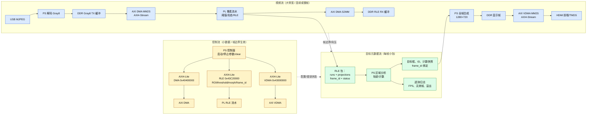

我已经拿到足够证据，下面直接给出完整链路分析。需要先强调一个会影响整份结论的事实：当前仓库实际接的是 AT-OV9281 USB/MJPEG 模组，走 USB→PS，并不是 OV9821 传感器原生 MIPI/DVP 直连 PL。因此我会分别说明“当前真实运行链路”和“若坚持 OV9821/传感器原生接口直连所需的桥接改造”。
一、先核对硬件：OV9821 / OV9281 与 PYNQ-Z2 是否兼容

1. 型号必须澄清
   项目里同时出现过两个名字：
   名称	当前证据	结论
   OV9821	原始需求文字中写的型号，仓库内没有找到可核对的数据手册、接线图或代码证据	不能据此确定协议、引脚、电压
   AT-OV9281	用户后来补充的模组参数图；仓库文档记录内部为 OV9281，对外 USB2.0 High Speed，输出 MJPEG/YUYV	当前实际使用型号按其处理
   OV9281 传感器	OmniVision 资料：可配置 10-bit 并行 DVP 或 MIPI CSI-2，2-lane，RAW8/RAW10	这是“裸传感器能力”，不等于模组对外接口

关键区别：

- 传感器输出：DVP 或 MIPI，只有几路差分/并行信号；
- 模组输出：USB，模组内部已经做了传感器接口转换 + JPEG 压缩 + USB 桥接；
- PYNQ-Z2 实际看到的是 USB 摄像头，不是传感器原生像素流。
  所以不能把“OV9281 支持 DVP/MIPI”直接当成“现在的摄像头已经向 PL 输出 DVP/MIPI”。

2. PYNQ-Z2 有哪些物理接口
   Facts from TUL PYNQ-Z2 User Manual and schematic:
   PYNQ-Z2 接口	内容	能不能直接接 OV9281 传感器
   Pmod A/B	每组 8 个 PL I/O + 3.3 V + GND	不能直接接 MIPI；可接经电平转换后的 DVP，但引脚数/电压需核对
   Arduino header	24 个 PL I/O，3.3 V 逻辑，官方警告不要接 5 V 扩展板	可作为 DVP 候选，但 24 根不等于全部空闲可用
   Raspberry Pi 40-pin	28 个 PL 引脚，部分与 Pmod A 共用	不是 CSI 摄像头座，不能当 MIPI CSI 插座
   HDMI IN/OUT	属于 PL 视频路径	HDMI IN 不能当 CSI 接收器
   专用 MIPI CSI 座	PYNQ-Z2 没有找到	只有 MIPI 输出的模组不能直接连接
3. 直接连接结论
   摄像头形态	能否直连 PYNQ-Z2	理由
   AT-OV9281 USB 模组	能	走 USB Host 端口，由 PS Linux V4L2 采集
   只输出 MIPI CSI-2 的 OV9281 模组	不能	PYNQ-Z2 无 CSI D-PHY 接收器、无 CSI 插座
   输出 DVP 的 OV9281 模组	不能无条件直连	PHY 是 1.8 V 典型，而扩展排针是 3.3 V；需要电平转换、PCLK 采样、SCCB 电平转换
   输出 DVP 且模组自带上电时序/时钟、且电平已转 3.3 V	可以设计接入 PL GPIO	仍需 overlay 释放引脚、PCLK clock-capable、时序约束和 bank VCCO 核对

如果模组只有 MIPI
需要桥接硬件，例如：
OV9281 MIPI CSI-2 2-lane
  → MIPI D-PHY 接收 / CSI-2 解包桥接芯片
  → 并行视频（DVP / LVDS / 其他）
  → 电平转换与 CDC
  → PYNQ-Z2 PL GPIO
可选器件类型：

- Toshiba TC358746AXBG：MIPI CSI-2 → 24-bit parallel，parallel PCLK 上限约 100 MHz；
- Lattice 的 CSI-2 → parallel bridge 参考设计；
- 带 MIPI D-PHY 的 FPGA/桥接板，再输出并行或 AXI。
  注意：单纯加 LVDS SerDes 不等于解决 CSI-2。如果解串后仍是 CSI-2，后面仍然需要 CSI-2 receiver；如果解成并行，还要检查 PCLK 上限、输出电平和连接器。
  如果模组输出 DVP
  较直接的路径：
  Sensor DVP 10-bit + PCLK + HSYNC/VSYNC
  → 1.8 V ↔ 3.3 V 电平转换/缓冲
  → PYNQ-Z2 PL GPIO
  → 在 PCLK 域采样
  → 异步 FIFO / CDC
  → 项目 50 MHz 或 100 MHz 处理域
  还必须处理：
- 外部 XCLK（OV9281 典型 6–27 MHz，实际按模组）；
- SCCB/I²C 双向电平转换和上拉；
- RESET / PWDN / 触发信号；
- PCLK 的 clock-capable 引脚；
- 摄像头电源 AVDD 2.8 V / DVDD 1.2 V / DOVDD 1.8 V（按模组决定是否板载）。
  仓库 hw/pin_budget.md 里已有 Arduino GPIO 的 DVP 候选映射，但明确是待验证草案，不是已接线证据。

4. 吞吐量估算
   有效像素下限：
   bit_rate = width × height × fps × bits_per_pixel
   例如 OV9281 1280×800@120：

- RAW8：1280 × 800 × 120 × 8 = 983.04 Mb/s ≈ 123 MB/s
- RAW10：1280 × 800 × 120 × 10 = 1228.8 Mb/s ≈ 154 MB/s
  DVP 还受消隐影响：
  PCLK ≈ HTS × VTS × fps
  wire_rate ≈ PCLK × data_width
  MIPI 还要加 packet/PHY overhead。不要看到“2 lane、800 Mb/s/lane”就直接认为任意模式都能跑满。
  二、当前真实实现链路
  当前实际链路不是“传感器原生像素流直接进 PL”，而是：
  AT-OV9281 USB 模组
  → USB 2.0（MJPEG）
  → Zynq PS USB 控制器
  → Linux UVC / V4L2
  → 软件 JPEG 解码为 640×400 Gray8
  → CMA 缓冲
  → AXI DMA MM2S
  → PL Gray8/RLE 流水
  → AXI DMA S2MM
  → PS 获取 RLE 游程、投影和统计
  → PS 原生 8 连通区域分析
  → PS 跨帧跟踪与越线计数
  → PS 绘制 1280×720 Gray8 显示画布
  → AXI VDMA MM2S
  → HDMI 前端
  → TMDS → 外部显示器

1. 摄像头曝光

- OV9281 是全局快门。
- 曝光时间决定运动模糊，帧率决定采样密度。
- USB 模组的曝光、增益等由 UVC 控件配置；硬触发/闪光同步是否引出仍未核实。
- 模组内部曝光到 USB 包发出，是摄像头内部延迟；当前软件时间戳不能自动覆盖这一段。

2. 图像数据传输

- 传感器 RAW → 模组内部 ISP/JPEG → USB。
- USB2.0 High Speed 理论 480 Mb/s（60 MB/s），实际还要扣协议和调度。
- 当前请求 MJPG 640×400@60；但集成运行器明确记录 negotiated_fps='NOT_QUERIED'，所以请求 60 不等于实际持续 60。
- 当前 640×400 MJPEG 模式在模组标称上可达很高帧率，但 USB 总线、JPEG 压缩率、解码和 PS 处理会形成上限。

3. 视频接口接收

- USB 设备被 Linux 枚举为 V4L2 摄像头。
- 代码请求 MJPG、640×400，并强制 CAP_PROP_CONVERT_RGB=0，读到的是压缩字节而不是 OpenCV 已解码 BGR。
- 这属于 PS 侧接收，不是 PL 侧 PHY 接收。

4. 像素流解析

- 检查 JPEG SOI（FF D8）。
- cv2.imdecode(..., IMREAD_GRAYSCALE) 直接解成 640×400 Gray8，256,000 字节。
- 没有 RGB 中间帧，也没有 RGB 回退。
- 形状或 dtype 不符会直接报错。

5. 图像预处理
   这里分两段：
   PS 预处理

- MJPEG 解码；
- 若配置调光/校准，先做干扰轮廓清除或灰度 LUT；
- 以 640×400 Gray8 为正式 RLE 输入；
- 打包成 16 字节头 + 256,000 字节像素 + 16 字节尾 = 256,032 字节。
  PL 预处理
  PL RLE 流水执行：
- Gray8 适配器：从 AXI4-Stream 的四字节 beat 中逐字节恢复像素，检查 TKEEP、TLAST、帧几何和 frame ID；
- ROI 选择；
- 可配置灰度偏移；
- 阈值比较：pixel >= threshold；
- 可选 3×3 腐蚀或膨胀；
- 生成 Binary8 前景信息。
  输入/输出：
  模块	输入	输出
  Gray8 adapter	AXI4-Stream 32-bit beats、TKEEP、TLAST	Gray8 像素 + SOF/EOL + frame ID
  ROI/LUT/threshold	Gray8 像素、配置寄存器	Binary8 前景/背景
  Morphology	Binary8、SOF/EOL	处理后的 Binary8
  RLE encoder	Binary8、行同步	游程字、投影字、帧尾状态

6. 目标提取
   PL 只做：

- 阈值分割；
- 可选形态学；
- 逐行最大前景游程；
- 行投影、列投影；
- 前景总数、游程总数、溢出/错误状态；
- 包完整性统计。
  PL 不输出整帧二值掩膜，正常路径输出的是有界 RLE + 投影 + 帧尾元数据。

PS RleCounter 再做：

- 8 连通游程合并；
- 面积、包围框、一阶矩、质心；
- 面积和框尺寸筛选；
- 粘连候选的局部拆分（仅对需要复杂拆分的候选重建局部掩膜）。

7. 特征计算
   每个候选目标得到：

- x_min/x_max/y_min/y_max
- area
- centroid_x/centroid_y
- 质量/拒绝标志
- 必要时局部拆分得到的子目标特征
  RLE 包中还有：
- ROI；
- 硬件时间戳；
- threshold / offset / morph mode；
- 行、列投影；
- total_fg；
- 游程数；
- 状态位。

8. 跨帧跟踪
   MaskCounter / RleCounter 的跟踪逻辑：

- 每帧检测结果按 (centroid_x, centroid_y, y_min, x_min) 排序；
- 统一由 _associate_and_update(frame_id, detections, timestamp) 更新轨迹；
- 当前 field-v1 启用：
  - 预测式关联；
  - max_lateral_step=12；
  - max_association_interval_s=0.5；
  - 严格横向门限；
  - 只保留活动轨迹，已完成轨迹不常驻历史。
- 轨迹记录质心、预测位置、丢失状态和已计数标志。
- 短时间丢失可恢复，长时间观测缺口不能静默当作有效通过。

9. 计数判定

- 计数轴为 x；
- 计数线 line_x=320；
- 方向为 +1（左到右）；
- 有滞回和“已计数”标志；
- 一个轨迹越过计数线并满足方向、连续性、身份条件后，提交唯一计数事件；
- 暂停期间仍推进跟踪和 counted 状态，但抑制账本增加，避免暂停期间的通行在恢复后被重复补计；
- clear 在计数帧边界重置总数，不重置跟踪内部状态。

10. 视频叠加
    PS 绘图进程生成 1280×720 Gray8 画布：

- 左侧摄像头视图，缩放为 576×360；
- 右侧面板显示计数、运行状态、FPS、处理耗时等；
- 叠加检测框、轨迹 ID、计数线；
- 使用 frame ID 绑定“画面 n + 结果 n”；
- 画布通过共享内存交给视频泵。
  当前是 PS 全帧绘制 + VDMA 显示，不是 PL 流式 overlay 合成。评审文档建议将来把高频几何信息放到 PL、PS 只画低频面板，但那还是推荐方案，不是当前实现。

11. HDMI 视频输出

- 显示帧为 1280×720 Gray8，921,600 字节；
- AXI VDMA MM2S 从 DDR 读取，经 AXI4-Stream 送入 HDMI 前端；
- 前端完成颜色转换、像素整理、视频时序生成和 TMDS 编码；
- 最终由 PYNQ-Z2 HDMI OUT 输出到显示器。
  显示连续性保障：
- VDMA 是独立显示扫描路径，不由“每一帧计数完成”驱动；
- 处理帧率低于 60 Hz 时，显示继续读取帧缓冲，重复上一张完整画面；
- 视频泵只提交完整、同帧的画布，不提交半成品；
- 计数结果的更新是帧边界更新，因此画面上的计数和框来自同一结果帧；
- 若绘图进程失败，显示侧进入 hold 状态，而不是提交未完成帧。
  三、端到端系统架构图（当前实现）

```mermaid
flowchart LR
    CAM["AT-OV9281 USB 模组<br/>OV9281 传感器<br/>MJPEG over USB2.0"]
    USB["USB2.0<br/>外部连接"]
    PSUSB["PS<br/>Zynq USB 控制器<br/>Linux UVC/V4L2"]
    DEC["PS<br/>MJPEG 解码<br/>640×400 Gray8<br/>256,000 B"]
    CMATX["DDR / CMA<br/>Gray8 TX 缓冲<br/>256,032 B 包"]
    DMA["PS/PL 边界<br/>AXI DMA MM2S<br/>32-bit AXI4-Stream<br/>0x40400000"]
    PLLUT["PL<br/>gray adapter<br/>ROI / LUT / threshold"]
    MORPH["PL<br/>可选 3×3 形态学<br/>行缓存"]
    RLE["PL<br/>bounded RLE encoder<br/>runs + projection + status"]
    CMARX["DDR / CMA<br/>RLE RX 缓冲<br/>有界 67,744 B"]
    DMAS["PS/PL 边界<br/>AXI DMA S2MM<br/>AXI4-Stream → DDR"]
    PSCCL["PS<br/>RLE 8 连通<br/>面积/框/质心<br/>局部拆分"]
    TRACK["PS<br/>跨帧关联<br/>轨迹状态 / counted"]
    COUNT["PS<br/>越线判定<br/>line_x=320<br/>唯一计数"]
    DRAW["PS<br/>1280×720 Gray8 合成<br/>框 / ID / 计数 / 面板"]
    SHARED["DDR / 共享帧<br/>完整画布"]
    VDMA["AXI VDMA MM2S<br/>HP2 32-bit<br/>0x43000000"]
    HDMI["PL HDMI 前端<br/>AXI4-Stream<br/>颜色/时序/TMDS"]
    MON["外部显示器"]

    CAM --> USB --> PSUSB --> DEC --> CMATX --> DMA --> PLLUT --> MORPH --> RLE --> CMARX --> DMAS --> PSCCL --> TRACK --> COUNT --> DRAW --> SHARED --> VDMA --> HDMI --> MON

    VC["AXI4-Lite<br/>0x43C20000<br/>ROI/threshold/morph<br/>帧号/参数"]
    VC -.-> PLLUT
    VC -.-> RLE

    HP["PS HP0 64-bit<br/>MM2S 读 DDR<br/>HP1 32-bit<br/>S2MM 写 DDR"]
    HP -.-> DMA
    HP -.-> CMATX
    HP -.-> CMARX

    config["PS 控制面<br/>寄存器配置 / 帧边界 / 错误处理"]
    config -.-> DMA
    config -.-> VDMA
    config -.-> VC

    classDef ext fill:#fde68a,stroke:#92400e,color:#111;
    classDef ps fill:#bfdbfe,stroke:#1d4ed8,color:#111;
    classDef pl fill:#bbf7d0,stroke:#15803d,color:#111;
    classDef ddr fill:#e9d5ff,stroke:#7e22ce,color:#111;
    class CAM,USB,MON ext;
    class PSUSB,DEC,DMA,DMAS,PSCCL,TRACK,COUNT,DRAW,config ps;
    class PLLUT,MORPH,RLE,VDMA,HDMI pl;
    class CMATX,CMARX,SHARED ddr;
```

四、视频数据处理流程图（当前实现）

```mermaid
flowchart TD
    A["1. 曝光<br/>全局快门积分<br/>有限曝光时间"] --> B["2. 模组内部<br/>RAW → JPEG<br/>USB 封装"]
    B --> C["3. USB2.0 传输<br/>MJPEG 压缩流"]
    C --> D["4. PS V4L2 接收<br/>raw MJPG bytes"]
    D --> E["5. JPEG 解码<br/>640×400 Gray8<br/>256,000 B"]
    E --> F["6. 软件预处理<br/>可选 LUT/校准/打包"]
    F --> G["7. CMA 帧缓冲<br/>16 B 头 + 256,000 B + 16 B 尾"]
    G --> H["8. AXI DMA MM2S<br/>AXI4-Stream 32-bit"]
    H --> I["9. PL gray adapter<br/>beat → pixel<br/>SOF/EOL/ID 校验"]
    I --> J["10. ROI + offset<br/>threshold 比较"]
    J --> K{"11. morph<br/>是否启用？"}
    K -- 是 --> L["12. 3×3 腐蚀/膨胀<br/>行缓存"]
    K -- 否 --> M
    L --> M["13. 前景像素流"]
    M --> N["14. RLE 编码<br/>逐行游程<br/>行/列投影"]
    N --> O["15. RLE 包 + 帧尾<br/>status/overflow<br/>frame_id"]
    O --> P["16. AXI DMA S2MM<br/>写入 DDR/CMA"]
    P --> Q["17. PS 包校验<br/>长度/几何/身份/CRC"]
    Q --> R{"18. 包有效？"}
    R -- 否 --> R2["19. 无效帧<br/>不更新计数<br/>记录状态"]
    R -- 是 --> S["20. 8 连通游程分析<br/>面积/框/质心"]
    S --> T["21. 粘连候选<br/>局部拆分"]
    T --> U["22. 跨帧关联<br/>预测 + 门限"]
    U --> V["23. 越线判定<br/>方向 + 滞回 + counted"]
    V --> W["24. 计数账本更新<br/>同帧结果快照"]
    W --> X["25. PS 合成 1280×720<br/>图像 n + 结果 n"]
    X --> Y["26. VDMA MM2S<br/>DDR → HDMI"]
    Y --> Z["27. HDMI 时序 + TMDS<br/>连续扫描输出"]
    Z --> AA["28. 显示器<br/>上一完整帧重复<br/>计数帧边界更新"]
```

五、控制流、视频流和目标元数据流关系图

六、各接口在链路中的实际作用
接口	位置	作用	数据/时钟
USB2.0	摄像头 ↔ PS	MJPEG 传输、UVC 控制	480 Mb/s 理论，实际受协议/压缩/解码限制
AXI4-Lite	PS ↔ PL 寄存器	配置 DMA、VDMA、ROI、阈值、morph、帧号、参数版本	小数据，帧边界生效
AXI4-Stream	DMA/VDMA ↔ PL	连续像素流或 RLE beat 流	32-bit beat，TKEEP/TLAST 握手
AXI DMA MM2S	DDR → PL	把 PS 打包的 256,032 B Gray8 包送入 PL	32-bit AXI4-Stream，HP0 64-bit 读
AXI DMA S2MM	PL → DDR	把 RLE 包写回 PS	32-bit AXI4-Stream，HP1 32-bit 写
AXI VDMA MM2S	DDR → HDMI	独立读取 1280×720 Gray8 显示帧	32-bit AXI4-Stream，HP2 32-bit
AXI HP0	AXI DMA MM2S ↔ DDR	高带宽读	64-bit 配置
AXI HP1	AXI DMA S2MM ↔ DDR	高带宽写	32-bit 配置
AXI HP2	AXI VDMA ↔ DDR	显示读取	32-bit，显示域约 142.857 MHz
AXI GP0	PS ↔ AXI4-Lite	控制寄存器	100 MHz 控制域

注意：HP0/HP1/HP2 是共享 DDR 总带宽的不同主设备端口，不代表三份独立 DDR 带宽。
七、DDR、BRAM、行缓存与流水线
必须访问 DDR 的部分

- USB 接收和解码后的整帧 Gray8 缓冲；
- AXI DMA MM2S 的 TX 缓冲；
- AXI DMA S2MM 的 RX 缓冲；
- PS 软件处理需要的帧/工作缓冲；
- 1280×720 显示帧缓冲；
- VDMA 读取的显示帧。
  这里 DDR 同时承担：
- 摄像头帧缓冲；
- DMA 包缓冲；
- PS 计数工作区；
- 显示帧缓冲；
- 软件堆栈。
  可以在 PL 内部完成的部分
- Gray8 beat 到像素的适配；
- ROI；
- LUT/threshold；
- 3×3 形态学的三行行缓存；
- 行内游程生成；
- 行/列投影累加；
- 帧尾状态生成。
  3×3 形态学使用三行分布式 RAM，不是整帧 BRAM 帧存。axis_rle_encoder 内部只保留行级和帧级计数状态，不缓存整帧。
  不能在 BRAM 中完整缓存的部分
  1280×720 Gray8 = 921,600 字节，超过 PYNQ-Z2 全部 BRAM 总容量约 630 KiB，所以显示帧必须放 DDR。
  吞吐估算
  路径	公式	640×400@60	1280×720@60
  有效 Gray8 像素载荷	W×H×fps	15.36 MB/s	55.296 MB/s
  当前 TX 包	256,032×fps	15.36192 MB/s	—
  当前显示读取	921,600×fps	—	55.296 MB/s
  RLE RX 上限	67,744×fps	4.06464 MB/s 上限	—

PL 单像素/拍：
frame_time_min = W × H / fPL

- 50 MHz：640×400 最少 5.12 ms（理想 195.3 FPS）；
- 100 MHz：640×400 最少 2.56 ms（理想 390.6 FPS）；
- 实际还要算 DMA、PS 解码、区域分析、绘图和 VDMA。
  当前板端性能记录：
- 处理 FPS 中位数约 18.317；
- 显示 FPS 中位数约 17.426；
- 单帧处理阶段已有 transfer/count/snapshot/publish/scale/draw/copy_submit 计时；
- 最新 600 帧是空场景，不能证明有目标时的计数准确率或高负载持续性能。
  主要瓶颈

1. USB MJPEG 有效带宽：不是所有标称帧率都能持续；
2. PS JPEG 解码：ARM 双核 A9，单线程解码 + 处理；
3. PS 区域分析和粘连拆分：局部掩膜重建和复杂拆分较贵；
4. PS 全帧绘图：1280×720 画布生成 + 框/文字/面板；
5. DDR 共享带宽：CPU、USB、DMA、VDMA 共用；
6. 显示连续性：显示扫描必须由 VDMA 独立维持，不能等处理完成；
7. RLE 膨胀：噪声多时游程数增加，S2MM 和 PS 分析负担上升；
8. PL 流水背压：S2MM 写不及可能反压 RLE encoder，进而反压 MM2S。
   八、如果改为 OV9281 原生 DVP/MIPI 直连 PL 的候选架构
   这部分是改造建议，不是当前实现。
   方案 A：DVP 接入 PL
   OV9281 DVP 10-bit + PCLK + HSYNC/VSYNC
   → 1.8V/3.3V 电平转换
   → PYNQ-Z2 PL GPIO
   → PCLK 域采样 + 异步 FIFO
   → AXI4-Stream 像素流
   → PL 阈值/形态/RLE
   → AXI DMA S2MM
   → PS 计数
   优点：

- 不需要 USB/PS 解码；
- 像素流直接从 PL 进入；
- 延迟更低、确定性更好。
  限制：
- 需要 10–12+ 根信号；
- 电平转换和 skew；
- PCLK clock-capable 引脚；
- overlay 引脚冲突；
- 仍需外部 XCLK 和 SCCB。
  方案 B：MIPI CSI-2 接入 PL
  OV9281 MIPI CSI-2 2-lane
  → MIPI D-PHY 接收
  → CSI-2 解包
  → AXI4-Stream 像素流
  → PL 处理
  PYNQ-Z2 本身没有 CSI 接收器，所以必须加桥接芯片或带 CSI 的 FPGA/桥接板；不能把差分对直接接到 GPIO。
  方案 C：保留 USB，但把更多处理移到 PL
  当前最有现实收益的路线：
- 保留 USB 输入；
- 在 PS 侧用更低成本解码；
- 把区域分析和跟踪更多移到 PL 或原生代码；
- 显示改用 PL overlay + VDMA，减少 PS 全帧绘图；
- 保持显示独立于计数处理。
  九、最终结论

1. OV9821 没有可核对证据；当前实际是 AT-OV9281 USB 模组。
2. OV9281 传感器原生支持 DVP/MIPI，但当前模组对外是 USB/MJPEG。
3. PYNQ-Z2 没有 MIPI CSI 接口；只输出 MIPI 的模组不能直连，必须加 CSI-2 桥接。
4. DVP 可以经电平转换接入 PL GPIO，但需要 XCLK、SCCB、CDC、引脚和时序验证。
5. 当前链路的像素流路径是：USB→PS 解码→DMA MM2S→PL 阈值/形态/RLE→DMA S2MM→PS 计数→PS 全帧绘制→VDMA→HDMI。
6. AXI4-Stream 主要用于 DMA/VDMA 与 PL 之间的像素或 RLE beat 流；AXI4-Lite 用于寄存器控制；AXI DMA 承担 DDR↔PL 双向包传输；VDMA 承担显示帧读取。
7. DDR 承载整帧 Gray8、RLE 包、显示画布；PL 只用 BRAM/行缓存完成流式阈值、形态学和 RLE，不缓存完整 720p 帧。
8. 显示连续性由独立 VDMA 扫描和完整帧缓冲保证；计数结果通过 frame ID 绑定到同帧画布，再在显示帧边界更新。
   如果目标是“摄像头原生像素直接进 PL 的高确定性架构”，下一步必须先确认摄像头模组确切型号、连接器和 pinout；在型号和接口确认前，不能把 DVP/MIPI 直连写成已冻结方案。
