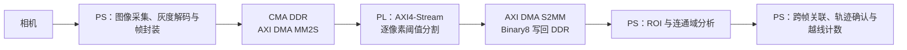

# 项目技术特色与 FPGA / PS-PL 协同处理

## 1. 项目定位

本项目面向螺母、垫圈等小型物料的连续视觉计数，基于 PYNQ-Z2（Zynq-7000 / XC7Z020）探索 ARM 处理系统（Processing System，PS）与可编程逻辑（Programmable Logic，PL）的异构协同。主要工程特色在于依据计算规律划分软硬件职责、选择适合的数据表示，并对 DMA、帧身份和结果有效性进行端到端管理。

本文将“创新点”作为工程设计与系统集成层面的技术特色使用，不主张相关基础算法或 IP 属于原创。文中分别标明当前主交付路线、历史实现和独立候选链路，避免将不同阶段的实现描述成同一条已验收系统。

## 2. 当前主交付路线：Binary8 整帧回传与 PS 计数

根据 2026 年 11 月 4 日的 WO-0015 决策，当前唯一主交付采用 Route A：PS 采集图像并准备输入帧，经 AXI DMA 的 MM2S 通道送入 PL 图像流水线；PL 输出 Binary8 二值图像，由 S2MM 写回 PS 可访问的 DDR；PS 再执行连通域分析、跨帧关联和越线计数。PL 主时钟为 50 MHz，Binary8 图像固定为 320×240，背景值为 `0x00`、前景值为 `0xFF`。

该链路采用定长帧数据交换。S2MM 回传一帧为 76,800 字节；32 位数据拍打包 4 个 Binary8 像素，因此每帧为 19,200 次数据拍。PS 与 PL 之间通过 DMA 和共享 DDR 交换图像，PL 负责规则、密集且逐像素的前处理，PS 保留连通域筛选、跟踪状态和计数策略等易变逻辑。

Gray8 输入链路已在 PYNQ-Z2 上完成 3 帧合成输入和 960 帧相机输入的逐像素 Binary8 比对，共 963 帧通过。该结果验证了对应协议和 DMA 图像数据通路；相机样本产生的二值掩膜没有前景像素，因此不能据此判断有物料条件下的检测准确率或吞吐能力。

## 3. 游程编码（RLE）：适配稀疏前景的空间表示

游程编码（Run-Length Encoding，RLE）是项目中值得写入的工程技术特色。对二值图像，PL 按行将连续前景像素表示成区间（游程），并可随帧返回行列投影等统计量。PS 以游程作为区域分析输入，通过游程间的连通关系计算区域面积、质心和包围框；常规路径无需先重建整幅二值图，只有需要进一步判别或拆分的候选区域才建立局部掩膜。

这项设计改变的是二值图像的空间表示与回传负载，不是目标分类算法本身。游程能保留有效二值 ROI 的空间拓扑，但压缩效率随前景形态变化：前景稀疏、连续段较长时，传输记录通常少于整幅 Binary8 掩膜；密集噪点会产生大量短游程，游程数量与包长会随之增加，并可能触及容量上限。因此实现设置了游程容量上限，超限帧报告溢出并拒绝更新计数，不能将平均回传长度表述成固定压缩率。

2026 年 10 月 28 日的独立 RLE 板测中，640×400 相机链路完成 300/300 帧处理；记录的相机样本每帧约有 470–492 个游程，RLE 回传长度约为 4.1 KB。该运行未达到 30 FPS，也没有人工物料真值，不能作为计数准确率结论。相同 ARM 上的 PS 区域路径对照显示：六个带孔目标的合成样本中，像素路径耗时 19.795 ms，RLE 解析加区域/计数耗时 7.656 ms；589 个碎片的高密度样本中两种路径耗时接近。该结果说明 RLE 的软件收益依赖场景结构，不能外推为整机 FPS 增幅。

这条 640×400 RLE 链路是独立候选实现，不等同于当前 Route A 主线。RLE RTL 中的 `axis_rle_encoder` 负责游程与投影输出；该候选运行时由 PS 原生代码完成 8 连通游程合并。不能把这一实现说成“已在 PL 中完成通用二维连通域标记”。

## 4. 有界游程级区域特征模块（FRG）

项目还包含游程级区域特征（FRG）硬件探索。其基本思路是将一行游程作为基本单元，通过比较相邻行区间的重叠关系建立连通关系，并累积面积、一阶矩和边界框等区域特征。相较于直接对全帧像素执行二维标号，该结构利用行扫描顺序和有限的行缓存状态，适合评估为 PL 中的流式特征计算模块。

该模块受 `MAX_LABELS`、`MAX_RUNS_PER_ROW` 等容量参数约束，超限时通过状态和溢出信号标记无效结果。专业表述宜使用“有界游程级连通区域特征提取”，不宜称为无资源边界的通用 FPGA CCL。FRG2 tap 与 overlay 的离线 XSim 记录提供了功能验证证据，但这不代表该路线已成为当前主交付或完成当前主线位流的板端验收。

## 5. JPEG-PL 解码与特征链路候选

另一条候选链路把相机 MJPEG 压缩数据送入 PL，由 PL 执行受支持格式的 JPEG 解码及后续 RLE/FRG 处理，PS 获取匹配帧的区域特征后继续执行跨帧计数。该方案探索把解码和局部图像处理放进像素数据流，降低 PS 对整帧解码及像素级循环的参与程度。

2026 年 11 月 2 日的独立候选位流完成了 120 帧相机输入，端到端实测为 11.31 FPS；该样本没有检测到前景。五帧合成 JPEG 越线序列中，每帧检出一个区域，目标中心越过 `x=320` 后累计计数从 0 增至 1，证明已知合成轨迹上的候选硬件链路能够贯通。该 JPEG 解码器只支持规定的图像尺寸、采样和标记条件，并非通用 JPEG 解码器。板测报告还注明，候选代码合入 LJ-01 后，合并源码组合尚未重新生成匹配的 BIT/HWH；因此板测结论绑定独立候选制品，不能直接等同于当前主线硬件快照的验收结果。

## 6. 帧同步的 PL 视频叠加

视频叠加模块展示了 PL 在实时视频输出中的用途：PL 以像素扫描时序生成二值掩膜、计数线和目标框等图形元素，并将 PS 提交的计数与检测框信息同步到视频像素域。掩膜存储采用双缓冲；完整帧通过校验后才发布，显示端在帧边界切换缓冲区，并使用帧号关联图像与叠加参数。这有助于避免显示端将某一帧的掩膜与另一帧的框或计数状态拼接。

相关 RTL 离线仿真完成了 943 项像素检查。独立 JPEG 候选板测核对了输出帧身份和扫描状态，但没有逐像素检查板端掩膜、框及数字字形，也没有外接显示器人工观察记录。因此目前可表述为“完成帧身份和扫描链路核验”，不应写成“显示效果已完成现场验收”。

## 7. PS 与 PL 的协同设计原则

- **PL 侧：** 承担规则明确、数据密集、适合逐像素流水的工作，例如阈值比较、二值像素打包、游程生成，以及经过容量和时序评估的区域特征计算或视频叠加。
- **PS 侧：** 承担较灵活且依赖跨帧状态的工作，例如连通域筛选、疑似粘连区域复核、轨迹关联、运动方向判定、越线去重和计数状态管理。
- **传输与控制：** AXI4-Stream 承载图像数据，AXI DMA 与 DDR 提供 PS/PL 间帧交换；AXI-Lite 用于状态和参数访问。帧号、参数版本、长度、校验状态及溢出标志用于关联数据与控制结果，并决定某帧是否可进入计数更新。
- **架构取舍：** 将确定性的前处理交给 PL，可为 PS 保留处理高层目标逻辑的空间；保留软件侧的跟踪和计数策略，则便于按不同物料和输送条件调整参数。实际收益应以相同输入、相同功能条件下的分阶段测量为准。

## 8. 技术结论与表述边界

项目最值得强调的工程特色是：基于 Zynq 的 PS/PL 异构流水线；面向二值前景稀疏性的 RLE 表示及其对 PS 区域分析路径的简化；以及对帧身份、容量边界和跨时钟域显示更新的明确管理。JPEG-PL 解码和 PL 区域特征提取提供了进一步的硬件化探索实例，但应标为候选实现。

当前主交付决策采用 Route A，PL 硬件连通域特征提取路线已冻结开发。文档中应将 Route A 的已验证图像数据通路、RLE/FRG 的阶段性候选实现，以及 JPEG-PL/overlay 的独立候选板测分别说明。现有证据尚不足以宣称真实物料计数准确率达标、通用场景下性能提升、稳定达到 30 FPS，或系统已经完成工业工况验收。

## 9. 项目内证据

- [WO-0015：主交付路线与 Binary8 接口决策](../docs/work-orders/wo-0015-s2mm-binary8-frame-return.md)
- [ADR-0004：Gray8 DMA 输入实现与板端验证边界](../docs/adr/adr-0004-gray8-dma-input.md)
- [RLE 运行说明与协议边界](../scripts/rle/README.md)
- [RLE 独立板测、资源与 PS 基准](../data/results/rle-20261028-board/README.md)
- [FRG2 与视频叠加离线验证记录](../data/results/ps-pl-offload-20261101/final-offline-verification/results.json)
- [JPEG-PL 候选板测及五帧越线结果](../data/results/jpeg-pl-board-20261102/README.md)
- [视频叠加 RTL](../fpga/experimental/standalone/video_binary_overlay.v)
